# Database — পল্লী সমবায় সমিতি + কৃষি সেচ ERP (Polsha)

> এই ফাইলটি লোকাল ডাটাবেজ `polsha` (লাইভ `pmpbssl.com`-এর ২৪/১১/২০২৬ তারিখের কপি, সব 59টি migration চালানো) থেকে `information_schema` পড়ে তৈরি। কলাম, টাইপ, ইন্ডেক্স ও Foreign Key হুবহু ডাটাবেজের; "Eloquent সম্পর্ক" অংশ `backend/app/Models`-এর কোড থেকে।

**সংক্ষেপে:** 104 টেবিল · 1227 কলাম · 438 ইন্ডেক্স · 219 Foreign Key · 88 Eloquent মডেল · Engine InnoDB · Charset utf8mb4 · MariaDB 10.11 (লাইভ) / 10.4 (লোকাল XAMPP)

## সূচিপত্র

1. [ডাটাবেজের মূল নিয়ম](#ডাটাবেজের-মূল-নিয়ম)
2. [মূল সম্পর্কের চিত্র](#মূল-সম্পর্কের-চিত্র)
3. [মডিউলভিত্তিক টেবিল তালিকা](#মডিউলভিত্তিক-টেবিল-তালিকা)
4. [সব Foreign Key এক নজরে](#সব-foreign-key-এক-নজরে)
5. [টেবিলের বিস্তারিত](#টেবিলের-বিস্তারিত)

## ডাটাবেজের মূল নিয়ম

- **টাকা** সবসময় `DECIMAL(15,2)`; জমির পরিমাণ শতক/একরে দশমিকসহ।
- **আর্থিক রেকর্ড কখনো ডিলিট হয় না** — বাতিল মানে উল্টো জার্নাল (reverse) + `audit_logs`-এ লেখা। তাই বেশিরভাগ আর্থিক FK `RESTRICT`।
- **ডাবল-এন্ট্রি:** প্রতিটি আর্থিক লেনদেন `journals` + `journal_lines`-এ যায়; operational টেবিল (invoices, receipts, member_transactions, loan_payments, water_bills …) `journal_id` দিয়ে জার্নালের সাথে যুক্ত।
- **Snapshot:** `invoices` ও `water_bills` তৈরির সময় মালিক/চাষি/দাগ/খতিয়ান/পরিমাণ কপি করে রাখে — পরে জমির তথ্য বদলালেও পুরোনো বিল বদলায় না।
- **ইতিহাস overwrite হয় না:** মালিকানা (`land_owners`), চাষি (`land_cultivations`), পাতওয়ারীর দায়িত্ব (`patwari_mouza_assignments`), সদস্যপদের অবস্থা (`membership_status_history`) — সবকটিতে শুরু/শেষ তারিখ।
- **সিরিয়াল নম্বর** `sequences` টেবিলে DB lock দিয়ে (`SELECT … FOR UPDATE`) — ফাঁক বা ডুপ্লিকেট হয় না।
- **Approval Engine** polymorphic: `approval_requests.approvable_type/approvable_id` যেকোনো মডেলকে নির্দেশ করে।
- **Audit Log** polymorphic: `audit_logs.auditable_type/auditable_id` + পুরোনো ও নতুন মান (JSON)।
- **Role/Permission** spatie/laravel-permission-এর টেবিল (`roles`, `permissions`, `model_has_*`, `role_has_permissions`)।
- **লগইন** Laravel Sanctum Bearer token (`personal_access_tokens`)।
- অর্থবছর জুলাই–জুন; Timezone `Asia/Dhaka`।

## মূল সম্পর্কের চিত্র

মূল ব্যবসায়িক টেবিলগুলোর Foreign Key সম্পর্ক (ইউজার/অডিট কলাম যেমন `created_by`, `approved_by` বাদ দিয়ে, যাতে চিত্র পড়া যায়)। পুরো তালিকা নিচে।

```mermaid
erDiagram
    chart_of_accounts ||--o{ bank_accounts : "account_id"
    chart_of_accounts ||--o{ chart_of_accounts : "parent_id"
    farmers ||--o{ combined_payments : "farmer_id"
    chart_of_accounts ||--o{ combined_payments : "fund_account_id"
    members ||--o{ combined_payments : "member_id"
    divisions ||--o{ districts : "division_id"
    households ||--o{ farmers : "household_id"
    farmers ||--o{ farmers : "merged_into_id"
    mouzas ||--o{ farmers : "mouza_id"
    villages ||--o{ farmers : "village_id"
    farmers ||--o{ households : "head_farmer_id"
    villages ||--o{ households : "village_id"
    farmers ||--o{ invoices : "farmer_id"
    journals ||--o{ invoices : "journal_id"
    lands ||--o{ invoices : "land_id"
    land_types ||--o{ invoices : "land_type_id"
    irrigation_rates ||--o{ invoices : "rate_id"
    seasons ||--o{ invoices : "season_id"
    land_types ||--o{ irrigation_rates : "land_type_id"
    seasons ||--o{ irrigation_rates : "season_id"
    journals ||--o{ journals : "reversal_of_id"
    journals ||--o{ journals : "reversed_by_id"
    chart_of_accounts ||--o{ journal_lines : "account_id"
    journals ||--o{ journal_lines : "journal_id"
    land_types ||--o{ lands : "land_type_id"
    mouzas ||--o{ lands : "mouza_id"
    villages ||--o{ lands : "village_id"
    farmers ||--o{ land_cultivations : "farmer_id"
    lands ||--o{ land_cultivations : "land_id"
    farmers ||--o{ land_owners : "farmer_id"
    lands ||--o{ land_owners : "land_id"
    chart_of_accounts ||--o{ loans : "fund_account_id"
    journals ||--o{ loans : "journal_id"
    members ||--o{ loans : "member_id"
    loan_products ||--o{ loans : "product_id"
    loans ||--o{ loan_guarantors : "loan_id"
    members ||--o{ loan_guarantors : "member_id"
    loans ||--o{ loan_installments : "loan_id"
    chart_of_accounts ||--o{ loan_payments : "fund_account_id"
    journals ||--o{ loan_payments : "journal_id"
    loans ||--o{ loan_payments : "loan_id"
    membership_applications ||--o{ members : "application_id"
    farmers ||--o{ members : "farmer_id"
    farmers ||--o{ membership_applications : "farmer_id"
    members ||--o{ membership_applications : "member_id"
    members ||--o{ membership_applications : "proposer_member_id"
    members ||--o{ membership_applications : "seconder_member_id"
    members ||--o{ member_accounts : "member_id"
    chart_of_accounts ||--o{ member_transactions : "counter_account_id"
    chart_of_accounts ||--o{ member_transactions : "fund_account_id"
    journals ||--o{ member_transactions : "journal_id"
    member_accounts ||--o{ member_transactions : "member_account_id"
    member_transactions ||--o{ member_transactions : "pair_id"
    unions ||--o{ mouzas : "union_id"
    upazilas ||--o{ mouzas : "upazila_id"
    farmers ||--o{ patwaris : "farmer_id"
    farmers ||--o{ receipts : "farmer_id"
    chart_of_accounts ||--o{ receipts : "fund_account_id"
    journals ||--o{ receipts : "journal_id"
    receipts ||--o{ receipt_items : "receipt_id"
    upazilas ||--o{ unions : "upazila_id"
    districts ||--o{ upazilas : "district_id"
    unions ||--o{ villages : "union_id"
    water_connections ||--o{ water_bills : "connection_id"
    journals ||--o{ water_bills : "journal_id"
    farmers ||--o{ water_connections : "farmer_id"
    villages ||--o{ water_connections : "village_id"
```

## মডিউলভিত্তিক টেবিল তালিকা

### এলাকা (Location)

| টেবিল | কলাম | ইন্ডেক্স | FK (বাইরে যায়) | FK (ভেতরে আসে) | মডেল | সারি (২৪/১১) |
|---|---:|---:|---:|---:|---|---:|
| [`divisions`](#divisions) | 7 | 1 | 0 | 1 | Division | 8 |
| [`districts`](#districts) | 8 | 2 | 1 | 1 | District | 64 |
| [`upazilas`](#upazilas) | 8 | 2 | 1 | 2 | Upazila | 494 |
| [`unions`](#unions) | 8 | 2 | 1 | 2 | Union | 4,536 |
| [`villages`](#villages) | 8 | 2 | 1 | 5 | Village | 2 |
| [`mouzas`](#mouzas) | 9 | 3 | 2 | 6 | Mouza | 0 |
| [`mouza_village`](#mouza_village) | 2 | 2 | 2 | 0 | — | 0 |

### ইউজার, Role ও নিরাপত্তা

| টেবিল | কলাম | ইন্ডেক্স | FK (বাইরে যায়) | FK (ভেতরে আসে) | মডেল | সারি (২৪/১১) |
|---|---:|---:|---:|---:|---|---:|
| [`users`](#users) | 18 | 3 | 0 | 64 | User | 1 |
| [`roles`](#roles) | 8 | 2 | 0 | 2 | Role | 14 |
| [`permissions`](#permissions) | 5 | 2 | 0 | 2 | — | 189 |
| [`model_has_roles`](#model_has_roles) | 3 | 2 | 1 | 0 | — | 1 |
| [`model_has_permissions`](#model_has_permissions) | 3 | 2 | 1 | 0 | — | 0 |
| [`role_has_permissions`](#role_has_permissions) | 2 | 2 | 2 | 0 | — | 426 |
| [`personal_access_tokens`](#personal_access_tokens) | 10 | 4 | 0 | 0 | — | 0 |
| [`password_reset_tokens`](#password_reset_tokens) | 3 | 1 | 0 | 0 | — | 0 |
| [`sessions`](#sessions) | 6 | 3 | 0 | 0 | — | 0 |
| [`login_logs`](#login_logs) | 8 | 3 | 0 | 0 | LoginLog | 26 |
| [`sms_otps`](#sms_otps) | 9 | 2 | 1 | 0 | SmsOtp | 0 |
| [`audit_logs`](#audit_logs) | 12 | 6 | 0 | 0 | AuditLog | 95 |

### Approval Engine

| টেবিল | কলাম | ইন্ডেক্স | FK (বাইরে যায়) | FK (ভেতরে আসে) | মডেল | সারি (২৪/১১) |
|---|---:|---:|---:|---:|---|---:|
| [`approval_rules`](#approval_rules) | 9 | 2 | 0 | 0 | ApprovalRule | 32 |
| [`approval_requests`](#approval_requests) | 16 | 6 | 1 | 13 | ApprovalRequest | 0 |
| [`approval_steps`](#approval_steps) | 10 | 3 | 2 | 0 | ApprovalStep | 0 |
| [`approval_comments`](#approval_comments) | 6 | 3 | 2 | 0 | ApprovalComment | 0 |

### কৃষক, খানা ও সদস্য

| টেবিল | কলাম | ইন্ডেক্স | FK (বাইরে যায়) | FK (ভেতরে আসে) | মডেল | সারি (২৪/১১) |
|---|---:|---:|---:|---:|---|---:|
| [`farmers`](#farmers) | 38 | 13 | 7 | 18 | Farmer | 0 |
| [`farmer_documents`](#farmer_documents) | 11 | 3 | 2 | 0 | FarmerDocument | 0 |
| [`farmer_family_members`](#farmer_family_members) | 9 | 2 | 1 | 0 | FarmerFamilyMember | 0 |
| [`households`](#households) | 7 | 4 | 2 | 1 | Household | 0 |
| [`duplicate_dismissals`](#duplicate_dismissals) | 6 | 4 | 3 | 0 | — | 0 |
| [`members`](#members) | 10 | 5 | 2 | 11 | Member | 0 |
| [`membership_applications`](#membership_applications) | 22 | 9 | 6 | 2 | MembershipApplication | 0 |
| [`membership_nominees`](#membership_nominees) | 10 | 3 | 2 | 0 | MembershipNominee | 0 |
| [`membership_status_history`](#membership_status_history) | 14 | 4 | 3 | 0 | MembershipStatusHistory | 0 |
| [`voter_lists`](#voter_lists) | 9 | 2 | 1 | 1 | VoterList | 0 |
| [`voter_list_items`](#voter_list_items) | 10 | 3 | 2 | 0 | VoterListItem | 0 |
| [`patwaris`](#patwaris) | 9 | 2 | 1 | 1 | Patwari | 0 |
| [`patwari_mouza_assignments`](#patwari_mouza_assignments) | 7 | 3 | 2 | 0 | PatwariMouzaAssignment | 0 |

### জমি ও বর্গা

| টেবিল | কলাম | ইন্ডেক্স | FK (বাইরে যায়) | FK (ভেতরে আসে) | মডেল | সারি (২৪/১১) |
|---|---:|---:|---:|---:|---|---:|
| [`lands`](#lands) | 22 | 9 | 7 | 6 | Land | 0 |
| [`land_types`](#land_types) | 10 | 2 | 0 | 3 | LandType | 6 |
| [`land_owners`](#land_owners) | 10 | 4 | 3 | 0 | LandOwner | 0 |
| [`land_cultivations`](#land_cultivations) | 13 | 4 | 3 | 0 | LandCultivation | 0 |
| [`land_documents`](#land_documents) | 11 | 3 | 2 | 0 | LandDocument | 0 |
| [`land_notes`](#land_notes) | 6 | 3 | 2 | 0 | LandNote | 0 |
| [`land_transfers`](#land_transfers) | 16 | 7 | 5 | 0 | LandTransfer | 0 |

### সেচ ও ইনভয়েস

| টেবিল | কলাম | ইন্ডেক্স | FK (বাইরে যায়) | FK (ভেতরে আসে) | মডেল | সারি (২৪/১১) |
|---|---:|---:|---:|---:|---|---:|
| [`seasons`](#seasons) | 13 | 3 | 1 | 3 | Season | 0 |
| [`irrigation_types`](#irrigation_types) | 8 | 3 | 0 | 3 | IrrigationType | 4 |
| [`irrigation_lifts`](#irrigation_lifts) | 9 | 3 | 0 | 3 | IrrigationLift | 3 |
| [`irrigation_rates`](#irrigation_rates) | 15 | 8 | 7 | 1 | IrrigationRate | 0 |
| [`invoice_batches`](#invoice_batches) | 10 | 4 | 3 | 1 | InvoiceBatch | 0 |
| [`invoices`](#invoices) | 30 | 16 | 12 | 0 | Invoice | 0 |

### রশিদ, পেমেন্ট ও দিন বন্ধ

| টেবিল | কলাম | ইন্ডেক্স | FK (বাইরে যায়) | FK (ভেতরে আসে) | মডেল | সারি (২৪/১১) |
|---|---:|---:|---:|---:|---|---:|
| [`receipt_books`](#receipt_books) | 10 | 3 | 1 | 0 | ReceiptBook | 0 |
| [`receipts`](#receipts) | 23 | 13 | 6 | 3 | Receipt | 0 |
| [`receipt_items`](#receipt_items) | 7 | 3 | 1 | 0 | ReceiptItem | 0 |
| [`combined_payments`](#combined_payments) | 21 | 11 | 6 | 2 | CombinedPayment | 0 |
| [`combined_payment_parts`](#combined_payment_parts) | 7 | 3 | 1 | 0 | CombinedPaymentPart | 0 |
| [`public_payment_requests`](#public_payment_requests) | 22 | 9 | 5 | 0 | PublicPaymentRequest | 0 |
| [`field_deposits`](#field_deposits) | 12 | 5 | 3 | 1 | FieldDeposit | 0 |
| [`day_closes`](#day_closes) | 19 | 5 | 2 | 0 | DayClose | 0 |
| [`print_logs`](#print_logs) | 7 | 4 | 1 | 0 | PrintLog | 0 |

### সঞ্চয়, শেয়ার ও মুনাফা বণ্টন

| টেবিল | কলাম | ইন্ডেক্স | FK (বাইরে যায়) | FK (ভেতরে আসে) | মডেল | সারি (২৪/১১) |
|---|---:|---:|---:|---:|---|---:|
| [`member_accounts`](#member_accounts) | 16 | 7 | 4 | 1 | MemberAccount | 0 |
| [`member_transactions`](#member_transactions) | 26 | 12 | 9 | 2 | MemberTransaction | 0 |
| [`distribution_runs`](#distribution_runs) | 16 | 5 | 3 | 2 | DistributionRun | 0 |
| [`distribution_items`](#distribution_items) | 8 | 4 | 3 | 0 | DistributionItem | 0 |

### ঋণ

| টেবিল | কলাম | ইন্ডেক্স | FK (বাইরে যায়) | FK (ভেতরে আসে) | মডেল | সারি (২৪/১১) |
|---|---:|---:|---:|---:|---|---:|
| [`loan_products`](#loan_products) | 20 | 2 | 0 | 1 | LoanProduct | 0 |
| [`loans`](#loans) | 32 | 11 | 8 | 3 | Loan | 0 |
| [`loan_guarantors`](#loan_guarantors) | 6 | 3 | 2 | 0 | LoanGuarantor | 0 |
| [`loan_installments`](#loan_installments) | 14 | 3 | 1 | 0 | LoanInstallment | 0 |
| [`loan_payments`](#loan_payments) | 22 | 8 | 5 | 0 | LoanPayment | 0 |

### হিসাব (Accounting) ও ব্যাংক

| টেবিল | কলাম | ইন্ডেক্স | FK (বাইরে যায়) | FK (ভেতরে আসে) | মডেল | সারি (২৪/১১) |
|---|---:|---:|---:|---:|---|---:|
| [`chart_of_accounts`](#chart_of_accounts) | 13 | 5 | 1 | 12 | Account | 166 |
| [`accounting_periods`](#accounting_periods) | 10 | 3 | 1 | 1 | AccountingPeriod | 0 |
| [`fiscal_year_closes`](#fiscal_year_closes) | 13 | 4 | 2 | 0 | FiscalYearClose | 0 |
| [`journals`](#journals) | 19 | 13 | 6 | 17 | Journal | 0 |
| [`journal_lines`](#journal_lines) | 8 | 4 | 3 | 1 | JournalLine | 0 |
| [`bank_accounts`](#bank_accounts) | 14 | 3 | 2 | 1 | BankAccount | 0 |
| [`bank_reconciliations`](#bank_reconciliations) | 13 | 4 | 3 | 1 | BankReconciliation | 0 |
| [`bank_statement_lines`](#bank_statement_lines) | 9 | 3 | 2 | 0 | BankStatementLine | 0 |
| [`statement_heads`](#statement_heads) | 10 | 3 | 0 | 1 | StatementHead | 186 |
| [`statement_head_accounts`](#statement_head_accounts) | 7 | 4 | 2 | 0 | — | 172 |

### সম্পদ (Assets)

| টেবিল | কলাম | ইন্ডেক্স | FK (বাইরে যায়) | FK (ভেতরে আসে) | মডেল | সারি (২৪/১১) |
|---|---:|---:|---:|---:|---|---:|
| [`asset_categories`](#asset_categories) | 9 | 2 | 0 | 1 | AssetCategory | 7 |
| [`assets`](#assets) | 30 | 8 | 5 | 3 | Asset | 0 |
| [`asset_movements`](#asset_movements) | 14 | 4 | 3 | 0 | AssetMovement | 0 |
| [`asset_maintenances`](#asset_maintenances) | 18 | 7 | 4 | 0 | AssetMaintenance | 0 |
| [`asset_depreciations`](#asset_depreciations) | 9 | 4 | 2 | 0 | AssetDepreciation | 0 |

### পানি সরবরাহ

| টেবিল | কলাম | ইন্ডেক্স | FK (বাইরে যায়) | FK (ভেতরে আসে) | মডেল | সারি (২৪/১১) |
|---|---:|---:|---:|---:|---|---:|
| [`water_connection_types`](#water_connection_types) | 11 | 2 | 0 | 1 | WaterConnectionType | 3 |
| [`water_connections`](#water_connections) | 28 | 9 | 5 | 3 | WaterConnection | 0 |
| [`water_connection_documents`](#water_connection_documents) | 10 | 3 | 2 | 0 | WaterConnectionDocument | 0 |
| [`water_bills`](#water_bills) | 20 | 9 | 5 | 1 | WaterBill | 0 |
| [`water_bill_penalties`](#water_bill_penalties) | 10 | 5 | 4 | 0 | WaterBillPenalty | 0 |

### Settings, SMS, ওয়েবসাইট ও লাইসেন্স

| টেবিল | কলাম | ইন্ডেক্স | FK (বাইরে যায়) | FK (ভেতরে আসে) | মডেল | সারি (২৪/১১) |
|---|---:|---:|---:|---:|---|---:|
| [`settings`](#settings) | 4 | 1 | 0 | 0 | Setting | 46 |
| [`sequences`](#sequences) | 10 | 2 | 0 | 0 | Sequence | 26 |
| [`sms_templates`](#sms_templates) | 9 | 2 | 0 | 0 | SmsTemplate | 9 |
| [`sms_logs`](#sms_logs) | 13 | 6 | 1 | 0 | SmsLog | 1 |
| [`website_messages`](#website_messages) | 12 | 3 | 1 | 0 | WebsiteMessage | 0 |
| [`license_state`](#license_state) | 13 | 1 | 0 | 0 | — | 1 |
| [`qr_scans`](#qr_scans) | 11 | 4 | 1 | 0 | QrScan | 1 |

### Import, Audit ও রক্ষণাবেক্ষণ

| টেবিল | কলাম | ইন্ডেক্স | FK (বাইরে যায়) | FK (ভেতরে আসে) | মডেল | সারি (২৪/১১) |
|---|---:|---:|---:|---:|---|---:|
| [`import_batches`](#import_batches) | 17 | 5 | 3 | 9 | ImportBatch | 0 |
| [`integrity_scans`](#integrity_scans) | 10 | 2 | 1 | 0 | IntegrityScan | 40 |
| [`export_logs`](#export_logs) | 10 | 4 | 1 | 0 | ExportLog | 0 |
| [`backups`](#backups) | 9 | 2 | 1 | 0 | Backup | 31 |

### Laravel ফ্রেমওয়ার্ক টেবিল

| টেবিল | কলাম | ইন্ডেক্স | FK (বাইরে যায়) | FK (ভেতরে আসে) | মডেল | সারি (২৪/১১) |
|---|---:|---:|---:|---:|---|---:|
| [`migrations`](#migrations) | 3 | 1 | 0 | 0 | — | 59 |
| [`cache`](#cache) | 3 | 2 | 0 | 0 | — | 8 |
| [`cache_locks`](#cache_locks) | 3 | 2 | 0 | 0 | — | 0 |
| [`jobs`](#jobs) | 7 | 2 | 0 | 0 | — | 0 |
| [`job_batches`](#job_batches) | 10 | 1 | 0 | 0 | — | 0 |
| [`failed_jobs`](#failed_jobs) | 7 | 2 | 0 | 0 | — | 0 |

## সব Foreign Key এক নজরে

| টেবিল.কলাম | → নির্দেশ করে | ON DELETE | ON UPDATE | Constraint |
|---|---|---|---|---|
| `accounting_periods.closed_by` | `users.id` | RESTRICT | RESTRICT | `accounting_periods_closed_by_foreign` |
| `approval_comments.approval_request_id` | `approval_requests.id` | CASCADE | RESTRICT | `approval_comments_approval_request_id_foreign` |
| `approval_comments.user_id` | `users.id` | RESTRICT | RESTRICT | `approval_comments_user_id_foreign` |
| `approval_requests.requested_by` | `users.id` | RESTRICT | RESTRICT | `approval_requests_requested_by_foreign` |
| `approval_steps.acted_by` | `users.id` | RESTRICT | RESTRICT | `approval_steps_acted_by_foreign` |
| `approval_steps.approval_request_id` | `approval_requests.id` | CASCADE | RESTRICT | `approval_steps_approval_request_id_foreign` |
| `assets.category_id` | `asset_categories.id` | RESTRICT | RESTRICT | `assets_category_id_foreign` |
| `assets.created_by` | `users.id` | RESTRICT | RESTRICT | `assets_created_by_foreign` |
| `assets.fund_account_id` | `chart_of_accounts.id` | RESTRICT | RESTRICT | `assets_fund_account_id_foreign` |
| `assets.journal_id` | `journals.id` | RESTRICT | RESTRICT | `assets_journal_id_foreign` |
| `assets.mouza_id` | `mouzas.id` | RESTRICT | RESTRICT | `assets_mouza_id_foreign` |
| `asset_depreciations.asset_id` | `assets.id` | CASCADE | RESTRICT | `asset_depreciations_asset_id_foreign` |
| `asset_depreciations.journal_id` | `journals.id` | RESTRICT | RESTRICT | `asset_depreciations_journal_id_foreign` |
| `asset_maintenances.asset_id` | `assets.id` | CASCADE | RESTRICT | `asset_maintenances_asset_id_foreign` |
| `asset_maintenances.created_by` | `users.id` | RESTRICT | RESTRICT | `asset_maintenances_created_by_foreign` |
| `asset_maintenances.fund_account_id` | `chart_of_accounts.id` | RESTRICT | RESTRICT | `asset_maintenances_fund_account_id_foreign` |
| `asset_maintenances.journal_id` | `journals.id` | RESTRICT | RESTRICT | `asset_maintenances_journal_id_foreign` |
| `asset_movements.asset_id` | `assets.id` | CASCADE | RESTRICT | `asset_movements_asset_id_foreign` |
| `asset_movements.created_by` | `users.id` | RESTRICT | RESTRICT | `asset_movements_created_by_foreign` |
| `asset_movements.journal_id` | `journals.id` | RESTRICT | RESTRICT | `asset_movements_journal_id_foreign` |
| `backups.created_by` | `users.id` | RESTRICT | RESTRICT | `backups_created_by_foreign` |
| `bank_accounts.account_id` | `chart_of_accounts.id` | RESTRICT | RESTRICT | `bank_accounts_account_id_foreign` |
| `bank_accounts.created_by` | `users.id` | RESTRICT | RESTRICT | `bank_accounts_created_by_foreign` |
| `bank_reconciliations.bank_account_id` | `bank_accounts.id` | RESTRICT | RESTRICT | `bank_reconciliations_bank_account_id_foreign` |
| `bank_reconciliations.created_by` | `users.id` | RESTRICT | RESTRICT | `bank_reconciliations_created_by_foreign` |
| `bank_reconciliations.finalized_by` | `users.id` | RESTRICT | RESTRICT | `bank_reconciliations_finalized_by_foreign` |
| `bank_statement_lines.journal_line_id` | `journal_lines.id` | SET NULL | RESTRICT | `bank_statement_lines_journal_line_id_foreign` |
| `bank_statement_lines.reconciliation_id` | `bank_reconciliations.id` | CASCADE | RESTRICT | `bank_statement_lines_reconciliation_id_foreign` |
| `chart_of_accounts.parent_id` | `chart_of_accounts.id` | RESTRICT | RESTRICT | `chart_of_accounts_parent_id_foreign` |
| `combined_payments.created_by` | `users.id` | RESTRICT | RESTRICT | `combined_payments_created_by_foreign` |
| `combined_payments.farmer_id` | `farmers.id` | RESTRICT | RESTRICT | `combined_payments_farmer_id_foreign` |
| `combined_payments.field_collector_id` | `users.id` | RESTRICT | RESTRICT | `combined_payments_field_collector_id_foreign` |
| `combined_payments.field_deposit_id` | `field_deposits.id` | RESTRICT | RESTRICT | `combined_payments_field_deposit_id_foreign` |
| `combined_payments.fund_account_id` | `chart_of_accounts.id` | RESTRICT | RESTRICT | `combined_payments_fund_account_id_foreign` |
| `combined_payments.member_id` | `members.id` | RESTRICT | RESTRICT | `combined_payments_member_id_foreign` |
| `combined_payment_parts.combined_payment_id` | `combined_payments.id` | CASCADE | RESTRICT | `combined_payment_parts_combined_payment_id_foreign` |
| `day_closes.closed_by` | `users.id` | RESTRICT | RESTRICT | `day_closes_closed_by_foreign` |
| `day_closes.reopened_by` | `users.id` | RESTRICT | RESTRICT | `day_closes_reopened_by_foreign` |
| `distribution_items.member_id` | `members.id` | RESTRICT | RESTRICT | `distribution_items_member_id_foreign` |
| `distribution_items.run_id` | `distribution_runs.id` | CASCADE | RESTRICT | `distribution_items_run_id_foreign` |
| `distribution_items.transaction_id` | `member_transactions.id` | RESTRICT | RESTRICT | `distribution_items_transaction_id_foreign` |
| `distribution_runs.approval_request_id` | `approval_requests.id` | RESTRICT | RESTRICT | `distribution_runs_approval_request_id_foreign` |
| `distribution_runs.created_by` | `users.id` | RESTRICT | RESTRICT | `distribution_runs_created_by_foreign` |
| `distribution_runs.journal_id` | `journals.id` | RESTRICT | RESTRICT | `distribution_runs_journal_id_foreign` |
| `districts.division_id` | `divisions.id` | RESTRICT | RESTRICT | `districts_division_id_foreign` |
| `duplicate_dismissals.dismissed_by` | `users.id` | RESTRICT | RESTRICT | `duplicate_dismissals_dismissed_by_foreign` |
| `duplicate_dismissals.farmer_a_id` | `farmers.id` | CASCADE | RESTRICT | `duplicate_dismissals_farmer_a_id_foreign` |
| `duplicate_dismissals.farmer_b_id` | `farmers.id` | CASCADE | RESTRICT | `duplicate_dismissals_farmer_b_id_foreign` |
| `export_logs.user_id` | `users.id` | RESTRICT | RESTRICT | `export_logs_user_id_foreign` |
| `farmers.created_by` | `users.id` | RESTRICT | RESTRICT | `farmers_created_by_foreign` |
| `farmers.deleted_by` | `users.id` | SET NULL | RESTRICT | `farmers_deleted_by_foreign` |
| `farmers.household_id` | `households.id` | SET NULL | RESTRICT | `farmers_household_id_foreign` |
| `farmers.import_batch_id` | `import_batches.id` | SET NULL | RESTRICT | `farmers_import_batch_id_foreign` |
| `farmers.merged_into_id` | `farmers.id` | RESTRICT | RESTRICT | `farmers_merged_into_id_foreign` |
| `farmers.mouza_id` | `mouzas.id` | RESTRICT | RESTRICT | `farmers_mouza_id_foreign` |
| `farmers.village_id` | `villages.id` | RESTRICT | RESTRICT | `farmers_village_id_foreign` |
| `farmer_documents.farmer_id` | `farmers.id` | CASCADE | RESTRICT | `farmer_documents_farmer_id_foreign` |
| `farmer_documents.uploaded_by` | `users.id` | RESTRICT | RESTRICT | `farmer_documents_uploaded_by_foreign` |
| `farmer_family_members.farmer_id` | `farmers.id` | CASCADE | RESTRICT | `farmer_family_members_farmer_id_foreign` |
| `field_deposits.collector_id` | `users.id` | RESTRICT | RESTRICT | `field_deposits_collector_id_foreign` |
| `field_deposits.journal_id` | `journals.id` | RESTRICT | RESTRICT | `field_deposits_journal_id_foreign` |
| `field_deposits.received_by` | `users.id` | RESTRICT | RESTRICT | `field_deposits_received_by_foreign` |
| `fiscal_year_closes.closed_by` | `users.id` | RESTRICT | RESTRICT | `fiscal_year_closes_closed_by_foreign` |
| `fiscal_year_closes.journal_id` | `journals.id` | RESTRICT | RESTRICT | `fiscal_year_closes_journal_id_foreign` |
| `households.head_farmer_id` | `farmers.id` | SET NULL | RESTRICT | `households_head_farmer_id_foreign` |
| `households.village_id` | `villages.id` | RESTRICT | RESTRICT | `households_village_id_foreign` |
| `import_batches.approval_request_id` | `approval_requests.id` | RESTRICT | RESTRICT | `import_batches_approval_request_id_foreign` |
| `import_batches.created_by` | `users.id` | RESTRICT | RESTRICT | `import_batches_created_by_foreign` |
| `import_batches.rolled_back_by` | `users.id` | RESTRICT | RESTRICT | `import_batches_rolled_back_by_foreign` |
| `integrity_scans.created_by` | `users.id` | RESTRICT | RESTRICT | `integrity_scans_created_by_foreign` |
| `invoices.batch_id` | `invoice_batches.id` | RESTRICT | RESTRICT | `invoices_batch_id_foreign` |
| `invoices.cancelled_by` | `users.id` | RESTRICT | RESTRICT | `invoices_cancelled_by_foreign` |
| `invoices.created_by` | `users.id` | RESTRICT | RESTRICT | `invoices_created_by_foreign` |
| `invoices.farmer_id` | `farmers.id` | RESTRICT | RESTRICT | `invoices_farmer_id_foreign` |
| `invoices.import_batch_id` | `import_batches.id` | SET NULL | RESTRICT | `invoices_import_batch_id_foreign` |
| `invoices.irrigation_type_id` | `irrigation_types.id` | RESTRICT | RESTRICT | `invoices_irrigation_type_id_foreign` |
| `invoices.journal_id` | `journals.id` | RESTRICT | RESTRICT | `invoices_journal_id_foreign` |
| `invoices.land_id` | `lands.id` | RESTRICT | RESTRICT | `invoices_land_id_foreign` |
| `invoices.land_type_id` | `land_types.id` | RESTRICT | RESTRICT | `invoices_land_type_id_foreign` |
| `invoices.lift_id` | `irrigation_lifts.id` | RESTRICT | RESTRICT | `invoices_lift_id_foreign` |
| `invoices.rate_id` | `irrigation_rates.id` | RESTRICT | RESTRICT | `invoices_rate_id_foreign` |
| `invoices.season_id` | `seasons.id` | RESTRICT | RESTRICT | `invoices_season_id_foreign` |
| `invoice_batches.created_by` | `users.id` | RESTRICT | RESTRICT | `invoice_batches_created_by_foreign` |
| `invoice_batches.mouza_id` | `mouzas.id` | RESTRICT | RESTRICT | `invoice_batches_mouza_id_foreign` |
| `invoice_batches.season_id` | `seasons.id` | RESTRICT | RESTRICT | `invoice_batches_season_id_foreign` |
| `irrigation_rates.approval_request_id` | `approval_requests.id` | RESTRICT | RESTRICT | `irrigation_rates_approval_request_id_foreign` |
| `irrigation_rates.approved_by` | `users.id` | RESTRICT | RESTRICT | `irrigation_rates_approved_by_foreign` |
| `irrigation_rates.created_by` | `users.id` | RESTRICT | RESTRICT | `irrigation_rates_created_by_foreign` |
| `irrigation_rates.irrigation_type_id` | `irrigation_types.id` | RESTRICT | RESTRICT | `irrigation_rates_irrigation_type_id_foreign` |
| `irrigation_rates.land_type_id` | `land_types.id` | RESTRICT | RESTRICT | `irrigation_rates_land_type_id_foreign` |
| `irrigation_rates.lift_id` | `irrigation_lifts.id` | RESTRICT | RESTRICT | `irrigation_rates_lift_id_foreign` |
| `irrigation_rates.season_id` | `seasons.id` | RESTRICT | RESTRICT | `irrigation_rates_season_id_foreign` |
| `journals.approval_request_id` | `approval_requests.id` | RESTRICT | RESTRICT | `journals_approval_request_id_foreign` |
| `journals.created_by` | `users.id` | RESTRICT | RESTRICT | `journals_created_by_foreign` |
| `journals.period_id` | `accounting_periods.id` | RESTRICT | RESTRICT | `journals_period_id_foreign` |
| `journals.posted_by` | `users.id` | RESTRICT | RESTRICT | `journals_posted_by_foreign` |
| `journals.reversal_of_id` | `journals.id` | RESTRICT | RESTRICT | `journals_reversal_of_id_foreign` |
| `journals.reversed_by_id` | `journals.id` | RESTRICT | RESTRICT | `journals_reversed_by_id_foreign` |
| `journal_lines.account_id` | `chart_of_accounts.id` | RESTRICT | RESTRICT | `journal_lines_account_id_foreign` |
| `journal_lines.journal_id` | `journals.id` | CASCADE | RESTRICT | `journal_lines_journal_id_foreign` |
| `journal_lines.reconciled_by` | `users.id` | RESTRICT | RESTRICT | `journal_lines_reconciled_by_foreign` |
| `lands.created_by` | `users.id` | RESTRICT | RESTRICT | `lands_created_by_foreign` |
| `lands.import_batch_id` | `import_batches.id` | SET NULL | RESTRICT | `lands_import_batch_id_foreign` |
| `lands.irrigation_type_id` | `irrigation_types.id` | RESTRICT | RESTRICT | `lands_irrigation_type_id_foreign` |
| `lands.land_type_id` | `land_types.id` | RESTRICT | RESTRICT | `lands_land_type_id_foreign` |
| `lands.lift_id` | `irrigation_lifts.id` | RESTRICT | RESTRICT | `lands_lift_id_foreign` |
| `lands.mouza_id` | `mouzas.id` | RESTRICT | RESTRICT | `lands_mouza_id_foreign` |
| `lands.village_id` | `villages.id` | SET NULL | RESTRICT | `lands_village_id_foreign` |
| `land_cultivations.created_by` | `users.id` | RESTRICT | RESTRICT | `land_cultivations_created_by_foreign` |
| `land_cultivations.farmer_id` | `farmers.id` | RESTRICT | RESTRICT | `land_cultivations_farmer_id_foreign` |
| `land_cultivations.land_id` | `lands.id` | CASCADE | RESTRICT | `land_cultivations_land_id_foreign` |
| `land_documents.land_id` | `lands.id` | CASCADE | RESTRICT | `land_documents_land_id_foreign` |
| `land_documents.uploaded_by` | `users.id` | RESTRICT | RESTRICT | `land_documents_uploaded_by_foreign` |
| `land_notes.created_by` | `users.id` | RESTRICT | RESTRICT | `land_notes_created_by_foreign` |
| `land_notes.land_id` | `lands.id` | CASCADE | RESTRICT | `land_notes_land_id_foreign` |
| `land_owners.created_by` | `users.id` | RESTRICT | RESTRICT | `land_owners_created_by_foreign` |
| `land_owners.farmer_id` | `farmers.id` | RESTRICT | RESTRICT | `land_owners_farmer_id_foreign` |
| `land_owners.land_id` | `lands.id` | CASCADE | RESTRICT | `land_owners_land_id_foreign` |
| `land_transfers.approval_request_id` | `approval_requests.id` | RESTRICT | RESTRICT | `land_transfers_approval_request_id_foreign` |
| `land_transfers.created_by` | `users.id` | RESTRICT | RESTRICT | `land_transfers_created_by_foreign` |
| `land_transfers.from_farmer_id` | `farmers.id` | RESTRICT | RESTRICT | `land_transfers_from_farmer_id_foreign` |
| `land_transfers.land_id` | `lands.id` | RESTRICT | RESTRICT | `land_transfers_land_id_foreign` |
| `land_transfers.to_farmer_id` | `farmers.id` | RESTRICT | RESTRICT | `land_transfers_to_farmer_id_foreign` |
| `loans.approval_request_id` | `approval_requests.id` | RESTRICT | RESTRICT | `loans_approval_request_id_foreign` |
| `loans.created_by` | `users.id` | RESTRICT | RESTRICT | `loans_created_by_foreign` |
| `loans.disbursed_by` | `users.id` | RESTRICT | RESTRICT | `loans_disbursed_by_foreign` |
| `loans.fund_account_id` | `chart_of_accounts.id` | RESTRICT | RESTRICT | `loans_fund_account_id_foreign` |
| `loans.import_batch_id` | `import_batches.id` | SET NULL | RESTRICT | `loans_import_batch_id_foreign` |
| `loans.journal_id` | `journals.id` | RESTRICT | RESTRICT | `loans_journal_id_foreign` |
| `loans.member_id` | `members.id` | RESTRICT | RESTRICT | `loans_member_id_foreign` |
| `loans.product_id` | `loan_products.id` | RESTRICT | RESTRICT | `loans_product_id_foreign` |
| `loan_guarantors.loan_id` | `loans.id` | CASCADE | RESTRICT | `loan_guarantors_loan_id_foreign` |
| `loan_guarantors.member_id` | `members.id` | RESTRICT | RESTRICT | `loan_guarantors_member_id_foreign` |
| `loan_installments.loan_id` | `loans.id` | CASCADE | RESTRICT | `loan_installments_loan_id_foreign` |
| `loan_payments.approval_request_id` | `approval_requests.id` | RESTRICT | RESTRICT | `loan_payments_approval_request_id_foreign` |
| `loan_payments.created_by` | `users.id` | RESTRICT | RESTRICT | `loan_payments_created_by_foreign` |
| `loan_payments.fund_account_id` | `chart_of_accounts.id` | RESTRICT | RESTRICT | `loan_payments_fund_account_id_foreign` |
| `loan_payments.journal_id` | `journals.id` | RESTRICT | RESTRICT | `loan_payments_journal_id_foreign` |
| `loan_payments.loan_id` | `loans.id` | RESTRICT | RESTRICT | `loan_payments_loan_id_foreign` |
| `members.application_id` | `membership_applications.id` | RESTRICT | RESTRICT | `members_application_id_foreign` |
| `members.farmer_id` | `farmers.id` | RESTRICT | RESTRICT | `members_farmer_id_foreign` |
| `membership_applications.approval_request_id` | `approval_requests.id` | RESTRICT | RESTRICT | `membership_applications_approval_request_id_foreign` |
| `membership_applications.created_by` | `users.id` | RESTRICT | RESTRICT | `membership_applications_created_by_foreign` |
| `membership_applications.farmer_id` | `farmers.id` | RESTRICT | RESTRICT | `membership_applications_farmer_id_foreign` |
| `membership_applications.member_id` | `members.id` | RESTRICT | RESTRICT | `membership_applications_member_id_foreign` |
| `membership_applications.proposer_member_id` | `members.id` | RESTRICT | RESTRICT | `membership_applications_proposer_member_id_foreign` |
| `membership_applications.seconder_member_id` | `members.id` | RESTRICT | RESTRICT | `membership_applications_seconder_member_id_foreign` |
| `membership_nominees.application_id` | `membership_applications.id` | CASCADE | RESTRICT | `membership_nominees_application_id_foreign` |
| `membership_nominees.member_id` | `members.id` | CASCADE | RESTRICT | `membership_nominees_member_id_foreign` |
| `membership_status_history.approval_request_id` | `approval_requests.id` | RESTRICT | RESTRICT | `membership_status_history_approval_request_id_foreign` |
| `membership_status_history.created_by` | `users.id` | RESTRICT | RESTRICT | `membership_status_history_created_by_foreign` |
| `membership_status_history.member_id` | `members.id` | CASCADE | RESTRICT | `membership_status_history_member_id_foreign` |
| `member_accounts.close_request_id` | `approval_requests.id` | SET NULL | RESTRICT | `member_accounts_close_request_id_foreign` |
| `member_accounts.created_by` | `users.id` | RESTRICT | RESTRICT | `member_accounts_created_by_foreign` |
| `member_accounts.import_batch_id` | `import_batches.id` | SET NULL | RESTRICT | `member_accounts_import_batch_id_foreign` |
| `member_accounts.member_id` | `members.id` | RESTRICT | RESTRICT | `member_accounts_member_id_foreign` |
| `member_transactions.approval_request_id` | `approval_requests.id` | RESTRICT | RESTRICT | `member_transactions_approval_request_id_foreign` |
| `member_transactions.counter_account_id` | `chart_of_accounts.id` | RESTRICT | RESTRICT | `member_transactions_counter_account_id_foreign` |
| `member_transactions.created_by` | `users.id` | RESTRICT | RESTRICT | `member_transactions_created_by_foreign` |
| `member_transactions.fund_account_id` | `chart_of_accounts.id` | RESTRICT | RESTRICT | `member_transactions_fund_account_id_foreign` |
| `member_transactions.import_batch_id` | `import_batches.id` | SET NULL | RESTRICT | `member_transactions_import_batch_id_foreign` |
| `member_transactions.journal_id` | `journals.id` | RESTRICT | RESTRICT | `member_transactions_journal_id_foreign` |
| `member_transactions.member_account_id` | `member_accounts.id` | RESTRICT | RESTRICT | `member_transactions_member_account_id_foreign` |
| `member_transactions.pair_id` | `member_transactions.id` | RESTRICT | RESTRICT | `member_transactions_pair_id_foreign` |
| `member_transactions.run_id` | `distribution_runs.id` | RESTRICT | RESTRICT | `member_transactions_run_id_foreign` |
| `model_has_permissions.permission_id` | `permissions.id` | CASCADE | RESTRICT | `model_has_permissions_permission_id_foreign` |
| `model_has_roles.role_id` | `roles.id` | CASCADE | RESTRICT | `model_has_roles_role_id_foreign` |
| `mouzas.union_id` | `unions.id` | RESTRICT | RESTRICT | `mouzas_union_id_foreign` |
| `mouzas.upazila_id` | `upazilas.id` | RESTRICT | RESTRICT | `mouzas_upazila_id_foreign` |
| `mouza_village.mouza_id` | `mouzas.id` | CASCADE | RESTRICT | `mouza_village_mouza_id_foreign` |
| `mouza_village.village_id` | `villages.id` | CASCADE | RESTRICT | `mouza_village_village_id_foreign` |
| `patwaris.farmer_id` | `farmers.id` | SET NULL | RESTRICT | `patwaris_farmer_id_foreign` |
| `patwari_mouza_assignments.mouza_id` | `mouzas.id` | RESTRICT | RESTRICT | `patwari_mouza_assignments_mouza_id_foreign` |
| `patwari_mouza_assignments.patwari_id` | `patwaris.id` | CASCADE | RESTRICT | `patwari_mouza_assignments_patwari_id_foreign` |
| `print_logs.user_id` | `users.id` | SET NULL | RESTRICT | `print_logs_user_id_foreign` |
| `public_payment_requests.combined_payment_id` | `combined_payments.id` | RESTRICT | RESTRICT | `public_payment_requests_combined_payment_id_foreign` |
| `public_payment_requests.farmer_id` | `farmers.id` | RESTRICT | RESTRICT | `public_payment_requests_farmer_id_foreign` |
| `public_payment_requests.receipt_id` | `receipts.id` | RESTRICT | RESTRICT | `public_payment_requests_receipt_id_foreign` |
| `public_payment_requests.verified_by` | `users.id` | RESTRICT | RESTRICT | `public_payment_requests_verified_by_foreign` |
| `public_payment_requests.water_connection_id` | `water_connections.id` | RESTRICT | RESTRICT | `public_payment_requests_water_connection_id_foreign` |
| `qr_scans.user_id` | `users.id` | RESTRICT | RESTRICT | `qr_scans_user_id_foreign` |
| `receipts.cancelled_by` | `users.id` | RESTRICT | RESTRICT | `receipts_cancelled_by_foreign` |
| `receipts.created_by` | `users.id` | RESTRICT | RESTRICT | `receipts_created_by_foreign` |
| `receipts.farmer_id` | `farmers.id` | RESTRICT | RESTRICT | `receipts_farmer_id_foreign` |
| `receipts.fund_account_id` | `chart_of_accounts.id` | RESTRICT | RESTRICT | `receipts_fund_account_id_foreign` |
| `receipts.import_batch_id` | `import_batches.id` | SET NULL | RESTRICT | `receipts_import_batch_id_foreign` |
| `receipts.journal_id` | `journals.id` | RESTRICT | RESTRICT | `receipts_journal_id_foreign` |
| `receipt_books.issued_to` | `users.id` | RESTRICT | RESTRICT | `receipt_books_issued_to_foreign` |
| `receipt_items.receipt_id` | `receipts.id` | CASCADE | RESTRICT | `receipt_items_receipt_id_foreign` |
| `role_has_permissions.permission_id` | `permissions.id` | CASCADE | RESTRICT | `role_has_permissions_permission_id_foreign` |
| `role_has_permissions.role_id` | `roles.id` | CASCADE | RESTRICT | `role_has_permissions_role_id_foreign` |
| `seasons.created_by` | `users.id` | RESTRICT | RESTRICT | `seasons_created_by_foreign` |
| `sms_logs.created_by` | `users.id` | RESTRICT | RESTRICT | `sms_logs_created_by_foreign` |
| `sms_otps.user_id` | `users.id` | CASCADE | RESTRICT | `sms_otps_user_id_foreign` |
| `statement_head_accounts.account_id` | `chart_of_accounts.id` | RESTRICT | RESTRICT | `statement_head_accounts_account_id_foreign` |
| `statement_head_accounts.statement_head_id` | `statement_heads.id` | CASCADE | RESTRICT | `statement_head_accounts_statement_head_id_foreign` |
| `unions.upazila_id` | `upazilas.id` | RESTRICT | RESTRICT | `unions_upazila_id_foreign` |
| `upazilas.district_id` | `districts.id` | RESTRICT | RESTRICT | `upazilas_district_id_foreign` |
| `villages.union_id` | `unions.id` | RESTRICT | RESTRICT | `villages_union_id_foreign` |
| `voter_lists.created_by` | `users.id` | RESTRICT | RESTRICT | `voter_lists_created_by_foreign` |
| `voter_list_items.member_id` | `members.id` | RESTRICT | RESTRICT | `voter_list_items_member_id_foreign` |
| `voter_list_items.voter_list_id` | `voter_lists.id` | CASCADE | RESTRICT | `voter_list_items_voter_list_id_foreign` |
| `water_bills.cancelled_by` | `users.id` | RESTRICT | RESTRICT | `water_bills_cancelled_by_foreign` |
| `water_bills.connection_id` | `water_connections.id` | RESTRICT | RESTRICT | `water_bills_connection_id_foreign` |
| `water_bills.created_by` | `users.id` | RESTRICT | RESTRICT | `water_bills_created_by_foreign` |
| `water_bills.import_batch_id` | `import_batches.id` | RESTRICT | RESTRICT | `water_bills_import_batch_id_foreign` |
| `water_bills.journal_id` | `journals.id` | RESTRICT | RESTRICT | `water_bills_journal_id_foreign` |
| `water_bill_penalties.bill_id` | `water_bills.id` | RESTRICT | RESTRICT | `water_bill_penalties_bill_id_foreign` |
| `water_bill_penalties.created_by` | `users.id` | RESTRICT | RESTRICT | `water_bill_penalties_created_by_foreign` |
| `water_bill_penalties.journal_id` | `journals.id` | RESTRICT | RESTRICT | `water_bill_penalties_journal_id_foreign` |
| `water_bill_penalties.receipt_id` | `receipts.id` | RESTRICT | RESTRICT | `water_bill_penalties_receipt_id_foreign` |
| `water_connections.created_by` | `users.id` | RESTRICT | RESTRICT | `water_connections_created_by_foreign` |
| `water_connections.farmer_id` | `farmers.id` | RESTRICT | RESTRICT | `water_connections_farmer_id_foreign` |
| `water_connections.import_batch_id` | `import_batches.id` | RESTRICT | RESTRICT | `water_connections_import_batch_id_foreign` |
| `water_connections.type_id` | `water_connection_types.id` | RESTRICT | RESTRICT | `water_connections_type_id_foreign` |
| `water_connections.village_id` | `villages.id` | RESTRICT | RESTRICT | `water_connections_village_id_foreign` |
| `water_connection_documents.connection_id` | `water_connections.id` | CASCADE | RESTRICT | `water_connection_documents_connection_id_foreign` |
| `water_connection_documents.uploaded_by` | `users.id` | RESTRICT | RESTRICT | `water_connection_documents_uploaded_by_foreign` |
| `website_messages.read_by` | `users.id` | RESTRICT | RESTRICT | `website_messages_read_by_foreign` |

## টেবিলের বিস্তারিত

চিহ্ন: **PK** = Primary Key · **UNI** = Unique · **MUL** = ইন্ডেক্সযুক্ত (সাধারণ/FK) · Null `হ্যাঁ` মানে খালি রাখা যায়।

### মডিউল: এলাকা (Location)

#### divisions

মডেল: `App\Models\Division` · সারি (২৪/১১/২০২৬): 8

| কলাম | টাইপ | Null | Default | Key | Extra / মন্তব্য |
|---|---|---|---|---|---|
| `id` | `bigint(20) unsigned` | না |  | PK | auto_increment |
| `name_bn` | `varchar(255)` | না |  |  |  |
| `name_en` | `varchar(255)` | হ্যাঁ | NULL |  |  |
| `code` | `varchar(20)` | হ্যাঁ | NULL |  |  |
| `is_active` | `tinyint(1)` | না | `1` |  |  |
| `created_at` | `timestamp` | হ্যাঁ | NULL |  |  |
| `updated_at` | `timestamp` | হ্যাঁ | NULL |  |  |

**ইন্ডেক্স**

| নাম | ধরন | কলাম |
|---|---|---|
| `PRIMARY` | PRIMARY | `id` |

**যে টেবিলগুলো একে নির্দেশ করে:** `districts.division_id`

**Eloquent সম্পর্ক:** `districts()` hasMany `District`

#### districts

মডেল: `App\Models\District` · সারি (২৪/১১/২০২৬): 64

| কলাম | টাইপ | Null | Default | Key | Extra / মন্তব্য |
|---|---|---|---|---|---|
| `id` | `bigint(20) unsigned` | না |  | PK | auto_increment |
| `division_id` | `bigint(20) unsigned` | না |  | MUL |  |
| `name_bn` | `varchar(255)` | না |  |  |  |
| `name_en` | `varchar(255)` | হ্যাঁ | NULL |  |  |
| `code` | `varchar(20)` | হ্যাঁ | NULL |  |  |
| `is_active` | `tinyint(1)` | না | `1` |  |  |
| `created_at` | `timestamp` | হ্যাঁ | NULL |  |  |
| `updated_at` | `timestamp` | হ্যাঁ | NULL |  |  |

**ইন্ডেক্স**

| নাম | ধরন | কলাম |
|---|---|---|
| `PRIMARY` | PRIMARY | `id` |
| `districts_division_id_name_bn_index` | INDEX | `division_id`, `name_bn` |

**Foreign Key**

- `division_id` → `divisions.id` (ON DELETE RESTRICT)

**যে টেবিলগুলো একে নির্দেশ করে:** `upazilas.district_id`

**Eloquent সম্পর্ক:** `division()` belongsTo `Division` · `upazilas()` hasMany `Upazila`

#### upazilas

মডেল: `App\Models\Upazila` · সারি (২৪/১১/২০২৬): 494

| কলাম | টাইপ | Null | Default | Key | Extra / মন্তব্য |
|---|---|---|---|---|---|
| `id` | `bigint(20) unsigned` | না |  | PK | auto_increment |
| `district_id` | `bigint(20) unsigned` | না |  | MUL |  |
| `name_bn` | `varchar(255)` | না |  |  |  |
| `name_en` | `varchar(255)` | হ্যাঁ | NULL |  |  |
| `code` | `varchar(20)` | হ্যাঁ | NULL |  |  |
| `is_active` | `tinyint(1)` | না | `1` |  |  |
| `created_at` | `timestamp` | হ্যাঁ | NULL |  |  |
| `updated_at` | `timestamp` | হ্যাঁ | NULL |  |  |

**ইন্ডেক্স**

| নাম | ধরন | কলাম |
|---|---|---|
| `PRIMARY` | PRIMARY | `id` |
| `upazilas_district_id_name_bn_index` | INDEX | `district_id`, `name_bn` |

**Foreign Key**

- `district_id` → `districts.id` (ON DELETE RESTRICT)

**যে টেবিলগুলো একে নির্দেশ করে:** `mouzas.upazila_id`, `unions.upazila_id`

**Eloquent সম্পর্ক:** `district()` belongsTo `District` · `unions()` hasMany `Union`

#### unions

মডেল: `App\Models\Union` · সারি (২৪/১১/২০২৬): 4,536

| কলাম | টাইপ | Null | Default | Key | Extra / মন্তব্য |
|---|---|---|---|---|---|
| `id` | `bigint(20) unsigned` | না |  | PK | auto_increment |
| `upazila_id` | `bigint(20) unsigned` | না |  | MUL |  |
| `name_bn` | `varchar(255)` | না |  |  |  |
| `name_en` | `varchar(255)` | হ্যাঁ | NULL |  |  |
| `code` | `varchar(20)` | হ্যাঁ | NULL |  |  |
| `is_active` | `tinyint(1)` | না | `1` |  |  |
| `created_at` | `timestamp` | হ্যাঁ | NULL |  |  |
| `updated_at` | `timestamp` | হ্যাঁ | NULL |  |  |

**ইন্ডেক্স**

| নাম | ধরন | কলাম |
|---|---|---|
| `PRIMARY` | PRIMARY | `id` |
| `unions_upazila_id_name_bn_index` | INDEX | `upazila_id`, `name_bn` |

**Foreign Key**

- `upazila_id` → `upazilas.id` (ON DELETE RESTRICT)

**যে টেবিলগুলো একে নির্দেশ করে:** `mouzas.union_id`, `villages.union_id`

**Eloquent সম্পর্ক:** `upazila()` belongsTo `Upazila` · `villages()` hasMany `Village` · `mouzas()` hasMany `Mouza`

#### villages

মডেল: `App\Models\Village` · সারি (২৪/১১/২০২৬): 2

| কলাম | টাইপ | Null | Default | Key | Extra / মন্তব্য |
|---|---|---|---|---|---|
| `id` | `bigint(20) unsigned` | না |  | PK | auto_increment |
| `union_id` | `bigint(20) unsigned` | না |  | MUL |  |
| `name_bn` | `varchar(255)` | না |  |  |  |
| `name_en` | `varchar(255)` | হ্যাঁ | NULL |  |  |
| `code` | `varchar(20)` | হ্যাঁ | NULL |  |  |
| `is_active` | `tinyint(1)` | না | `1` |  |  |
| `created_at` | `timestamp` | হ্যাঁ | NULL |  |  |
| `updated_at` | `timestamp` | হ্যাঁ | NULL |  |  |

**ইন্ডেক্স**

| নাম | ধরন | কলাম |
|---|---|---|
| `PRIMARY` | PRIMARY | `id` |
| `villages_union_id_name_bn_index` | INDEX | `union_id`, `name_bn` |

**Foreign Key**

- `union_id` → `unions.id` (ON DELETE RESTRICT)

**যে টেবিলগুলো একে নির্দেশ করে:** `farmers.village_id`, `households.village_id`, `lands.village_id`, `mouza_village.village_id`, `water_connections.village_id`

**Eloquent সম্পর্ক:** `union()` belongsTo `Union` · `mouzas()` belongsToMany `Mouza`

#### mouzas

মডেল: `App\Models\Mouza` · সারি (২৪/১১/২০২৬): 0

| কলাম | টাইপ | Null | Default | Key | Extra / মন্তব্য |
|---|---|---|---|---|---|
| `id` | `bigint(20) unsigned` | না |  | PK | auto_increment |
| `union_id` | `bigint(20) unsigned` | না |  | MUL |  |
| `upazila_id` | `bigint(20) unsigned` | না |  | MUL |  |
| `name_bn` | `varchar(255)` | না |  |  |  |
| `name_en` | `varchar(255)` | হ্যাঁ | NULL |  |  |
| `jl_no` | `varchar(20)` | না |  |  |  |
| `is_active` | `tinyint(1)` | না | `1` |  |  |
| `created_at` | `timestamp` | হ্যাঁ | NULL |  |  |
| `updated_at` | `timestamp` | হ্যাঁ | NULL |  |  |

**ইন্ডেক্স**

| নাম | ধরন | কলাম |
|---|---|---|
| `PRIMARY` | PRIMARY | `id` |
| `mouzas_union_id_foreign` | INDEX | `union_id` |
| `mouzas_upazila_id_jl_no_unique` | UNIQUE | `upazila_id`, `jl_no` |

**Foreign Key**

- `union_id` → `unions.id` (ON DELETE RESTRICT)
- `upazila_id` → `upazilas.id` (ON DELETE RESTRICT)

**যে টেবিলগুলো একে নির্দেশ করে:** `assets.mouza_id`, `farmers.mouza_id`, `invoice_batches.mouza_id`, `lands.mouza_id`, `mouza_village.mouza_id`, `patwari_mouza_assignments.mouza_id`

**Eloquent সম্পর্ক:** `union()` belongsTo `Union` · `upazila()` belongsTo `Upazila` · `villages()` belongsToMany `Village` · `farmers()` hasMany `Farmer` · `lands()` hasMany `Land`

#### mouza_village

সারি (২৪/১১/২০২৬): 0

| কলাম | টাইপ | Null | Default | Key | Extra / মন্তব্য |
|---|---|---|---|---|---|
| `mouza_id` | `bigint(20) unsigned` | না |  | PK |  |
| `village_id` | `bigint(20) unsigned` | না |  | PK |  |

**ইন্ডেক্স**

| নাম | ধরন | কলাম |
|---|---|---|
| `PRIMARY` | PRIMARY | `mouza_id`, `village_id` |
| `mouza_village_village_id_foreign` | INDEX | `village_id` |

**Foreign Key**

- `mouza_id` → `mouzas.id` (ON DELETE CASCADE)
- `village_id` → `villages.id` (ON DELETE CASCADE)

### মডিউল: ইউজার, Role ও নিরাপত্তা

#### users

মডেল: `App\Models\User` · সারি (২৪/১১/২০২৬): 1

| কলাম | টাইপ | Null | Default | Key | Extra / মন্তব্য |
|---|---|---|---|---|---|
| `id` | `bigint(20) unsigned` | না |  | PK | auto_increment |
| `name_bn` | `varchar(255)` | না |  |  |  |
| `name_en` | `varchar(255)` | হ্যাঁ | NULL |  |  |
| `username` | `varchar(50)` | না |  | UNI |  |
| `mobile` | `varchar(11)` | না |  | UNI |  |
| `email` | `varchar(255)` | হ্যাঁ | NULL |  |  |
| `photo` | `varchar(255)` | হ্যাঁ | NULL |  |  |
| `password` | `varchar(255)` | না |  |  |  |
| `is_active` | `tinyint(1)` | না | `1` |  |  |
| `must_change_password` | `tinyint(1)` | না | `1` |  |  |
| `failed_attempts` | `tinyint(3) unsigned` | না | `0` |  |  |
| `locked_until` | `timestamp` | হ্যাঁ | NULL |  |  |
| `last_login_at` | `timestamp` | হ্যাঁ | NULL |  |  |
| `locale` | `varchar(5)` | না | `'bn'` |  |  |
| `remember_token` | `varchar(100)` | হ্যাঁ | NULL |  |  |
| `created_at` | `timestamp` | হ্যাঁ | NULL |  |  |
| `updated_at` | `timestamp` | হ্যাঁ | NULL |  |  |
| `deleted_at` | `timestamp` | হ্যাঁ | NULL |  |  |

**ইন্ডেক্স**

| নাম | ধরন | কলাম |
|---|---|---|
| `PRIMARY` | PRIMARY | `id` |
| `users_mobile_unique` | UNIQUE | `mobile` |
| `users_username_unique` | UNIQUE | `username` |

**যে টেবিলগুলো একে নির্দেশ করে:** `accounting_periods.closed_by`, `approval_comments.user_id`, `approval_requests.requested_by`, `approval_steps.acted_by`, `assets.created_by`, `asset_maintenances.created_by`, `asset_movements.created_by`, `backups.created_by`, `bank_accounts.created_by`, `bank_reconciliations.created_by`, `bank_reconciliations.finalized_by`, `combined_payments.created_by`, `combined_payments.field_collector_id`, `day_closes.closed_by`, `day_closes.reopened_by`, `distribution_runs.created_by`, `duplicate_dismissals.dismissed_by`, `export_logs.user_id`, `farmers.created_by`, `farmers.deleted_by`, `farmer_documents.uploaded_by`, `field_deposits.collector_id`, `field_deposits.received_by`, `fiscal_year_closes.closed_by`, `import_batches.created_by`, `import_batches.rolled_back_by`, `integrity_scans.created_by`, `invoices.cancelled_by`, `invoices.created_by`, `invoice_batches.created_by`, `irrigation_rates.approved_by`, `irrigation_rates.created_by`, `journals.created_by`, `journals.posted_by`, `journal_lines.reconciled_by`, `lands.created_by`, `land_cultivations.created_by`, `land_documents.uploaded_by`, `land_notes.created_by`, `land_owners.created_by`, `land_transfers.created_by`, `loans.created_by`, `loans.disbursed_by`, `loan_payments.created_by`, `membership_applications.created_by`, `membership_status_history.created_by`, `member_accounts.created_by`, `member_transactions.created_by`, `print_logs.user_id`, `public_payment_requests.verified_by`, `qr_scans.user_id`, `receipts.cancelled_by`, `receipts.created_by`, `receipt_books.issued_to`, `seasons.created_by`, `sms_logs.created_by`, `sms_otps.user_id`, `voter_lists.created_by`, `water_bills.cancelled_by`, `water_bills.created_by`, `water_bill_penalties.created_by`, `water_connections.created_by`, `water_connection_documents.uploaded_by`, `website_messages.read_by`

**Eloquent সম্পর্ক:** `loginLogs()` hasMany `LoginLog`

#### roles

মডেল: `App\Models\Role` · সারি (২৪/১১/২০২৬): 14

| কলাম | টাইপ | Null | Default | Key | Extra / মন্তব্য |
|---|---|---|---|---|---|
| `id` | `bigint(20) unsigned` | না |  | PK | auto_increment |
| `name` | `varchar(255)` | না |  | MUL |  |
| `label` | `varchar(255)` | হ্যাঁ | NULL |  |  |
| `description` | `varchar(500)` | হ্যাঁ | NULL |  |  |
| `is_system` | `tinyint(1)` | না | `0` |  |  |
| `guard_name` | `varchar(255)` | না |  |  |  |
| `created_at` | `timestamp` | হ্যাঁ | NULL |  |  |
| `updated_at` | `timestamp` | হ্যাঁ | NULL |  |  |

**ইন্ডেক্স**

| নাম | ধরন | কলাম |
|---|---|---|
| `PRIMARY` | PRIMARY | `id` |
| `roles_name_guard_name_unique` | UNIQUE | `name`, `guard_name` |

**যে টেবিলগুলো একে নির্দেশ করে:** `model_has_roles.role_id`, `role_has_permissions.role_id`

#### permissions

সারি (২৪/১১/২০২৬): 189

| কলাম | টাইপ | Null | Default | Key | Extra / মন্তব্য |
|---|---|---|---|---|---|
| `id` | `bigint(20) unsigned` | না |  | PK | auto_increment |
| `name` | `varchar(255)` | না |  | MUL |  |
| `guard_name` | `varchar(255)` | না |  |  |  |
| `created_at` | `timestamp` | হ্যাঁ | NULL |  |  |
| `updated_at` | `timestamp` | হ্যাঁ | NULL |  |  |

**ইন্ডেক্স**

| নাম | ধরন | কলাম |
|---|---|---|
| `PRIMARY` | PRIMARY | `id` |
| `permissions_name_guard_name_unique` | UNIQUE | `name`, `guard_name` |

**যে টেবিলগুলো একে নির্দেশ করে:** `model_has_permissions.permission_id`, `role_has_permissions.permission_id`

#### model_has_roles

সারি (২৪/১১/২০২৬): 1

| কলাম | টাইপ | Null | Default | Key | Extra / মন্তব্য |
|---|---|---|---|---|---|
| `role_id` | `bigint(20) unsigned` | না |  | PK |  |
| `model_type` | `varchar(255)` | না |  | PK |  |
| `model_id` | `bigint(20) unsigned` | না |  | PK |  |

**ইন্ডেক্স**

| নাম | ধরন | কলাম |
|---|---|---|
| `PRIMARY` | PRIMARY | `role_id`, `model_id`, `model_type` |
| `model_has_roles_model_id_model_type_index` | INDEX | `model_id`, `model_type` |

**Foreign Key**

- `role_id` → `roles.id` (ON DELETE CASCADE)

#### model_has_permissions

সারি (২৪/১১/২০২৬): 0

| কলাম | টাইপ | Null | Default | Key | Extra / মন্তব্য |
|---|---|---|---|---|---|
| `permission_id` | `bigint(20) unsigned` | না |  | PK |  |
| `model_type` | `varchar(255)` | না |  | PK |  |
| `model_id` | `bigint(20) unsigned` | না |  | PK |  |

**ইন্ডেক্স**

| নাম | ধরন | কলাম |
|---|---|---|
| `PRIMARY` | PRIMARY | `permission_id`, `model_id`, `model_type` |
| `model_has_permissions_model_id_model_type_index` | INDEX | `model_id`, `model_type` |

**Foreign Key**

- `permission_id` → `permissions.id` (ON DELETE CASCADE)

#### role_has_permissions

সারি (২৪/১১/২০২৬): 426

| কলাম | টাইপ | Null | Default | Key | Extra / মন্তব্য |
|---|---|---|---|---|---|
| `permission_id` | `bigint(20) unsigned` | না |  | PK |  |
| `role_id` | `bigint(20) unsigned` | না |  | PK |  |

**ইন্ডেক্স**

| নাম | ধরন | কলাম |
|---|---|---|
| `PRIMARY` | PRIMARY | `permission_id`, `role_id` |
| `role_has_permissions_role_id_foreign` | INDEX | `role_id` |

**Foreign Key**

- `permission_id` → `permissions.id` (ON DELETE CASCADE)
- `role_id` → `roles.id` (ON DELETE CASCADE)

#### personal_access_tokens

সারি (২৪/১১/২০২৬): 0

| কলাম | টাইপ | Null | Default | Key | Extra / মন্তব্য |
|---|---|---|---|---|---|
| `id` | `bigint(20) unsigned` | না |  | PK | auto_increment |
| `tokenable_type` | `varchar(255)` | না |  | MUL |  |
| `tokenable_id` | `bigint(20) unsigned` | না |  |  |  |
| `name` | `text` | না |  |  |  |
| `token` | `varchar(64)` | না |  | UNI |  |
| `abilities` | `text` | হ্যাঁ | NULL |  |  |
| `last_used_at` | `timestamp` | হ্যাঁ | NULL |  |  |
| `expires_at` | `timestamp` | হ্যাঁ | NULL | MUL |  |
| `created_at` | `timestamp` | হ্যাঁ | NULL |  |  |
| `updated_at` | `timestamp` | হ্যাঁ | NULL |  |  |

**ইন্ডেক্স**

| নাম | ধরন | কলাম |
|---|---|---|
| `PRIMARY` | PRIMARY | `id` |
| `personal_access_tokens_expires_at_index` | INDEX | `expires_at` |
| `personal_access_tokens_tokenable_type_tokenable_id_index` | INDEX | `tokenable_type`, `tokenable_id` |
| `personal_access_tokens_token_unique` | UNIQUE | `token` |

#### password_reset_tokens

সারি (২৪/১১/২০২৬): 0

| কলাম | টাইপ | Null | Default | Key | Extra / মন্তব্য |
|---|---|---|---|---|---|
| `email` | `varchar(255)` | না |  | PK |  |
| `token` | `varchar(255)` | না |  |  |  |
| `created_at` | `timestamp` | হ্যাঁ | NULL |  |  |

**ইন্ডেক্স**

| নাম | ধরন | কলাম |
|---|---|---|
| `PRIMARY` | PRIMARY | `email` |

#### sessions

সারি (২৪/১১/২০২৬): 0

| কলাম | টাইপ | Null | Default | Key | Extra / মন্তব্য |
|---|---|---|---|---|---|
| `id` | `varchar(255)` | না |  | PK |  |
| `user_id` | `bigint(20) unsigned` | হ্যাঁ | NULL | MUL |  |
| `ip_address` | `varchar(45)` | হ্যাঁ | NULL |  |  |
| `user_agent` | `text` | হ্যাঁ | NULL |  |  |
| `payload` | `longtext` | না |  |  |  |
| `last_activity` | `int(11)` | না |  | MUL |  |

**ইন্ডেক্স**

| নাম | ধরন | কলাম |
|---|---|---|
| `PRIMARY` | PRIMARY | `id` |
| `sessions_last_activity_index` | INDEX | `last_activity` |
| `sessions_user_id_index` | INDEX | `user_id` |

#### login_logs

মডেল: `App\Models\LoginLog` · সারি (২৪/১১/২০২৬): 26

| কলাম | টাইপ | Null | Default | Key | Extra / মন্তব্য |
|---|---|---|---|---|---|
| `id` | `bigint(20) unsigned` | না |  | PK | auto_increment |
| `user_id` | `bigint(20) unsigned` | হ্যাঁ | NULL | MUL |  |
| `username` | `varchar(100)` | না |  |  |  |
| `success` | `tinyint(1)` | না |  |  |  |
| `reason` | `varchar(50)` | হ্যাঁ | NULL |  |  |
| `ip_address` | `varchar(45)` | হ্যাঁ | NULL |  |  |
| `user_agent` | `varchar(500)` | হ্যাঁ | NULL |  |  |
| `created_at` | `timestamp` | না | `current_timestamp()` | MUL |  |

**ইন্ডেক্স**

| নাম | ধরন | কলাম |
|---|---|---|
| `PRIMARY` | PRIMARY | `id` |
| `login_logs_created_at_index` | INDEX | `created_at` |
| `login_logs_user_id_index` | INDEX | `user_id` |

#### sms_otps

মডেল: `App\Models\SmsOtp` · সারি (২৪/১১/২০২৬): 0

| কলাম | টাইপ | Null | Default | Key | Extra / মন্তব্য |
|---|---|---|---|---|---|
| `id` | `bigint(20) unsigned` | না |  | PK | auto_increment |
| `user_id` | `bigint(20) unsigned` | না |  | MUL |  |
| `purpose` | `varchar(30)` | না |  |  |  |
| `code_hash` | `varchar(255)` | না |  |  |  |
| `attempts` | `tinyint(3) unsigned` | না | `0` |  |  |
| `expires_at` | `timestamp` | না | `current_timestamp()` |  | on update current_timestamp() |
| `used_at` | `timestamp` | হ্যাঁ | NULL |  |  |
| `created_at` | `timestamp` | হ্যাঁ | NULL |  |  |
| `updated_at` | `timestamp` | হ্যাঁ | NULL |  |  |

**ইন্ডেক্স**

| নাম | ধরন | কলাম |
|---|---|---|
| `PRIMARY` | PRIMARY | `id` |
| `sms_otps_user_id_foreign` | INDEX | `user_id` |

**Foreign Key**

- `user_id` → `users.id` (ON DELETE CASCADE)

**Eloquent সম্পর্ক:** `user()` belongsTo `User`

#### audit_logs

মডেল: `App\Models\AuditLog` · সারি (২৪/১১/২০২৬): 95

| কলাম | টাইপ | Null | Default | Key | Extra / মন্তব্য |
|---|---|---|---|---|---|
| `id` | `bigint(20) unsigned` | না |  | PK | auto_increment |
| `user_id` | `bigint(20) unsigned` | হ্যাঁ | NULL | MUL |  |
| `module` | `varchar(50)` | না |  | MUL |  |
| `action` | `varchar(30)` | না |  | MUL |  |
| `auditable_type` | `varchar(100)` | হ্যাঁ | NULL | MUL |  |
| `auditable_id` | `bigint(20) unsigned` | হ্যাঁ | NULL |  |  |
| `old_values` | `longtext` | হ্যাঁ | NULL |  |  |
| `new_values` | `longtext` | হ্যাঁ | NULL |  |  |
| `description` | `varchar(500)` | হ্যাঁ | NULL |  |  |
| `ip_address` | `varchar(45)` | হ্যাঁ | NULL |  |  |
| `user_agent` | `varchar(500)` | হ্যাঁ | NULL |  |  |
| `created_at` | `timestamp` | না | `current_timestamp()` | MUL |  |

**ইন্ডেক্স**

| নাম | ধরন | কলাম |
|---|---|---|
| `PRIMARY` | PRIMARY | `id` |
| `audit_logs_action_index` | INDEX | `action` |
| `audit_logs_auditable_type_auditable_id_index` | INDEX | `auditable_type`, `auditable_id` |
| `audit_logs_created_at_index` | INDEX | `created_at` |
| `audit_logs_module_index` | INDEX | `module` |
| `audit_logs_user_id_index` | INDEX | `user_id` |

**Eloquent সম্পর্ক:** `user()` belongsTo `User`

### মডিউল: Approval Engine

#### approval_rules

মডেল: `App\Models\ApprovalRule` · সারি (২৪/১১/২০২৬): 32

| কলাম | টাইপ | Null | Default | Key | Extra / মন্তব্য |
|---|---|---|---|---|---|
| `id` | `bigint(20) unsigned` | না |  | PK | auto_increment |
| `action_key` | `varchar(60)` | না |  | UNI |  |
| `module` | `varchar(50)` | না |  |  |  |
| `label` | `varchar(255)` | না |  |  |  |
| `enabled` | `tinyint(1)` | না | `1` |  |  |
| `steps` | `longtext` | না |  |  |  |
| `min_amount` | `decimal(15,2)` | হ্যাঁ | NULL |  |  |
| `created_at` | `timestamp` | হ্যাঁ | NULL |  |  |
| `updated_at` | `timestamp` | হ্যাঁ | NULL |  |  |

**ইন্ডেক্স**

| নাম | ধরন | কলাম |
|---|---|---|
| `PRIMARY` | PRIMARY | `id` |
| `approval_rules_action_key_unique` | UNIQUE | `action_key` |

#### approval_requests

মডেল: `App\Models\ApprovalRequest` · সারি (২৪/১১/২০২৬): 0

| কলাম | টাইপ | Null | Default | Key | Extra / মন্তব্য |
|---|---|---|---|---|---|
| `id` | `bigint(20) unsigned` | না |  | PK | auto_increment |
| `action_key` | `varchar(60)` | না |  | MUL |  |
| `module` | `varchar(50)` | না |  | MUL |  |
| `title` | `varchar(255)` | না |  |  |  |
| `approvable_type` | `varchar(255)` | হ্যাঁ | NULL | MUL |  |
| `approvable_id` | `bigint(20) unsigned` | হ্যাঁ | NULL |  |  |
| `payload` | `longtext` | হ্যাঁ | NULL |  |  |
| `before` | `longtext` | হ্যাঁ | NULL |  |  |
| `amount` | `decimal(15,2)` | হ্যাঁ | NULL |  |  |
| `status` | `varchar(20)` | না | `'pending'` | MUL |  |
| `current_step` | `tinyint(3) unsigned` | না | `1` |  |  |
| `total_steps` | `tinyint(3) unsigned` | না | `1` |  |  |
| `requested_by` | `bigint(20) unsigned` | না |  | MUL |  |
| `decided_at` | `timestamp` | হ্যাঁ | NULL |  |  |
| `created_at` | `timestamp` | হ্যাঁ | NULL |  |  |
| `updated_at` | `timestamp` | হ্যাঁ | NULL |  |  |

**ইন্ডেক্স**

| নাম | ধরন | কলাম |
|---|---|---|
| `PRIMARY` | PRIMARY | `id` |
| `approval_requests_action_key_index` | INDEX | `action_key` |
| `approval_requests_approvable_type_approvable_id_index` | INDEX | `approvable_type`, `approvable_id` |
| `approval_requests_module_index` | INDEX | `module` |
| `approval_requests_requested_by_foreign` | INDEX | `requested_by` |
| `approval_requests_status_index` | INDEX | `status` |

**Foreign Key**

- `requested_by` → `users.id` (ON DELETE RESTRICT)

**যে টেবিলগুলো একে নির্দেশ করে:** `approval_comments.approval_request_id`, `approval_steps.approval_request_id`, `distribution_runs.approval_request_id`, `import_batches.approval_request_id`, `irrigation_rates.approval_request_id`, `journals.approval_request_id`, `land_transfers.approval_request_id`, `loans.approval_request_id`, `loan_payments.approval_request_id`, `membership_applications.approval_request_id`, `membership_status_history.approval_request_id`, `member_accounts.close_request_id`, `member_transactions.approval_request_id`

**Eloquent সম্পর্ক:** `approvable()` morphTo · `requester()` belongsTo `User` · `steps()` hasMany `ApprovalStep` · `comments()` hasMany `ApprovalComment`

#### approval_steps

মডেল: `App\Models\ApprovalStep` · সারি (২৪/১১/২০২৬): 0

| কলাম | টাইপ | Null | Default | Key | Extra / মন্তব্য |
|---|---|---|---|---|---|
| `id` | `bigint(20) unsigned` | না |  | PK | auto_increment |
| `approval_request_id` | `bigint(20) unsigned` | না |  | MUL |  |
| `step_no` | `tinyint(3) unsigned` | না |  |  |  |
| `roles` | `longtext` | না |  |  |  |
| `status` | `varchar(20)` | না | `'waiting'` |  |  |
| `acted_by` | `bigint(20) unsigned` | হ্যাঁ | NULL | MUL |  |
| `acted_at` | `timestamp` | হ্যাঁ | NULL |  |  |
| `remarks` | `varchar(1000)` | হ্যাঁ | NULL |  |  |
| `created_at` | `timestamp` | হ্যাঁ | NULL |  |  |
| `updated_at` | `timestamp` | হ্যাঁ | NULL |  |  |

**ইন্ডেক্স**

| নাম | ধরন | কলাম |
|---|---|---|
| `PRIMARY` | PRIMARY | `id` |
| `approval_steps_acted_by_foreign` | INDEX | `acted_by` |
| `approval_steps_approval_request_id_step_no_unique` | UNIQUE | `approval_request_id`, `step_no` |

**Foreign Key**

- `acted_by` → `users.id` (ON DELETE RESTRICT)
- `approval_request_id` → `approval_requests.id` (ON DELETE CASCADE)

**Eloquent সম্পর্ক:** `actor()` belongsTo `User`

#### approval_comments

মডেল: `App\Models\ApprovalComment` · সারি (২৪/১১/২০২৬): 0

| কলাম | টাইপ | Null | Default | Key | Extra / মন্তব্য |
|---|---|---|---|---|---|
| `id` | `bigint(20) unsigned` | না |  | PK | auto_increment |
| `approval_request_id` | `bigint(20) unsigned` | না |  | MUL |  |
| `user_id` | `bigint(20) unsigned` | না |  | MUL |  |
| `body` | `text` | না |  |  |  |
| `created_at` | `timestamp` | হ্যাঁ | NULL |  |  |
| `updated_at` | `timestamp` | হ্যাঁ | NULL |  |  |

**ইন্ডেক্স**

| নাম | ধরন | কলাম |
|---|---|---|
| `PRIMARY` | PRIMARY | `id` |
| `approval_comments_approval_request_id_foreign` | INDEX | `approval_request_id` |
| `approval_comments_user_id_foreign` | INDEX | `user_id` |

**Foreign Key**

- `approval_request_id` → `approval_requests.id` (ON DELETE CASCADE)
- `user_id` → `users.id` (ON DELETE RESTRICT)

**Eloquent সম্পর্ক:** `user()` belongsTo `User`

### মডিউল: কৃষক, খানা ও সদস্য

#### farmers

মডেল: `App\Models\Farmer` · সারি (২৪/১১/২০২৬): 0

| কলাম | টাইপ | Null | Default | Key | Extra / মন্তব্য |
|---|---|---|---|---|---|
| `id` | `bigint(20) unsigned` | না |  | PK | auto_increment |
| `farmer_code` | `varchar(20)` | না |  | UNI |  |
| `name_bn` | `varchar(255)` | না |  | MUL |  |
| `name_en` | `varchar(255)` | হ্যাঁ | NULL |  |  |
| `father_name` | `varchar(255)` | না |  |  |  |
| `mother_name` | `varchar(255)` | হ্যাঁ | NULL |  |  |
| `spouse_name` | `varchar(255)` | হ্যাঁ | NULL |  |  |
| `gender` | `varchar(10)` | না |  |  |  |
| `date_of_birth` | `date` | হ্যাঁ | NULL |  |  |
| `nid` | `varchar(17)` | হ্যাঁ | NULL | UNI |  |
| `birth_reg_no` | `varchar(17)` | হ্যাঁ | NULL |  |  |
| `mobile` | `varchar(11)` | হ্যাঁ | NULL | MUL |  |
| `alt_mobile` | `varchar(11)` | হ্যাঁ | NULL |  |  |
| `email` | `varchar(150)` | হ্যাঁ | NULL |  |  |
| `photo` | `varchar(255)` | হ্যাঁ | NULL |  |  |
| `village_id` | `bigint(20) unsigned` | না |  | MUL |  |
| `mouza_id` | `bigint(20) unsigned` | না |  | MUL |  |
| `para` | `varchar(255)` | হ্যাঁ | NULL |  |  |
| `post_office` | `varchar(255)` | হ্যাঁ | NULL |  |  |
| `post_code` | `varchar(10)` | হ্যাঁ | NULL |  |  |
| `household_id` | `bigint(20) unsigned` | হ্যাঁ | NULL | MUL |  |
| `household_relation` | `varchar(30)` | হ্যাঁ | NULL |  |  |
| `occupation` | `varchar(50)` | হ্যাঁ | NULL |  |  |
| `blood_group` | `varchar(5)` | হ্যাঁ | NULL |  |  |
| `education_level` | `varchar(30)` | হ্যাঁ | NULL |  |  |
| `farmer_type` | `varchar(30)` | হ্যাঁ | NULL |  |  |
| `remarks` | `text` | হ্যাঁ | NULL |  |  |
| `is_active` | `tinyint(1)` | না | `1` |  |  |
| `merged_into_id` | `bigint(20) unsigned` | হ্যাঁ | NULL | MUL |  |
| `delete_reason` | `varchar(20)` | হ্যাঁ | NULL |  |  |
| `delete_note` | `varchar(300)` | হ্যাঁ | NULL |  |  |
| `deleted_by` | `bigint(20) unsigned` | হ্যাঁ | NULL | MUL |  |
| `removed_at` | `timestamp` | হ্যাঁ | NULL | MUL |  |
| `created_by` | `bigint(20) unsigned` | হ্যাঁ | NULL | MUL |  |
| `import_batch_id` | `bigint(20) unsigned` | হ্যাঁ | NULL | MUL |  |
| `created_at` | `timestamp` | হ্যাঁ | NULL |  |  |
| `updated_at` | `timestamp` | হ্যাঁ | NULL |  |  |
| `deleted_at` | `timestamp` | হ্যাঁ | NULL |  |  |

**ইন্ডেক্স**

| নাম | ধরন | কলাম |
|---|---|---|
| `PRIMARY` | PRIMARY | `id` |
| `farmers_created_by_foreign` | INDEX | `created_by` |
| `farmers_deleted_by_foreign` | INDEX | `deleted_by` |
| `farmers_farmer_code_unique` | UNIQUE | `farmer_code` |
| `farmers_household_id_foreign` | INDEX | `household_id` |
| `farmers_import_batch_id_foreign` | INDEX | `import_batch_id` |
| `farmers_merged_into_id_foreign` | INDEX | `merged_into_id` |
| `farmers_mobile_index` | INDEX | `mobile` |
| `farmers_mouza_id_foreign` | INDEX | `mouza_id` |
| `farmers_name_bn_father_name_index` | INDEX | `name_bn`, `father_name` |
| `farmers_nid_unique` | UNIQUE | `nid` |
| `farmers_removed_at_index` | INDEX | `removed_at` |
| `farmers_village_id_foreign` | INDEX | `village_id` |

**Foreign Key**

- `created_by` → `users.id` (ON DELETE RESTRICT)
- `deleted_by` → `users.id` (ON DELETE SET NULL)
- `household_id` → `households.id` (ON DELETE SET NULL)
- `import_batch_id` → `import_batches.id` (ON DELETE SET NULL)
- `merged_into_id` → `farmers.id` (ON DELETE RESTRICT)
- `mouza_id` → `mouzas.id` (ON DELETE RESTRICT)
- `village_id` → `villages.id` (ON DELETE RESTRICT)

**যে টেবিলগুলো একে নির্দেশ করে:** `combined_payments.farmer_id`, `duplicate_dismissals.farmer_a_id`, `duplicate_dismissals.farmer_b_id`, `farmers.merged_into_id`, `farmer_documents.farmer_id`, `farmer_family_members.farmer_id`, `households.head_farmer_id`, `invoices.farmer_id`, `land_cultivations.farmer_id`, `land_owners.farmer_id`, `land_transfers.from_farmer_id`, `land_transfers.to_farmer_id`, `members.farmer_id`, `membership_applications.farmer_id`, `patwaris.farmer_id`, `public_payment_requests.farmer_id`, `receipts.farmer_id`, `water_connections.farmer_id`

**Eloquent সম্পর্ক:** `village()` belongsTo `Village` · `mouza()` belongsTo `Mouza` · `household()` belongsTo `Household` · `member()` hasOne `Member` · `family()` hasMany `FarmerFamilyMember` · `documents()` hasMany `FarmerDocument` · `applications()` hasMany `MembershipApplication` · `ownerships()` hasMany `LandOwner` · `cultivations()` hasMany `LandCultivation` · `mergedInto()` belongsTo `Farmer` · `deleter()` belongsTo `User`

#### farmer_documents

মডেল: `App\Models\FarmerDocument` · সারি (২৪/১১/২০২৬): 0

| কলাম | টাইপ | Null | Default | Key | Extra / মন্তব্য |
|---|---|---|---|---|---|
| `id` | `bigint(20) unsigned` | না |  | PK | auto_increment |
| `farmer_id` | `bigint(20) unsigned` | না |  | MUL |  |
| `type` | `varchar(30)` | না |  |  |  |
| `path` | `varchar(255)` | না |  |  |  |
| `original_name` | `varchar(255)` | না |  |  |  |
| `mime` | `varchar(100)` | না |  |  |  |
| `size` | `int(10) unsigned` | না |  |  |  |
| `remarks` | `varchar(500)` | হ্যাঁ | NULL |  |  |
| `uploaded_by` | `bigint(20) unsigned` | হ্যাঁ | NULL | MUL |  |
| `created_at` | `timestamp` | হ্যাঁ | NULL |  |  |
| `updated_at` | `timestamp` | হ্যাঁ | NULL |  |  |

**ইন্ডেক্স**

| নাম | ধরন | কলাম |
|---|---|---|
| `PRIMARY` | PRIMARY | `id` |
| `farmer_documents_farmer_id_foreign` | INDEX | `farmer_id` |
| `farmer_documents_uploaded_by_foreign` | INDEX | `uploaded_by` |

**Foreign Key**

- `farmer_id` → `farmers.id` (ON DELETE CASCADE)
- `uploaded_by` → `users.id` (ON DELETE RESTRICT)

**Eloquent সম্পর্ক:** `uploader()` belongsTo `User`

#### farmer_family_members

মডেল: `App\Models\FarmerFamilyMember` · সারি (২৪/১১/২০২৬): 0

| কলাম | টাইপ | Null | Default | Key | Extra / মন্তব্য |
|---|---|---|---|---|---|
| `id` | `bigint(20) unsigned` | না |  | PK | auto_increment |
| `farmer_id` | `bigint(20) unsigned` | না |  | MUL |  |
| `name` | `varchar(150)` | না |  |  |  |
| `relation` | `varchar(30)` | হ্যাঁ | NULL |  |  |
| `occupation` | `varchar(100)` | হ্যাঁ | NULL |  |  |
| `mobile` | `varchar(11)` | হ্যাঁ | NULL |  |  |
| `sort` | `smallint(5) unsigned` | না | `0` |  |  |
| `created_at` | `timestamp` | হ্যাঁ | NULL |  |  |
| `updated_at` | `timestamp` | হ্যাঁ | NULL |  |  |

**ইন্ডেক্স**

| নাম | ধরন | কলাম |
|---|---|---|
| `PRIMARY` | PRIMARY | `id` |
| `farmer_family_members_farmer_id_foreign` | INDEX | `farmer_id` |

**Foreign Key**

- `farmer_id` → `farmers.id` (ON DELETE CASCADE)

**Eloquent সম্পর্ক:** `farmer()` belongsTo `Farmer`

#### households

মডেল: `App\Models\Household` · সারি (২৪/১১/২০২৬): 0

| কলাম | টাইপ | Null | Default | Key | Extra / মন্তব্য |
|---|---|---|---|---|---|
| `id` | `bigint(20) unsigned` | না |  | PK | auto_increment |
| `code` | `varchar(20)` | না |  | UNI |  |
| `village_id` | `bigint(20) unsigned` | হ্যাঁ | NULL | MUL |  |
| `head_farmer_id` | `bigint(20) unsigned` | হ্যাঁ | NULL | MUL |  |
| `remarks` | `varchar(500)` | হ্যাঁ | NULL |  |  |
| `created_at` | `timestamp` | হ্যাঁ | NULL |  |  |
| `updated_at` | `timestamp` | হ্যাঁ | NULL |  |  |

**ইন্ডেক্স**

| নাম | ধরন | কলাম |
|---|---|---|
| `PRIMARY` | PRIMARY | `id` |
| `households_code_unique` | UNIQUE | `code` |
| `households_head_farmer_id_index` | INDEX | `head_farmer_id` |
| `households_village_id_foreign` | INDEX | `village_id` |

**Foreign Key**

- `head_farmer_id` → `farmers.id` (ON DELETE SET NULL)
- `village_id` → `villages.id` (ON DELETE RESTRICT)

**যে টেবিলগুলো একে নির্দেশ করে:** `farmers.household_id`

**Eloquent সম্পর্ক:** `head()` belongsTo `Farmer` · `village()` belongsTo `Village` · `farmers()` hasMany `Farmer`

#### duplicate_dismissals

সারি (২৪/১১/২০২৬): 0

| কলাম | টাইপ | Null | Default | Key | Extra / মন্তব্য |
|---|---|---|---|---|---|
| `id` | `bigint(20) unsigned` | না |  | PK | auto_increment |
| `farmer_a_id` | `bigint(20) unsigned` | না |  | MUL |  |
| `farmer_b_id` | `bigint(20) unsigned` | না |  | MUL |  |
| `dismissed_by` | `bigint(20) unsigned` | হ্যাঁ | NULL | MUL |  |
| `created_at` | `timestamp` | হ্যাঁ | NULL |  |  |
| `updated_at` | `timestamp` | হ্যাঁ | NULL |  |  |

**ইন্ডেক্স**

| নাম | ধরন | কলাম |
|---|---|---|
| `PRIMARY` | PRIMARY | `id` |
| `duplicate_dismissals_dismissed_by_foreign` | INDEX | `dismissed_by` |
| `duplicate_dismissals_farmer_a_id_farmer_b_id_unique` | UNIQUE | `farmer_a_id`, `farmer_b_id` |
| `duplicate_dismissals_farmer_b_id_foreign` | INDEX | `farmer_b_id` |

**Foreign Key**

- `dismissed_by` → `users.id` (ON DELETE RESTRICT)
- `farmer_a_id` → `farmers.id` (ON DELETE CASCADE)
- `farmer_b_id` → `farmers.id` (ON DELETE CASCADE)

#### members

মডেল: `App\Models\Member` · সারি (২৪/১১/২০২৬): 0

| কলাম | টাইপ | Null | Default | Key | Extra / মন্তব্য |
|---|---|---|---|---|---|
| `id` | `bigint(20) unsigned` | না |  | PK | auto_increment |
| `farmer_id` | `bigint(20) unsigned` | না |  | UNI |  |
| `member_no` | `int(10) unsigned` | না |  | UNI |  |
| `admitted_on` | `date` | না |  |  |  |
| `status` | `varchar(20)` | না | `'active'` | MUL |  |
| `is_legacy` | `tinyint(1)` | না | `0` |  |  |
| `application_id` | `bigint(20) unsigned` | হ্যাঁ | NULL | MUL |  |
| `status_changed_on` | `date` | হ্যাঁ | NULL |  |  |
| `created_at` | `timestamp` | হ্যাঁ | NULL |  |  |
| `updated_at` | `timestamp` | হ্যাঁ | NULL |  |  |

**ইন্ডেক্স**

| নাম | ধরন | কলাম |
|---|---|---|
| `PRIMARY` | PRIMARY | `id` |
| `members_application_id_foreign` | INDEX | `application_id` |
| `members_farmer_id_unique` | UNIQUE | `farmer_id` |
| `members_member_no_unique` | UNIQUE | `member_no` |
| `members_status_index` | INDEX | `status` |

**Foreign Key**

- `application_id` → `membership_applications.id` (ON DELETE RESTRICT)
- `farmer_id` → `farmers.id` (ON DELETE RESTRICT)

**যে টেবিলগুলো একে নির্দেশ করে:** `combined_payments.member_id`, `distribution_items.member_id`, `loans.member_id`, `loan_guarantors.member_id`, `membership_applications.member_id`, `membership_applications.proposer_member_id`, `membership_applications.seconder_member_id`, `membership_nominees.member_id`, `membership_status_history.member_id`, `member_accounts.member_id`, `voter_list_items.member_id`

**Eloquent সম্পর্ক:** `farmer()` belongsTo `Farmer` · `accounts()` hasMany `MemberAccount` · `application()` belongsTo `MembershipApplication` · `nominees()` hasMany `MembershipNominee` · `history()` hasMany `MembershipStatusHistory`

#### membership_applications

মডেল: `App\Models\MembershipApplication` · সারি (২৪/১১/২০২৬): 0

| কলাম | টাইপ | Null | Default | Key | Extra / মন্তব্য |
|---|---|---|---|---|---|
| `id` | `bigint(20) unsigned` | না |  | PK | auto_increment |
| `application_no` | `varchar(30)` | না |  | UNI |  |
| `farmer_id` | `bigint(20) unsigned` | না |  | MUL |  |
| `applied_on` | `date` | না |  |  |  |
| `proposer_member_id` | `bigint(20) unsigned` | হ্যাঁ | NULL | MUL |  |
| `seconder_member_id` | `bigint(20) unsigned` | হ্যাঁ | NULL | MUL |  |
| `admission_fee` | `decimal(15,2)` | না |  |  |  |
| `default_fee` | `decimal(15,2)` | না |  |  |  |
| `fee_override_reason` | `varchar(500)` | হ্যাঁ | NULL |  |  |
| `fee_status` | `varchar(10)` | না | `'paid'` |  |  |
| `initial_shares` | `int(10) unsigned` | হ্যাঁ | NULL |  |  |
| `form_scan` | `varchar(255)` | হ্যাঁ | NULL |  |  |
| `signature` | `varchar(255)` | হ্যাঁ | NULL |  |  |
| `resolution_no` | `varchar(50)` | হ্যাঁ | NULL |  |  |
| `resolution_date` | `date` | হ্যাঁ | NULL |  |  |
| `remarks` | `varchar(300)` | হ্যাঁ | NULL |  |  |
| `status` | `varchar(20)` | না | `'draft'` | MUL |  |
| `approval_request_id` | `bigint(20) unsigned` | হ্যাঁ | NULL | MUL |  |
| `member_id` | `bigint(20) unsigned` | হ্যাঁ | NULL | MUL |  |
| `created_by` | `bigint(20) unsigned` | হ্যাঁ | NULL | MUL |  |
| `created_at` | `timestamp` | হ্যাঁ | NULL |  |  |
| `updated_at` | `timestamp` | হ্যাঁ | NULL |  |  |

**ইন্ডেক্স**

| নাম | ধরন | কলাম |
|---|---|---|
| `PRIMARY` | PRIMARY | `id` |
| `membership_applications_application_no_unique` | UNIQUE | `application_no` |
| `membership_applications_approval_request_id_foreign` | INDEX | `approval_request_id` |
| `membership_applications_created_by_foreign` | INDEX | `created_by` |
| `membership_applications_farmer_id_foreign` | INDEX | `farmer_id` |
| `membership_applications_member_id_foreign` | INDEX | `member_id` |
| `membership_applications_proposer_member_id_foreign` | INDEX | `proposer_member_id` |
| `membership_applications_seconder_member_id_foreign` | INDEX | `seconder_member_id` |
| `membership_applications_status_index` | INDEX | `status` |

**Foreign Key**

- `approval_request_id` → `approval_requests.id` (ON DELETE RESTRICT)
- `created_by` → `users.id` (ON DELETE RESTRICT)
- `farmer_id` → `farmers.id` (ON DELETE RESTRICT)
- `member_id` → `members.id` (ON DELETE RESTRICT)
- `proposer_member_id` → `members.id` (ON DELETE RESTRICT)
- `seconder_member_id` → `members.id` (ON DELETE RESTRICT)

**যে টেবিলগুলো একে নির্দেশ করে:** `members.application_id`, `membership_nominees.application_id`

**Eloquent সম্পর্ক:** `farmer()` belongsTo `Farmer` · `nominees()` hasMany `MembershipNominee` · `proposer()` belongsTo `Member` · `seconder()` belongsTo `Member` · `approvalRequest()` belongsTo `ApprovalRequest` · `member()` belongsTo `Member` · `creator()` belongsTo `User`

#### membership_nominees

মডেল: `App\Models\MembershipNominee` · সারি (২৪/১১/২০২৬): 0

| কলাম | টাইপ | Null | Default | Key | Extra / মন্তব্য |
|---|---|---|---|---|---|
| `id` | `bigint(20) unsigned` | না |  | PK | auto_increment |
| `application_id` | `bigint(20) unsigned` | হ্যাঁ | NULL | MUL |  |
| `member_id` | `bigint(20) unsigned` | হ্যাঁ | NULL | MUL |  |
| `name` | `varchar(255)` | না |  |  |  |
| `relation` | `varchar(30)` | না |  |  |  |
| `nid` | `varchar(17)` | হ্যাঁ | NULL |  |  |
| `mobile` | `varchar(11)` | হ্যাঁ | NULL |  |  |
| `share_percent` | `decimal(5,2)` | না |  |  |  |
| `created_at` | `timestamp` | হ্যাঁ | NULL |  |  |
| `updated_at` | `timestamp` | হ্যাঁ | NULL |  |  |

**ইন্ডেক্স**

| নাম | ধরন | কলাম |
|---|---|---|
| `PRIMARY` | PRIMARY | `id` |
| `membership_nominees_application_id_foreign` | INDEX | `application_id` |
| `membership_nominees_member_id_foreign` | INDEX | `member_id` |

**Foreign Key**

- `application_id` → `membership_applications.id` (ON DELETE CASCADE)
- `member_id` → `members.id` (ON DELETE CASCADE)

#### membership_status_history

মডেল: `App\Models\MembershipStatusHistory` · সারি (২৪/১১/২০২৬): 0

| কলাম | টাইপ | Null | Default | Key | Extra / মন্তব্য |
|---|---|---|---|---|---|
| `id` | `bigint(20) unsigned` | না |  | PK | auto_increment |
| `member_id` | `bigint(20) unsigned` | না |  | MUL |  |
| `action` | `varchar(20)` | না |  |  |  |
| `from_status` | `varchar(20)` | হ্যাঁ | NULL |  |  |
| `to_status` | `varchar(20)` | না |  |  |  |
| `effective_date` | `date` | না |  |  |  |
| `reason_type` | `varchar(30)` | হ্যাঁ | NULL |  |  |
| `reason` | `varchar(1000)` | হ্যাঁ | NULL |  |  |
| `resolution_no` | `varchar(50)` | হ্যাঁ | NULL |  |  |
| `fee` | `decimal(15,2)` | হ্যাঁ | NULL |  |  |
| `approval_request_id` | `bigint(20) unsigned` | হ্যাঁ | NULL | MUL |  |
| `created_by` | `bigint(20) unsigned` | হ্যাঁ | NULL | MUL |  |
| `created_at` | `timestamp` | হ্যাঁ | NULL |  |  |
| `updated_at` | `timestamp` | হ্যাঁ | NULL |  |  |

**ইন্ডেক্স**

| নাম | ধরন | কলাম |
|---|---|---|
| `PRIMARY` | PRIMARY | `id` |
| `membership_status_history_approval_request_id_foreign` | INDEX | `approval_request_id` |
| `membership_status_history_created_by_foreign` | INDEX | `created_by` |
| `membership_status_history_member_id_foreign` | INDEX | `member_id` |

**Foreign Key**

- `approval_request_id` → `approval_requests.id` (ON DELETE RESTRICT)
- `created_by` → `users.id` (ON DELETE RESTRICT)
- `member_id` → `members.id` (ON DELETE CASCADE)

**Eloquent সম্পর্ক:** `creator()` belongsTo `User`

#### voter_lists

মডেল: `App\Models\VoterList` · সারি (২৪/১১/২০২৬): 0

| কলাম | টাইপ | Null | Default | Key | Extra / মন্তব্য |
|---|---|---|---|---|---|
| `id` | `bigint(20) unsigned` | না |  | PK | auto_increment |
| `title` | `varchar(255)` | না |  |  |  |
| `cutoff_date` | `date` | না |  |  |  |
| `min_months` | `smallint(5) unsigned` | না | `0` |  |  |
| `eligible_count` | `int(10) unsigned` | না | `0` |  |  |
| `ineligible_count` | `int(10) unsigned` | না | `0` |  |  |
| `created_by` | `bigint(20) unsigned` | হ্যাঁ | NULL | MUL |  |
| `created_at` | `timestamp` | হ্যাঁ | NULL |  |  |
| `updated_at` | `timestamp` | হ্যাঁ | NULL |  |  |

**ইন্ডেক্স**

| নাম | ধরন | কলাম |
|---|---|---|
| `PRIMARY` | PRIMARY | `id` |
| `voter_lists_created_by_foreign` | INDEX | `created_by` |

**Foreign Key**

- `created_by` → `users.id` (ON DELETE RESTRICT)

**যে টেবিলগুলো একে নির্দেশ করে:** `voter_list_items.voter_list_id`

**Eloquent সম্পর্ক:** `items()` hasMany `VoterListItem` · `creator()` belongsTo `User`

#### voter_list_items

মডেল: `App\Models\VoterListItem` · সারি (২৪/১১/২০২৬): 0

| কলাম | টাইপ | Null | Default | Key | Extra / মন্তব্য |
|---|---|---|---|---|---|
| `id` | `bigint(20) unsigned` | না |  | PK | auto_increment |
| `voter_list_id` | `bigint(20) unsigned` | না |  | MUL |  |
| `member_id` | `bigint(20) unsigned` | না |  | MUL |  |
| `serial` | `int(10) unsigned` | হ্যাঁ | NULL |  |  |
| `member_no` | `int(10) unsigned` | না |  |  |  |
| `name` | `varchar(255)` | না |  |  |  |
| `father_name` | `varchar(255)` | না |  |  |  |
| `village` | `varchar(255)` | হ্যাঁ | NULL |  |  |
| `eligible` | `tinyint(1)` | না |  |  |  |
| `reason` | `varchar(255)` | হ্যাঁ | NULL |  |  |

**ইন্ডেক্স**

| নাম | ধরন | কলাম |
|---|---|---|
| `PRIMARY` | PRIMARY | `id` |
| `voter_list_items_member_id_foreign` | INDEX | `member_id` |
| `voter_list_items_voter_list_id_foreign` | INDEX | `voter_list_id` |

**Foreign Key**

- `member_id` → `members.id` (ON DELETE RESTRICT)
- `voter_list_id` → `voter_lists.id` (ON DELETE CASCADE)

#### patwaris

মডেল: `App\Models\Patwari` · সারি (২৪/১১/২০২৬): 0

| কলাম | টাইপ | Null | Default | Key | Extra / মন্তব্য |
|---|---|---|---|---|---|
| `id` | `bigint(20) unsigned` | না |  | PK | auto_increment |
| `name` | `varchar(255)` | না |  |  |  |
| `father_name` | `varchar(255)` | না |  |  |  |
| `mobile` | `varchar(11)` | না |  |  |  |
| `nid` | `varchar(17)` | হ্যাঁ | NULL |  |  |
| `farmer_id` | `bigint(20) unsigned` | হ্যাঁ | NULL | MUL |  |
| `is_active` | `tinyint(1)` | না | `1` |  |  |
| `created_at` | `timestamp` | হ্যাঁ | NULL |  |  |
| `updated_at` | `timestamp` | হ্যাঁ | NULL |  |  |

**ইন্ডেক্স**

| নাম | ধরন | কলাম |
|---|---|---|
| `PRIMARY` | PRIMARY | `id` |
| `patwaris_farmer_id_foreign` | INDEX | `farmer_id` |

**Foreign Key**

- `farmer_id` → `farmers.id` (ON DELETE SET NULL)

**যে টেবিলগুলো একে নির্দেশ করে:** `patwari_mouza_assignments.patwari_id`

**Eloquent সম্পর্ক:** `assignments()` hasMany `PatwariMouzaAssignment` · `currentAssignments()` hasMany `PatwariMouzaAssignment` · `farmer()` belongsTo `Farmer`

#### patwari_mouza_assignments

মডেল: `App\Models\PatwariMouzaAssignment` · সারি (২৪/১১/২০২৬): 0

| কলাম | টাইপ | Null | Default | Key | Extra / মন্তব্য |
|---|---|---|---|---|---|
| `id` | `bigint(20) unsigned` | না |  | PK | auto_increment |
| `patwari_id` | `bigint(20) unsigned` | না |  | MUL |  |
| `mouza_id` | `bigint(20) unsigned` | না |  | MUL |  |
| `start_date` | `date` | না |  |  |  |
| `end_date` | `date` | হ্যাঁ | NULL |  |  |
| `created_at` | `timestamp` | হ্যাঁ | NULL |  |  |
| `updated_at` | `timestamp` | হ্যাঁ | NULL |  |  |

**ইন্ডেক্স**

| নাম | ধরন | কলাম |
|---|---|---|
| `PRIMARY` | PRIMARY | `id` |
| `patwari_mouza_assignments_mouza_id_end_date_index` | INDEX | `mouza_id`, `end_date` |
| `patwari_mouza_assignments_patwari_id_foreign` | INDEX | `patwari_id` |

**Foreign Key**

- `mouza_id` → `mouzas.id` (ON DELETE RESTRICT)
- `patwari_id` → `patwaris.id` (ON DELETE CASCADE)

**Eloquent সম্পর্ক:** `mouza()` belongsTo `Mouza` · `patwari()` belongsTo `Patwari`

### মডিউল: জমি ও বর্গা

#### lands

মডেল: `App\Models\Land` · সারি (২৪/১১/২০২৬): 0

| কলাম | টাইপ | Null | Default | Key | Extra / মন্তব্য |
|---|---|---|---|---|---|
| `id` | `bigint(20) unsigned` | না |  | PK | auto_increment |
| `land_code` | `varchar(20)` | না |  | UNI |  |
| `mouza_id` | `bigint(20) unsigned` | না |  | MUL |  |
| `village_id` | `bigint(20) unsigned` | হ্যাঁ | NULL | MUL |  |
| `survey` | `varchar(10)` | না | `'RS'` |  |  |
| `khatian_no` | `varchar(30)` | না |  |  |  |
| `dag_no` | `varchar(30)` | না |  |  |  |
| `area_decimal` | `decimal(12,4)` | না |  |  |  |
| `latitude` | `decimal(10,7)` | হ্যাঁ | NULL |  |  |
| `longitude` | `decimal(10,7)` | হ্যাঁ | NULL |  |  |
| `location_note` | `varchar(300)` | হ্যাঁ | NULL |  |  |
| `irrigable_decimal` | `decimal(12,4)` | হ্যাঁ | NULL |  |  |
| `land_type_id` | `bigint(20) unsigned` | হ্যাঁ | NULL | MUL |  |
| `irrigation_type_id` | `bigint(20) unsigned` | হ্যাঁ | NULL | MUL |  |
| `lift_id` | `bigint(20) unsigned` | হ্যাঁ | NULL | MUL |  |
| `status` | `varchar(20)` | না | `'cultivated'` |  |  |
| `remarks` | `text` | হ্যাঁ | NULL |  |  |
| `created_by` | `bigint(20) unsigned` | হ্যাঁ | NULL | MUL |  |
| `import_batch_id` | `bigint(20) unsigned` | হ্যাঁ | NULL | MUL |  |
| `created_at` | `timestamp` | হ্যাঁ | NULL |  |  |
| `updated_at` | `timestamp` | হ্যাঁ | NULL |  |  |
| `deleted_at` | `timestamp` | হ্যাঁ | NULL |  |  |

**ইন্ডেক্স**

| নাম | ধরন | কলাম |
|---|---|---|
| `PRIMARY` | PRIMARY | `id` |
| `lands_created_by_foreign` | INDEX | `created_by` |
| `lands_import_batch_id_foreign` | INDEX | `import_batch_id` |
| `lands_irrigation_type_id_foreign` | INDEX | `irrigation_type_id` |
| `lands_land_code_unique` | UNIQUE | `land_code` |
| `lands_land_type_id_foreign` | INDEX | `land_type_id` |
| `lands_lift_id_foreign` | INDEX | `lift_id` |
| `lands_mouza_id_survey_khatian_no_dag_no_index` | INDEX | `mouza_id`, `survey`, `khatian_no`, `dag_no` |
| `lands_village_id_foreign` | INDEX | `village_id` |

**Foreign Key**

- `created_by` → `users.id` (ON DELETE RESTRICT)
- `import_batch_id` → `import_batches.id` (ON DELETE SET NULL)
- `irrigation_type_id` → `irrigation_types.id` (ON DELETE RESTRICT)
- `land_type_id` → `land_types.id` (ON DELETE RESTRICT)
- `lift_id` → `irrigation_lifts.id` (ON DELETE RESTRICT)
- `mouza_id` → `mouzas.id` (ON DELETE RESTRICT)
- `village_id` → `villages.id` (ON DELETE SET NULL)

**যে টেবিলগুলো একে নির্দেশ করে:** `invoices.land_id`, `land_cultivations.land_id`, `land_documents.land_id`, `land_notes.land_id`, `land_owners.land_id`, `land_transfers.land_id`

**Eloquent সম্পর্ক:** `mouza()` belongsTo `Mouza` · `landType()` belongsTo `LandType` · `irrigationType()` belongsTo `IrrigationType` · `lift()` belongsTo `IrrigationLift` · `invoices()` hasMany `Invoice` · `owners()` hasMany `LandOwner` · `ownerHistory()` hasMany `LandOwner` · `cultivation()` hasOne `LandCultivation` · `cultivationHistory()` hasMany `LandCultivation` · `documents()` hasMany `LandDocument` · `notes()` hasMany `LandNote`

#### land_types

মডেল: `App\Models\LandType` · সারি (২৪/১১/২০২৬): 6

| কলাম | টাইপ | Null | Default | Key | Extra / মন্তব্য |
|---|---|---|---|---|---|
| `id` | `bigint(20) unsigned` | না |  | PK | auto_increment |
| `name_bn` | `varchar(255)` | না |  |  |  |
| `code` | `varchar(10)` | হ্যাঁ | NULL | UNI |  |
| `category` | `varchar(50)` | হ্যাঁ | NULL |  |  |
| `description` | `varchar(500)` | হ্যাঁ | NULL |  |  |
| `default_rate` | `decimal(12,2)` | না | `0.00` |  |  |
| `is_active` | `tinyint(1)` | না | `1` |  |  |
| `sort_order` | `smallint(5) unsigned` | না | `0` |  |  |
| `created_at` | `timestamp` | হ্যাঁ | NULL |  |  |
| `updated_at` | `timestamp` | হ্যাঁ | NULL |  |  |

**ইন্ডেক্স**

| নাম | ধরন | কলাম |
|---|---|---|
| `PRIMARY` | PRIMARY | `id` |
| `land_types_code_unique` | UNIQUE | `code` |

**যে টেবিলগুলো একে নির্দেশ করে:** `invoices.land_type_id`, `irrigation_rates.land_type_id`, `lands.land_type_id`

**Eloquent সম্পর্ক:** `lands()` hasMany `Land`

#### land_owners

মডেল: `App\Models\LandOwner` · সারি (২৪/১১/২০২৬): 0

| কলাম | টাইপ | Null | Default | Key | Extra / মন্তব্য |
|---|---|---|---|---|---|
| `id` | `bigint(20) unsigned` | না |  | PK | auto_increment |
| `land_id` | `bigint(20) unsigned` | না |  | MUL |  |
| `farmer_id` | `bigint(20) unsigned` | না |  | MUL |  |
| `share_percent` | `decimal(5,2)` | না |  |  |  |
| `start_date` | `date` | না |  |  |  |
| `end_date` | `date` | হ্যাঁ | NULL |  |  |
| `remarks` | `varchar(500)` | হ্যাঁ | NULL |  |  |
| `created_by` | `bigint(20) unsigned` | হ্যাঁ | NULL | MUL |  |
| `created_at` | `timestamp` | হ্যাঁ | NULL |  |  |
| `updated_at` | `timestamp` | হ্যাঁ | NULL |  |  |

**ইন্ডেক্স**

| নাম | ধরন | কলাম |
|---|---|---|
| `PRIMARY` | PRIMARY | `id` |
| `land_owners_created_by_foreign` | INDEX | `created_by` |
| `land_owners_farmer_id_end_date_index` | INDEX | `farmer_id`, `end_date` |
| `land_owners_land_id_end_date_index` | INDEX | `land_id`, `end_date` |

**Foreign Key**

- `created_by` → `users.id` (ON DELETE RESTRICT)
- `farmer_id` → `farmers.id` (ON DELETE RESTRICT)
- `land_id` → `lands.id` (ON DELETE CASCADE)

**Eloquent সম্পর্ক:** `farmer()` belongsTo `Farmer` · `land()` belongsTo `Land`

#### land_cultivations

মডেল: `App\Models\LandCultivation` · সারি (২৪/১১/২০২৬): 0

| কলাম | টাইপ | Null | Default | Key | Extra / মন্তব্য |
|---|---|---|---|---|---|
| `id` | `bigint(20) unsigned` | না |  | PK | auto_increment |
| `land_id` | `bigint(20) unsigned` | না |  | MUL |  |
| `farmer_id` | `bigint(20) unsigned` | না |  | MUL |  |
| `type` | `varchar(10)` | না |  |  |  |
| `terms` | `varchar(500)` | হ্যাঁ | NULL |  |  |
| `share_percent` | `decimal(5,2)` | হ্যাঁ | NULL |  |  |
| `start_date` | `date` | না |  |  |  |
| `contract_end` | `date` | হ্যাঁ | NULL |  |  |
| `end_date` | `date` | হ্যাঁ | NULL |  |  |
| `remarks` | `varchar(500)` | হ্যাঁ | NULL |  |  |
| `created_by` | `bigint(20) unsigned` | হ্যাঁ | NULL | MUL |  |
| `created_at` | `timestamp` | হ্যাঁ | NULL |  |  |
| `updated_at` | `timestamp` | হ্যাঁ | NULL |  |  |

**ইন্ডেক্স**

| নাম | ধরন | কলাম |
|---|---|---|
| `PRIMARY` | PRIMARY | `id` |
| `land_cultivations_created_by_foreign` | INDEX | `created_by` |
| `land_cultivations_farmer_id_end_date_index` | INDEX | `farmer_id`, `end_date` |
| `land_cultivations_land_id_end_date_index` | INDEX | `land_id`, `end_date` |

**Foreign Key**

- `created_by` → `users.id` (ON DELETE RESTRICT)
- `farmer_id` → `farmers.id` (ON DELETE RESTRICT)
- `land_id` → `lands.id` (ON DELETE CASCADE)

**Eloquent সম্পর্ক:** `farmer()` belongsTo `Farmer` · `land()` belongsTo `Land`

#### land_documents

মডেল: `App\Models\LandDocument` · সারি (২৪/১১/২০২৬): 0

| কলাম | টাইপ | Null | Default | Key | Extra / মন্তব্য |
|---|---|---|---|---|---|
| `id` | `bigint(20) unsigned` | না |  | PK | auto_increment |
| `land_id` | `bigint(20) unsigned` | না |  | MUL |  |
| `type` | `varchar(20)` | না |  |  |  |
| `title` | `varchar(150)` | হ্যাঁ | NULL |  |  |
| `path` | `varchar(255)` | না |  |  |  |
| `original_name` | `varchar(255)` | না |  |  |  |
| `mime` | `varchar(100)` | হ্যাঁ | NULL |  |  |
| `size` | `int(10) unsigned` | না | `0` |  |  |
| `uploaded_by` | `bigint(20) unsigned` | হ্যাঁ | NULL | MUL |  |
| `created_at` | `timestamp` | হ্যাঁ | NULL |  |  |
| `updated_at` | `timestamp` | হ্যাঁ | NULL |  |  |

**ইন্ডেক্স**

| নাম | ধরন | কলাম |
|---|---|---|
| `PRIMARY` | PRIMARY | `id` |
| `land_documents_land_id_foreign` | INDEX | `land_id` |
| `land_documents_uploaded_by_foreign` | INDEX | `uploaded_by` |

**Foreign Key**

- `land_id` → `lands.id` (ON DELETE CASCADE)
- `uploaded_by` → `users.id` (ON DELETE RESTRICT)

**Eloquent সম্পর্ক:** `uploader()` belongsTo `User`

#### land_notes

মডেল: `App\Models\LandNote` · সারি (২৪/১১/২০২৬): 0

| কলাম | টাইপ | Null | Default | Key | Extra / মন্তব্য |
|---|---|---|---|---|---|
| `id` | `bigint(20) unsigned` | না |  | PK | auto_increment |
| `land_id` | `bigint(20) unsigned` | না |  | MUL |  |
| `note` | `varchar(500)` | না |  |  |  |
| `created_by` | `bigint(20) unsigned` | হ্যাঁ | NULL | MUL |  |
| `created_at` | `timestamp` | হ্যাঁ | NULL |  |  |
| `updated_at` | `timestamp` | হ্যাঁ | NULL |  |  |

**ইন্ডেক্স**

| নাম | ধরন | কলাম |
|---|---|---|
| `PRIMARY` | PRIMARY | `id` |
| `land_notes_created_by_foreign` | INDEX | `created_by` |
| `land_notes_land_id_foreign` | INDEX | `land_id` |

**Foreign Key**

- `created_by` → `users.id` (ON DELETE RESTRICT)
- `land_id` → `lands.id` (ON DELETE CASCADE)

**Eloquent সম্পর্ক:** `creator()` belongsTo `User`

#### land_transfers

মডেল: `App\Models\LandTransfer` · সারি (২৪/১১/২০২৬): 0

| কলাম | টাইপ | Null | Default | Key | Extra / মন্তব্য |
|---|---|---|---|---|---|
| `id` | `bigint(20) unsigned` | না |  | PK | auto_increment |
| `transfer_no` | `varchar(30)` | না |  | UNI |  |
| `land_id` | `bigint(20) unsigned` | না |  | MUL |  |
| `from_farmer_id` | `bigint(20) unsigned` | না |  | MUL |  |
| `to_farmer_id` | `bigint(20) unsigned` | না |  | MUL |  |
| `type` | `varchar(10)` | না |  |  |  |
| `share_percent` | `decimal(5,2)` | না |  |  |  |
| `reason` | `varchar(20)` | না |  |  |  |
| `transfer_date` | `date` | না |  |  |  |
| `amount` | `decimal(15,2)` | হ্যাঁ | NULL |  |  |
| `remarks` | `varchar(500)` | হ্যাঁ | NULL |  |  |
| `status` | `varchar(12)` | না | `'draft'` |  |  |
| `approval_request_id` | `bigint(20) unsigned` | হ্যাঁ | NULL | MUL |  |
| `created_by` | `bigint(20) unsigned` | হ্যাঁ | NULL | MUL |  |
| `created_at` | `timestamp` | হ্যাঁ | NULL |  |  |
| `updated_at` | `timestamp` | হ্যাঁ | NULL |  |  |

**ইন্ডেক্স**

| নাম | ধরন | কলাম |
|---|---|---|
| `PRIMARY` | PRIMARY | `id` |
| `land_transfers_approval_request_id_foreign` | INDEX | `approval_request_id` |
| `land_transfers_created_by_foreign` | INDEX | `created_by` |
| `land_transfers_from_farmer_id_foreign` | INDEX | `from_farmer_id` |
| `land_transfers_land_id_status_index` | INDEX | `land_id`, `status` |
| `land_transfers_to_farmer_id_foreign` | INDEX | `to_farmer_id` |
| `land_transfers_transfer_no_unique` | UNIQUE | `transfer_no` |

**Foreign Key**

- `approval_request_id` → `approval_requests.id` (ON DELETE RESTRICT)
- `created_by` → `users.id` (ON DELETE RESTRICT)
- `from_farmer_id` → `farmers.id` (ON DELETE RESTRICT)
- `land_id` → `lands.id` (ON DELETE RESTRICT)
- `to_farmer_id` → `farmers.id` (ON DELETE RESTRICT)

**Eloquent সম্পর্ক:** `land()` belongsTo `Land` · `fromFarmer()` belongsTo `Farmer` · `toFarmer()` belongsTo `Farmer` · `creator()` belongsTo `User`

### মডিউল: সেচ ও ইনভয়েস

#### seasons

মডেল: `App\Models\Season` · সারি (২৪/১১/২০২৬): 0

| কলাম | টাইপ | Null | Default | Key | Extra / মন্তব্য |
|---|---|---|---|---|---|
| `id` | `bigint(20) unsigned` | না |  | PK | auto_increment |
| `name_bn` | `varchar(100)` | না |  |  |  |
| `code` | `varchar(20)` | হ্যাঁ | NULL | UNI |  |
| `type` | `varchar(20)` | হ্যাঁ | NULL |  |  |
| `crop` | `varchar(100)` | হ্যাঁ | NULL |  |  |
| `start_date` | `date` | না |  |  |  |
| `end_date` | `date` | না |  |  |  |
| `due_date` | `date` | হ্যাঁ | NULL |  |  |
| `status` | `varchar(10)` | না | `'open'` |  |  |
| `remarks` | `varchar(500)` | হ্যাঁ | NULL |  |  |
| `created_by` | `bigint(20) unsigned` | হ্যাঁ | NULL | MUL |  |
| `created_at` | `timestamp` | হ্যাঁ | NULL |  |  |
| `updated_at` | `timestamp` | হ্যাঁ | NULL |  |  |

**ইন্ডেক্স**

| নাম | ধরন | কলাম |
|---|---|---|
| `PRIMARY` | PRIMARY | `id` |
| `seasons_code_unique` | UNIQUE | `code` |
| `seasons_created_by_foreign` | INDEX | `created_by` |

**Foreign Key**

- `created_by` → `users.id` (ON DELETE RESTRICT)

**যে টেবিলগুলো একে নির্দেশ করে:** `invoices.season_id`, `invoice_batches.season_id`, `irrigation_rates.season_id`

**Eloquent সম্পর্ক:** `rates()` hasMany `IrrigationRate` · `invoices()` hasMany `Invoice` · `creator()` belongsTo `User`

#### irrigation_types

মডেল: `App\Models\IrrigationType` · সারি (২৪/১১/২০২৬): 4

| কলাম | টাইপ | Null | Default | Key | Extra / মন্তব্য |
|---|---|---|---|---|---|
| `id` | `bigint(20) unsigned` | না |  | PK | auto_increment |
| `name_bn` | `varchar(100)` | না |  | UNI |  |
| `code` | `varchar(12)` | হ্যাঁ | NULL | UNI |  |
| `description` | `varchar(500)` | হ্যাঁ | NULL |  |  |
| `is_active` | `tinyint(1)` | না | `1` |  |  |
| `sort_order` | `smallint(5) unsigned` | না | `0` |  |  |
| `created_at` | `timestamp` | হ্যাঁ | NULL |  |  |
| `updated_at` | `timestamp` | হ্যাঁ | NULL |  |  |

**ইন্ডেক্স**

| নাম | ধরন | কলাম |
|---|---|---|
| `PRIMARY` | PRIMARY | `id` |
| `irrigation_types_code_unique` | UNIQUE | `code` |
| `irrigation_types_name_bn_unique` | UNIQUE | `name_bn` |

**যে টেবিলগুলো একে নির্দেশ করে:** `invoices.irrigation_type_id`, `irrigation_rates.irrigation_type_id`, `lands.irrigation_type_id`

**Eloquent সম্পর্ক:** `lands()` hasMany `Land` · `rates()` hasMany `IrrigationRate`

#### irrigation_lifts

মডেল: `App\Models\IrrigationLift` · সারি (২৪/১১/২০২৬): 3

| কলাম | টাইপ | Null | Default | Key | Extra / মন্তব্য |
|---|---|---|---|---|---|
| `id` | `bigint(20) unsigned` | না |  | PK | auto_increment |
| `code` | `varchar(12)` | না |  | UNI |  |
| `name_bn` | `varchar(100)` | না |  | UNI |  |
| `name_en` | `varchar(100)` | হ্যাঁ | NULL |  |  |
| `description` | `varchar(500)` | হ্যাঁ | NULL |  |  |
| `is_active` | `tinyint(1)` | না | `1` |  |  |
| `sort_order` | `int(10) unsigned` | না | `0` |  |  |
| `created_at` | `timestamp` | হ্যাঁ | NULL |  |  |
| `updated_at` | `timestamp` | হ্যাঁ | NULL |  |  |

**ইন্ডেক্স**

| নাম | ধরন | কলাম |
|---|---|---|
| `PRIMARY` | PRIMARY | `id` |
| `irrigation_lifts_code_unique` | UNIQUE | `code` |
| `irrigation_lifts_name_bn_unique` | UNIQUE | `name_bn` |

**যে টেবিলগুলো একে নির্দেশ করে:** `invoices.lift_id`, `irrigation_rates.lift_id`, `lands.lift_id`

**Eloquent সম্পর্ক:** `lands()` hasMany `Land` · `rates()` hasMany `IrrigationRate`

#### irrigation_rates

মডেল: `App\Models\IrrigationRate` · সারি (২৪/১১/২০২৬): 0

| কলাম | টাইপ | Null | Default | Key | Extra / মন্তব্য |
|---|---|---|---|---|---|
| `id` | `bigint(20) unsigned` | না |  | PK | auto_increment |
| `season_id` | `bigint(20) unsigned` | না |  | MUL |  |
| `land_type_id` | `bigint(20) unsigned` | হ্যাঁ | NULL | MUL |  |
| `irrigation_type_id` | `bigint(20) unsigned` | না |  | MUL |  |
| `lift_id` | `bigint(20) unsigned` | হ্যাঁ | NULL | MUL |  |
| `rate` | `decimal(12,4)` | না |  |  |  |
| `effective_from` | `date` | না |  |  |  |
| `status` | `varchar(10)` | না | `'pending'` |  |  |
| `reason` | `varchar(500)` | হ্যাঁ | NULL |  |  |
| `approval_request_id` | `bigint(20) unsigned` | হ্যাঁ | NULL | MUL |  |
| `created_by` | `bigint(20) unsigned` | হ্যাঁ | NULL | MUL |  |
| `approved_by` | `bigint(20) unsigned` | হ্যাঁ | NULL | MUL |  |
| `approved_at` | `timestamp` | হ্যাঁ | NULL |  |  |
| `created_at` | `timestamp` | হ্যাঁ | NULL |  |  |
| `updated_at` | `timestamp` | হ্যাঁ | NULL |  |  |

**ইন্ডেক্স**

| নাম | ধরন | কলাম |
|---|---|---|
| `PRIMARY` | PRIMARY | `id` |
| `irrigation_rates_approval_request_id_foreign` | INDEX | `approval_request_id` |
| `irrigation_rates_approved_by_foreign` | INDEX | `approved_by` |
| `irrigation_rates_created_by_foreign` | INDEX | `created_by` |
| `irrigation_rates_irrigation_type_id_foreign` | INDEX | `irrigation_type_id` |
| `irrigation_rates_land_type_id_foreign` | INDEX | `land_type_id` |
| `irrigation_rates_lift_id_foreign` | INDEX | `lift_id` |
| `irrigation_rates_lookup` | INDEX | `season_id`, `irrigation_type_id`, `land_type_id`, `status` |

**Foreign Key**

- `approval_request_id` → `approval_requests.id` (ON DELETE RESTRICT)
- `approved_by` → `users.id` (ON DELETE RESTRICT)
- `created_by` → `users.id` (ON DELETE RESTRICT)
- `irrigation_type_id` → `irrigation_types.id` (ON DELETE RESTRICT)
- `land_type_id` → `land_types.id` (ON DELETE RESTRICT)
- `lift_id` → `irrigation_lifts.id` (ON DELETE RESTRICT)
- `season_id` → `seasons.id` (ON DELETE RESTRICT)

**যে টেবিলগুলো একে নির্দেশ করে:** `invoices.rate_id`

**Eloquent সম্পর্ক:** `invoices()` hasMany `Invoice` · `season()` belongsTo `Season` · `landType()` belongsTo `LandType` · `irrigationType()` belongsTo `IrrigationType` · `lift()` belongsTo `IrrigationLift` · `creator()` belongsTo `User` · `approver()` belongsTo `User`

#### invoice_batches

মডেল: `App\Models\InvoiceBatch` · সারি (২৪/১১/২০২৬): 0

| কলাম | টাইপ | Null | Default | Key | Extra / মন্তব্য |
|---|---|---|---|---|---|
| `id` | `bigint(20) unsigned` | না |  | PK | auto_increment |
| `season_id` | `bigint(20) unsigned` | না |  | MUL |  |
| `mouza_id` | `bigint(20) unsigned` | হ্যাঁ | NULL | MUL |  |
| `invoice_date` | `date` | না |  |  |  |
| `invoice_count` | `int(10) unsigned` | না | `0` |  |  |
| `total_amount` | `decimal(15,2)` | না | `0.00` |  |  |
| `skipped_count` | `int(10) unsigned` | না | `0` |  |  |
| `created_by` | `bigint(20) unsigned` | হ্যাঁ | NULL | MUL |  |
| `created_at` | `timestamp` | হ্যাঁ | NULL |  |  |
| `updated_at` | `timestamp` | হ্যাঁ | NULL |  |  |

**ইন্ডেক্স**

| নাম | ধরন | কলাম |
|---|---|---|
| `PRIMARY` | PRIMARY | `id` |
| `invoice_batches_created_by_foreign` | INDEX | `created_by` |
| `invoice_batches_mouza_id_foreign` | INDEX | `mouza_id` |
| `invoice_batches_season_id_foreign` | INDEX | `season_id` |

**Foreign Key**

- `created_by` → `users.id` (ON DELETE RESTRICT)
- `mouza_id` → `mouzas.id` (ON DELETE RESTRICT)
- `season_id` → `seasons.id` (ON DELETE RESTRICT)

**যে টেবিলগুলো একে নির্দেশ করে:** `invoices.batch_id`

**Eloquent সম্পর্ক:** `season()` belongsTo `Season` · `mouza()` belongsTo `Mouza` · `creator()` belongsTo `User`

#### invoices

মডেল: `App\Models\Invoice` · সারি (২৪/১১/২০২৬): 0

| কলাম | টাইপ | Null | Default | Key | Extra / মন্তব্য |
|---|---|---|---|---|---|
| `id` | `bigint(20) unsigned` | না |  | PK | auto_increment |
| `invoice_no` | `varchar(30)` | না |  | UNI |  |
| `season_id` | `bigint(20) unsigned` | না |  | MUL |  |
| `land_id` | `bigint(20) unsigned` | না |  | MUL |  |
| `farmer_id` | `bigint(20) unsigned` | না |  | MUL |  |
| `cultivation_type` | `varchar(10)` | না |  |  |  |
| `land_type_id` | `bigint(20) unsigned` | হ্যাঁ | NULL | MUL |  |
| `irrigation_type_id` | `bigint(20) unsigned` | না |  | MUL |  |
| `lift_id` | `bigint(20) unsigned` | হ্যাঁ | NULL | MUL |  |
| `rate_id` | `bigint(20) unsigned` | হ্যাঁ | NULL | MUL |  |
| `invoice_date` | `date` | না |  | MUL |  |
| `due_date` | `date` | হ্যাঁ | NULL |  |  |
| `area_decimal` | `decimal(12,4)` | না |  |  |  |
| `rate` | `decimal(12,4)` | না |  |  |  |
| `charges` | `longtext` | হ্যাঁ | NULL |  |  |
| `discount` | `decimal(12,2)` | না | `0.00` |  |  |
| `amount` | `decimal(15,2)` | না |  |  |  |
| `paid_amount` | `decimal(15,2)` | না | `0.00` |  |  |
| `status` | `varchar(12)` | না | `'unpaid'` | MUL |  |
| `snapshot` | `longtext` | না |  |  |  |
| `remarks` | `varchar(500)` | হ্যাঁ | NULL |  |  |
| `batch_id` | `bigint(20) unsigned` | হ্যাঁ | NULL | MUL |  |
| `journal_id` | `bigint(20) unsigned` | হ্যাঁ | NULL | MUL |  |
| `created_by` | `bigint(20) unsigned` | হ্যাঁ | NULL | MUL |  |
| `cancelled_at` | `timestamp` | হ্যাঁ | NULL |  |  |
| `cancelled_by` | `bigint(20) unsigned` | হ্যাঁ | NULL | MUL |  |
| `cancel_reason` | `varchar(500)` | হ্যাঁ | NULL |  |  |
| `created_at` | `timestamp` | হ্যাঁ | NULL |  |  |
| `updated_at` | `timestamp` | হ্যাঁ | NULL |  |  |
| `import_batch_id` | `bigint(20) unsigned` | হ্যাঁ | NULL | MUL |  |

**ইন্ডেক্স**

| নাম | ধরন | কলাম |
|---|---|---|
| `PRIMARY` | PRIMARY | `id` |
| `invoices_batch_id_foreign` | INDEX | `batch_id` |
| `invoices_cancelled_by_foreign` | INDEX | `cancelled_by` |
| `invoices_created_by_foreign` | INDEX | `created_by` |
| `invoices_farmer_id_status_index` | INDEX | `farmer_id`, `status` |
| `invoices_import_batch_id_foreign` | INDEX | `import_batch_id` |
| `invoices_invoice_date_index` | INDEX | `invoice_date` |
| `invoices_invoice_no_unique` | UNIQUE | `invoice_no` |
| `invoices_irrigation_type_id_foreign` | INDEX | `irrigation_type_id` |
| `invoices_journal_id_foreign` | INDEX | `journal_id` |
| `invoices_land_id_foreign` | INDEX | `land_id` |
| `invoices_land_type_id_foreign` | INDEX | `land_type_id` |
| `invoices_lift_id_foreign` | INDEX | `lift_id` |
| `invoices_rate_id_foreign` | INDEX | `rate_id` |
| `invoices_season_id_land_id_status_index` | INDEX | `season_id`, `land_id`, `status` |
| `invoices_status_index` | INDEX | `status` |

**Foreign Key**

- `batch_id` → `invoice_batches.id` (ON DELETE RESTRICT)
- `cancelled_by` → `users.id` (ON DELETE RESTRICT)
- `created_by` → `users.id` (ON DELETE RESTRICT)
- `farmer_id` → `farmers.id` (ON DELETE RESTRICT)
- `import_batch_id` → `import_batches.id` (ON DELETE SET NULL)
- `irrigation_type_id` → `irrigation_types.id` (ON DELETE RESTRICT)
- `journal_id` → `journals.id` (ON DELETE RESTRICT)
- `land_id` → `lands.id` (ON DELETE RESTRICT)
- `land_type_id` → `land_types.id` (ON DELETE RESTRICT)
- `lift_id` → `irrigation_lifts.id` (ON DELETE RESTRICT)
- `rate_id` → `irrigation_rates.id` (ON DELETE RESTRICT)
- `season_id` → `seasons.id` (ON DELETE RESTRICT)

**Eloquent সম্পর্ক:** `season()` belongsTo `Season` · `land()` belongsTo `Land` · `farmer()` belongsTo `Farmer` · `irrigationType()` belongsTo `IrrigationType` · `lift()` belongsTo `IrrigationLift` · `landType()` belongsTo `LandType` · `rateRow()` belongsTo `IrrigationRate` · `batch()` belongsTo `InvoiceBatch` · `journal()` belongsTo `Journal` · `creator()` belongsTo `User` · `receiptItems()` morphMany `ReceiptItem`

### মডিউল: রশিদ, পেমেন্ট ও দিন বন্ধ

#### receipt_books

মডেল: `App\Models\ReceiptBook` · সারি (২৪/১১/২০২৬): 0

| কলাম | টাইপ | Null | Default | Key | Extra / মন্তব্য |
|---|---|---|---|---|---|
| `id` | `bigint(20) unsigned` | না |  | PK | auto_increment |
| `book_no` | `varchar(30)` | না |  | UNI |  |
| `start_no` | `bigint(20) unsigned` | না |  |  |  |
| `end_no` | `bigint(20) unsigned` | না |  |  |  |
| `issued_to` | `bigint(20) unsigned` | হ্যাঁ | NULL | MUL |  |
| `issued_on` | `date` | হ্যাঁ | NULL |  |  |
| `status` | `varchar(12)` | না | `'stock'` |  |  |
| `note` | `varchar(300)` | হ্যাঁ | NULL |  |  |
| `created_at` | `timestamp` | হ্যাঁ | NULL |  |  |
| `updated_at` | `timestamp` | হ্যাঁ | NULL |  |  |

**ইন্ডেক্স**

| নাম | ধরন | কলাম |
|---|---|---|
| `PRIMARY` | PRIMARY | `id` |
| `receipt_books_book_no_unique` | UNIQUE | `book_no` |
| `receipt_books_issued_to_foreign` | INDEX | `issued_to` |

**Foreign Key**

- `issued_to` → `users.id` (ON DELETE RESTRICT)

**Eloquent সম্পর্ক:** `holder()` belongsTo `User`

#### receipts

মডেল: `App\Models\Receipt` · সারি (২৪/১১/২০২৬): 0

| কলাম | টাইপ | Null | Default | Key | Extra / মন্তব্য |
|---|---|---|---|---|---|
| `id` | `bigint(20) unsigned` | না |  | PK | auto_increment |
| `receipt_no` | `varchar(30)` | না |  | UNI |  |
| `module` | `varchar(20)` | না |  | MUL |  |
| `farmer_id` | `bigint(20) unsigned` | হ্যাঁ | NULL | MUL |  |
| `payer_name` | `varchar(150)` | না |  |  |  |
| `date` | `date` | না |  | MUL |  |
| `amount` | `decimal(15,2)` | না |  |  |  |
| `method` | `varchar(10)` | না |  |  |  |
| `fund_account_id` | `bigint(20) unsigned` | না |  | MUL |  |
| `reference` | `varchar(100)` | হ্যাঁ | NULL |  |  |
| `is_legacy` | `tinyint(1)` | না | `0` |  |  |
| `legacy_no` | `varchar(50)` | হ্যাঁ | NULL | UNI |  |
| `status` | `varchar(16)` | না | `'active'` | MUL |  |
| `remarks` | `varchar(500)` | হ্যাঁ | NULL |  |  |
| `verify_token` | `varchar(40)` | না |  | UNI |  |
| `journal_id` | `bigint(20) unsigned` | হ্যাঁ | NULL | MUL |  |
| `created_by` | `bigint(20) unsigned` | হ্যাঁ | NULL | MUL |  |
| `cancelled_at` | `timestamp` | হ্যাঁ | NULL |  |  |
| `cancelled_by` | `bigint(20) unsigned` | হ্যাঁ | NULL | MUL |  |
| `cancel_reason` | `varchar(500)` | হ্যাঁ | NULL |  |  |
| `created_at` | `timestamp` | হ্যাঁ | NULL |  |  |
| `updated_at` | `timestamp` | হ্যাঁ | NULL |  |  |
| `import_batch_id` | `bigint(20) unsigned` | হ্যাঁ | NULL | MUL |  |

**ইন্ডেক্স**

| নাম | ধরন | কলাম |
|---|---|---|
| `PRIMARY` | PRIMARY | `id` |
| `receipts_cancelled_by_foreign` | INDEX | `cancelled_by` |
| `receipts_created_by_foreign` | INDEX | `created_by` |
| `receipts_date_index` | INDEX | `date` |
| `receipts_farmer_id_foreign` | INDEX | `farmer_id` |
| `receipts_fund_account_id_foreign` | INDEX | `fund_account_id` |
| `receipts_import_batch_id_foreign` | INDEX | `import_batch_id` |
| `receipts_journal_id_foreign` | INDEX | `journal_id` |
| `receipts_legacy_no_unique` | UNIQUE | `legacy_no` |
| `receipts_module_index` | INDEX | `module` |
| `receipts_receipt_no_unique` | UNIQUE | `receipt_no` |
| `receipts_status_index` | INDEX | `status` |
| `receipts_verify_token_unique` | UNIQUE | `verify_token` |

**Foreign Key**

- `cancelled_by` → `users.id` (ON DELETE RESTRICT)
- `created_by` → `users.id` (ON DELETE RESTRICT)
- `farmer_id` → `farmers.id` (ON DELETE RESTRICT)
- `fund_account_id` → `chart_of_accounts.id` (ON DELETE RESTRICT)
- `import_batch_id` → `import_batches.id` (ON DELETE SET NULL)
- `journal_id` → `journals.id` (ON DELETE RESTRICT)

**যে টেবিলগুলো একে নির্দেশ করে:** `public_payment_requests.receipt_id`, `receipt_items.receipt_id`, `water_bill_penalties.receipt_id`

**Eloquent সম্পর্ক:** `items()` hasMany `ReceiptItem` · `farmer()` belongsTo `Farmer` · `fund()` belongsTo `Account` · `journal()` belongsTo `Journal` · `creator()` belongsTo `User` · `canceller()` belongsTo `User`

#### receipt_items

মডেল: `App\Models\ReceiptItem` · সারি (২৪/১১/২০২৬): 0

| কলাম | টাইপ | Null | Default | Key | Extra / মন্তব্য |
|---|---|---|---|---|---|
| `id` | `bigint(20) unsigned` | না |  | PK | auto_increment |
| `receipt_id` | `bigint(20) unsigned` | না |  | MUL |  |
| `payable_type` | `varchar(255)` | না |  | MUL |  |
| `payable_id` | `bigint(20) unsigned` | না |  |  |  |
| `description` | `varchar(255)` | না |  |  |  |
| `amount` | `decimal(15,2)` | না |  |  |  |
| `due_after` | `decimal(15,2)` | হ্যাঁ | NULL |  |  |

**ইন্ডেক্স**

| নাম | ধরন | কলাম |
|---|---|---|
| `PRIMARY` | PRIMARY | `id` |
| `receipt_items_payable_type_payable_id_index` | INDEX | `payable_type`, `payable_id` |
| `receipt_items_receipt_id_foreign` | INDEX | `receipt_id` |

**Foreign Key**

- `receipt_id` → `receipts.id` (ON DELETE CASCADE)

**Eloquent সম্পর্ক:** `receipt()` belongsTo `Receipt` · `payable()` morphTo

#### combined_payments

মডেল: `App\Models\CombinedPayment` · সারি (২৪/১১/২০২৬): 0

| কলাম | টাইপ | Null | Default | Key | Extra / মন্তব্য |
|---|---|---|---|---|---|
| `id` | `bigint(20) unsigned` | না |  | PK | auto_increment |
| `payment_no` | `varchar(30)` | না |  | UNI |  |
| `farmer_id` | `bigint(20) unsigned` | না |  | MUL |  |
| `member_id` | `bigint(20) unsigned` | হ্যাঁ | NULL | MUL |  |
| `payer_name` | `varchar(255)` | না |  |  |  |
| `date` | `date` | না |  | MUL |  |
| `amount` | `decimal(15,2)` | না |  |  |  |
| `method` | `varchar(10)` | না |  |  |  |
| `fund_account_id` | `bigint(20) unsigned` | হ্যাঁ | NULL | MUL |  |
| `reference` | `varchar(100)` | হ্যাঁ | NULL |  |  |
| `remarks` | `varchar(500)` | হ্যাঁ | NULL |  |  |
| `allocation` | `longtext` | হ্যাঁ | NULL |  |  |
| `status` | `varchar(20)` | না | `'posted'` | MUL |  |
| `verify_token` | `varchar(40)` | না |  | UNI |  |
| `created_by` | `bigint(20) unsigned` | হ্যাঁ | NULL | MUL |  |
| `field_collector_id` | `bigint(20) unsigned` | হ্যাঁ | NULL | MUL |  |
| `field_deposit_id` | `bigint(20) unsigned` | হ্যাঁ | NULL | MUL |  |
| `cancelled_at` | `timestamp` | হ্যাঁ | NULL |  |  |
| `cancel_reason` | `varchar(300)` | হ্যাঁ | NULL |  |  |
| `created_at` | `timestamp` | হ্যাঁ | NULL |  |  |
| `updated_at` | `timestamp` | হ্যাঁ | NULL |  |  |

**ইন্ডেক্স**

| নাম | ধরন | কলাম |
|---|---|---|
| `PRIMARY` | PRIMARY | `id` |
| `combined_payments_created_by_foreign` | INDEX | `created_by` |
| `combined_payments_date_index` | INDEX | `date` |
| `combined_payments_farmer_id_foreign` | INDEX | `farmer_id` |
| `combined_payments_field_collector_id_foreign` | INDEX | `field_collector_id` |
| `combined_payments_field_deposit_id_foreign` | INDEX | `field_deposit_id` |
| `combined_payments_fund_account_id_foreign` | INDEX | `fund_account_id` |
| `combined_payments_member_id_foreign` | INDEX | `member_id` |
| `combined_payments_payment_no_unique` | UNIQUE | `payment_no` |
| `combined_payments_status_index` | INDEX | `status` |
| `combined_payments_verify_token_unique` | UNIQUE | `verify_token` |

**Foreign Key**

- `created_by` → `users.id` (ON DELETE RESTRICT)
- `farmer_id` → `farmers.id` (ON DELETE RESTRICT)
- `field_collector_id` → `users.id` (ON DELETE RESTRICT)
- `field_deposit_id` → `field_deposits.id` (ON DELETE RESTRICT)
- `fund_account_id` → `chart_of_accounts.id` (ON DELETE RESTRICT)
- `member_id` → `members.id` (ON DELETE RESTRICT)

**যে টেবিলগুলো একে নির্দেশ করে:** `combined_payment_parts.combined_payment_id`, `public_payment_requests.combined_payment_id`

**Eloquent সম্পর্ক:** `parts()` hasMany `CombinedPaymentPart` · `fieldCollector()` belongsTo `User` · `fieldDeposit()` belongsTo `FieldDeposit` · `farmer()` belongsTo `Farmer` · `member()` belongsTo `Member` · `fund()` belongsTo `Account` · `creator()` belongsTo `User`

#### combined_payment_parts

মডেল: `App\Models\CombinedPaymentPart` · সারি (২৪/১১/২০২৬): 0

| কলাম | টাইপ | Null | Default | Key | Extra / মন্তব্য |
|---|---|---|---|---|---|
| `id` | `bigint(20) unsigned` | না |  | PK | auto_increment |
| `combined_payment_id` | `bigint(20) unsigned` | না |  | MUL |  |
| `module` | `varchar(20)` | না |  |  |  |
| `amount` | `decimal(15,2)` | না |  |  |  |
| `source_type` | `varchar(255)` | না |  | MUL |  |
| `source_id` | `bigint(20) unsigned` | না |  |  |  |
| `description` | `varchar(255)` | হ্যাঁ | NULL |  |  |

**ইন্ডেক্স**

| নাম | ধরন | কলাম |
|---|---|---|
| `PRIMARY` | PRIMARY | `id` |
| `combined_payment_parts_combined_payment_id_foreign` | INDEX | `combined_payment_id` |
| `combined_payment_parts_source_type_source_id_index` | INDEX | `source_type`, `source_id` |

**Foreign Key**

- `combined_payment_id` → `combined_payments.id` (ON DELETE CASCADE)

**Eloquent সম্পর্ক:** `combined()` belongsTo `CombinedPayment` · `source()` morphTo

#### public_payment_requests

মডেল: `App\Models\PublicPaymentRequest` · সারি (২৪/১১/২০২৬): 0

| কলাম | টাইপ | Null | Default | Key | Extra / মন্তব্য |
|---|---|---|---|---|---|
| `id` | `bigint(20) unsigned` | না |  | PK | auto_increment |
| `request_no` | `varchar(30)` | না |  | UNI |  |
| `farmer_code` | `varchar(30)` | না |  |  |  |
| `farmer_id` | `bigint(20) unsigned` | হ্যাঁ | NULL | MUL |  |
| `water_connection_id` | `bigint(20) unsigned` | হ্যাঁ | NULL | MUL |  |
| `payer_name` | `varchar(150)` | না |  |  |  |
| `mobile` | `varchar(20)` | না |  |  |  |
| `method` | `varchar(10)` | না |  | MUL |  |
| `sender_number` | `varchar(20)` | না |  |  |  |
| `trx_id` | `varchar(40)` | না |  |  |  |
| `amount` | `decimal(15,2)` | না |  |  |  |
| `paid_on` | `date` | না |  |  |  |
| `note` | `varchar(300)` | হ্যাঁ | NULL |  |  |
| `status` | `varchar(12)` | না | `'pending'` | MUL |  |
| `combined_payment_id` | `bigint(20) unsigned` | হ্যাঁ | NULL | MUL |  |
| `receipt_id` | `bigint(20) unsigned` | হ্যাঁ | NULL | MUL |  |
| `verified_by` | `bigint(20) unsigned` | হ্যাঁ | NULL | MUL |  |
| `verified_at` | `timestamp` | হ্যাঁ | NULL |  |  |
| `reject_reason` | `varchar(300)` | হ্যাঁ | NULL |  |  |
| `ip` | `varchar(45)` | হ্যাঁ | NULL |  |  |
| `created_at` | `timestamp` | হ্যাঁ | NULL |  |  |
| `updated_at` | `timestamp` | হ্যাঁ | NULL |  |  |

**ইন্ডেক্স**

| নাম | ধরন | কলাম |
|---|---|---|
| `PRIMARY` | PRIMARY | `id` |
| `public_payment_requests_combined_payment_id_foreign` | INDEX | `combined_payment_id` |
| `public_payment_requests_farmer_id_foreign` | INDEX | `farmer_id` |
| `public_payment_requests_method_trx_id_unique` | UNIQUE | `method`, `trx_id` |
| `public_payment_requests_receipt_id_foreign` | INDEX | `receipt_id` |
| `public_payment_requests_request_no_unique` | UNIQUE | `request_no` |
| `public_payment_requests_status_index` | INDEX | `status` |
| `public_payment_requests_verified_by_foreign` | INDEX | `verified_by` |
| `public_payment_requests_water_connection_id_foreign` | INDEX | `water_connection_id` |

**Foreign Key**

- `combined_payment_id` → `combined_payments.id` (ON DELETE RESTRICT)
- `farmer_id` → `farmers.id` (ON DELETE RESTRICT)
- `receipt_id` → `receipts.id` (ON DELETE RESTRICT)
- `verified_by` → `users.id` (ON DELETE RESTRICT)
- `water_connection_id` → `water_connections.id` (ON DELETE RESTRICT)

**Eloquent সম্পর্ক:** `farmer()` belongsTo `Farmer` · `combinedPayment()` belongsTo `CombinedPayment` · `waterConnection()` belongsTo `WaterConnection` · `receipt()` belongsTo `Receipt` · `verifier()` belongsTo `User`

#### field_deposits

মডেল: `App\Models\FieldDeposit` · সারি (২৪/১১/২০২৬): 0

| কলাম | টাইপ | Null | Default | Key | Extra / মন্তব্য |
|---|---|---|---|---|---|
| `id` | `bigint(20) unsigned` | না |  | PK | auto_increment |
| `deposit_no` | `varchar(30)` | না |  | UNI |  |
| `collector_id` | `bigint(20) unsigned` | না |  | MUL |  |
| `date` | `date` | না |  |  |  |
| `amount` | `decimal(15,2)` | না |  |  |  |
| `payments_count` | `int(10) unsigned` | না | `0` |  |  |
| `parts` | `longtext` | হ্যাঁ | NULL |  |  |
| `journal_id` | `bigint(20) unsigned` | হ্যাঁ | NULL | MUL |  |
| `note` | `varchar(500)` | হ্যাঁ | NULL |  |  |
| `received_by` | `bigint(20) unsigned` | হ্যাঁ | NULL | MUL |  |
| `created_at` | `timestamp` | হ্যাঁ | NULL |  |  |
| `updated_at` | `timestamp` | হ্যাঁ | NULL |  |  |

**ইন্ডেক্স**

| নাম | ধরন | কলাম |
|---|---|---|
| `PRIMARY` | PRIMARY | `id` |
| `field_deposits_collector_id_foreign` | INDEX | `collector_id` |
| `field_deposits_deposit_no_unique` | UNIQUE | `deposit_no` |
| `field_deposits_journal_id_foreign` | INDEX | `journal_id` |
| `field_deposits_received_by_foreign` | INDEX | `received_by` |

**Foreign Key**

- `collector_id` → `users.id` (ON DELETE RESTRICT)
- `journal_id` → `journals.id` (ON DELETE RESTRICT)
- `received_by` → `users.id` (ON DELETE RESTRICT)

**যে টেবিলগুলো একে নির্দেশ করে:** `combined_payments.field_deposit_id`

**Eloquent সম্পর্ক:** `collector()` belongsTo `User` · `receiver()` belongsTo `User` · `journal()` belongsTo `Journal` · `payments()` hasMany `CombinedPayment`

#### day_closes

মডেল: `App\Models\DayClose` · সারি (২৪/১১/২০২৬): 0

| কলাম | টাইপ | Null | Default | Key | Extra / মন্তব্য |
|---|---|---|---|---|---|
| `id` | `bigint(20) unsigned` | না |  | PK | auto_increment |
| `date` | `date` | না |  | UNI |  |
| `opening` | `decimal(15,2)` | না | `0.00` |  |  |
| `collections` | `decimal(15,2)` | না | `0.00` |  |  |
| `payments` | `decimal(15,2)` | না | `0.00` |  |  |
| `expected` | `decimal(15,2)` | না | `0.00` |  |  |
| `actual` | `decimal(15,2)` | না | `0.00` |  |  |
| `difference` | `decimal(15,2)` | না | `0.00` |  |  |
| `breakdown` | `longtext` | হ্যাঁ | NULL |  |  |
| `denominations` | `longtext` | হ্যাঁ | NULL |  |  |
| `note` | `varchar(500)` | হ্যাঁ | NULL |  |  |
| `status` | `varchar(20)` | না | `'closed'` | MUL |  |
| `closed_by` | `bigint(20) unsigned` | হ্যাঁ | NULL | MUL |  |
| `closed_at` | `timestamp` | হ্যাঁ | NULL |  |  |
| `reopen_reason` | `varchar(300)` | হ্যাঁ | NULL |  |  |
| `reopened_by` | `bigint(20) unsigned` | হ্যাঁ | NULL | MUL |  |
| `reopened_at` | `timestamp` | হ্যাঁ | NULL |  |  |
| `created_at` | `timestamp` | হ্যাঁ | NULL |  |  |
| `updated_at` | `timestamp` | হ্যাঁ | NULL |  |  |

**ইন্ডেক্স**

| নাম | ধরন | কলাম |
|---|---|---|
| `PRIMARY` | PRIMARY | `id` |
| `day_closes_closed_by_foreign` | INDEX | `closed_by` |
| `day_closes_date_unique` | UNIQUE | `date` |
| `day_closes_reopened_by_foreign` | INDEX | `reopened_by` |
| `day_closes_status_index` | INDEX | `status` |

**Foreign Key**

- `closed_by` → `users.id` (ON DELETE RESTRICT)
- `reopened_by` → `users.id` (ON DELETE RESTRICT)

**Eloquent সম্পর্ক:** `closer()` belongsTo `User` · `reopener()` belongsTo `User`

#### print_logs

মডেল: `App\Models\PrintLog` · সারি (২৪/১১/২০২৬): 0

| কলাম | টাইপ | Null | Default | Key | Extra / মন্তব্য |
|---|---|---|---|---|---|
| `id` | `bigint(20) unsigned` | না |  | PK | auto_increment |
| `document_type` | `varchar(30)` | না |  | MUL |  |
| `document_id` | `bigint(20) unsigned` | না |  |  |  |
| `copy_no` | `int(10) unsigned` | না |  |  |  |
| `user_id` | `bigint(20) unsigned` | হ্যাঁ | NULL | MUL |  |
| `ip_address` | `varchar(45)` | হ্যাঁ | NULL |  |  |
| `created_at` | `timestamp` | না | `current_timestamp()` | MUL |  |

**ইন্ডেক্স**

| নাম | ধরন | কলাম |
|---|---|---|
| `PRIMARY` | PRIMARY | `id` |
| `print_logs_created_at_index` | INDEX | `created_at` |
| `print_logs_document_type_document_id_index` | INDEX | `document_type`, `document_id` |
| `print_logs_user_id_foreign` | INDEX | `user_id` |

**Foreign Key**

- `user_id` → `users.id` (ON DELETE SET NULL)

**Eloquent সম্পর্ক:** `user()` belongsTo `User`

### মডিউল: সঞ্চয়, শেয়ার ও মুনাফা বণ্টন

#### member_accounts

মডেল: `App\Models\MemberAccount` · সারি (২৪/১১/২০২৬): 0

| কলাম | টাইপ | Null | Default | Key | Extra / মন্তব্য |
|---|---|---|---|---|---|
| `id` | `bigint(20) unsigned` | না |  | PK | auto_increment |
| `kind` | `varchar(10)` | না |  | MUL |  |
| `member_id` | `bigint(20) unsigned` | না |  | MUL |  |
| `account_no` | `varchar(30)` | না |  | UNI |  |
| `opened_on` | `date` | না |  |  |  |
| `status` | `varchar(10)` | না | `'active'` |  |  |
| `closed_on` | `date` | হ্যাঁ | NULL |  |  |
| `close_reason` | `varchar(300)` | হ্যাঁ | NULL |  |  |
| `close_kind` | `varchar(20)` | হ্যাঁ | NULL |  |  |
| `close_request_id` | `bigint(20) unsigned` | হ্যাঁ | NULL | MUL |  |
| `balance` | `decimal(15,2)` | না | `0.00` |  |  |
| `remarks` | `varchar(500)` | হ্যাঁ | NULL |  |  |
| `created_by` | `bigint(20) unsigned` | হ্যাঁ | NULL | MUL |  |
| `created_at` | `timestamp` | হ্যাঁ | NULL |  |  |
| `updated_at` | `timestamp` | হ্যাঁ | NULL |  |  |
| `import_batch_id` | `bigint(20) unsigned` | হ্যাঁ | NULL | MUL |  |

**ইন্ডেক্স**

| নাম | ধরন | কলাম |
|---|---|---|
| `PRIMARY` | PRIMARY | `id` |
| `member_accounts_account_no_unique` | UNIQUE | `account_no` |
| `member_accounts_close_request_id_foreign` | INDEX | `close_request_id` |
| `member_accounts_created_by_foreign` | INDEX | `created_by` |
| `member_accounts_import_batch_id_foreign` | INDEX | `import_batch_id` |
| `member_accounts_kind_member_id_unique` | UNIQUE | `kind`, `member_id` |
| `member_accounts_member_id_foreign` | INDEX | `member_id` |

**Foreign Key**

- `close_request_id` → `approval_requests.id` (ON DELETE SET NULL)
- `created_by` → `users.id` (ON DELETE RESTRICT)
- `import_batch_id` → `import_batches.id` (ON DELETE SET NULL)
- `member_id` → `members.id` (ON DELETE RESTRICT)

**যে টেবিলগুলো একে নির্দেশ করে:** `member_transactions.member_account_id`

**Eloquent সম্পর্ক:** `member()` belongsTo `Member` · `transactions()` hasMany `MemberTransaction` · `creator()` belongsTo `User`

#### member_transactions

মডেল: `App\Models\MemberTransaction` · সারি (২৪/১১/২০২৬): 0

| কলাম | টাইপ | Null | Default | Key | Extra / মন্তব্য |
|---|---|---|---|---|---|
| `id` | `bigint(20) unsigned` | না |  | PK | auto_increment |
| `txn_no` | `varchar(30)` | না |  | UNI |  |
| `member_account_id` | `bigint(20) unsigned` | না |  | MUL |  |
| `kind` | `varchar(10)` | না |  | MUL |  |
| `date` | `date` | না |  |  |  |
| `type` | `varchar(15)` | না |  |  |  |
| `direction` | `varchar(3)` | না |  |  |  |
| `amount` | `decimal(15,2)` | না |  |  |  |
| `balance_after` | `decimal(15,2)` | হ্যাঁ | NULL |  |  |
| `status` | `varchar(15)` | না | `'posted'` |  |  |
| `method` | `varchar(10)` | হ্যাঁ | NULL |  |  |
| `fund_account_id` | `bigint(20) unsigned` | হ্যাঁ | NULL | MUL |  |
| `counter_account_id` | `bigint(20) unsigned` | হ্যাঁ | NULL | MUL |  |
| `reference` | `varchar(100)` | হ্যাঁ | NULL |  |  |
| `remarks` | `varchar(500)` | হ্যাঁ | NULL |  |  |
| `pair_id` | `bigint(20) unsigned` | হ্যাঁ | NULL | MUL |  |
| `run_id` | `bigint(20) unsigned` | হ্যাঁ | NULL | MUL |  |
| `journal_id` | `bigint(20) unsigned` | হ্যাঁ | NULL | MUL |  |
| `approval_request_id` | `bigint(20) unsigned` | হ্যাঁ | NULL | MUL |  |
| `cancel_reason` | `varchar(300)` | হ্যাঁ | NULL |  |  |
| `created_by` | `bigint(20) unsigned` | হ্যাঁ | NULL | MUL |  |
| `posted_at` | `timestamp` | হ্যাঁ | NULL |  |  |
| `cancelled_at` | `timestamp` | হ্যাঁ | NULL |  |  |
| `created_at` | `timestamp` | হ্যাঁ | NULL |  |  |
| `updated_at` | `timestamp` | হ্যাঁ | NULL |  |  |
| `import_batch_id` | `bigint(20) unsigned` | হ্যাঁ | NULL | MUL |  |

**ইন্ডেক্স**

| নাম | ধরন | কলাম |
|---|---|---|
| `PRIMARY` | PRIMARY | `id` |
| `member_transactions_approval_request_id_foreign` | INDEX | `approval_request_id` |
| `member_transactions_counter_account_id_foreign` | INDEX | `counter_account_id` |
| `member_transactions_created_by_foreign` | INDEX | `created_by` |
| `member_transactions_fund_account_id_foreign` | INDEX | `fund_account_id` |
| `member_transactions_import_batch_id_foreign` | INDEX | `import_batch_id` |
| `member_transactions_journal_id_foreign` | INDEX | `journal_id` |
| `member_transactions_kind_type_date_index` | INDEX | `kind`, `type`, `date` |
| `member_transactions_member_account_id_status_date_index` | INDEX | `member_account_id`, `status`, `date` |
| `member_transactions_pair_id_foreign` | INDEX | `pair_id` |
| `member_transactions_run_id_foreign` | INDEX | `run_id` |
| `member_transactions_txn_no_unique` | UNIQUE | `txn_no` |

**Foreign Key**

- `approval_request_id` → `approval_requests.id` (ON DELETE RESTRICT)
- `counter_account_id` → `chart_of_accounts.id` (ON DELETE RESTRICT)
- `created_by` → `users.id` (ON DELETE RESTRICT)
- `fund_account_id` → `chart_of_accounts.id` (ON DELETE RESTRICT)
- `import_batch_id` → `import_batches.id` (ON DELETE SET NULL)
- `journal_id` → `journals.id` (ON DELETE RESTRICT)
- `member_account_id` → `member_accounts.id` (ON DELETE RESTRICT)
- `pair_id` → `member_transactions.id` (ON DELETE RESTRICT)
- `run_id` → `distribution_runs.id` (ON DELETE RESTRICT)

**যে টেবিলগুলো একে নির্দেশ করে:** `distribution_items.transaction_id`, `member_transactions.pair_id`

**Eloquent সম্পর্ক:** `account()` belongsTo `MemberAccount` · `fund()` belongsTo `Account` · `counterAccount()` belongsTo `Account` · `pair()` belongsTo `self` · `run()` belongsTo `DistributionRun` · `journal()` belongsTo `Journal` · `creator()` belongsTo `User`

#### distribution_runs

মডেল: `App\Models\DistributionRun` · সারি (২৪/১১/২০২৬): 0

| কলাম | টাইপ | Null | Default | Key | Extra / মন্তব্য |
|---|---|---|---|---|---|
| `id` | `bigint(20) unsigned` | না |  | PK | auto_increment |
| `run_no` | `varchar(30)` | না |  | UNI |  |
| `kind` | `varchar(10)` | না |  |  |  |
| `title` | `varchar(200)` | না |  |  |  |
| `date` | `date` | না |  |  |  |
| `basis_date` | `date` | হ্যাঁ | NULL |  |  |
| `pool_amount` | `decimal(15,2)` | হ্যাঁ | NULL |  |  |
| `total_amount` | `decimal(15,2)` | না | `0.00` |  |  |
| `status` | `varchar(10)` | না | `'pending'` |  |  |
| `remarks` | `varchar(500)` | হ্যাঁ | NULL |  |  |
| `approval_request_id` | `bigint(20) unsigned` | হ্যাঁ | NULL | MUL |  |
| `journal_id` | `bigint(20) unsigned` | হ্যাঁ | NULL | MUL |  |
| `created_by` | `bigint(20) unsigned` | হ্যাঁ | NULL | MUL |  |
| `posted_at` | `timestamp` | হ্যাঁ | NULL |  |  |
| `created_at` | `timestamp` | হ্যাঁ | NULL |  |  |
| `updated_at` | `timestamp` | হ্যাঁ | NULL |  |  |

**ইন্ডেক্স**

| নাম | ধরন | কলাম |
|---|---|---|
| `PRIMARY` | PRIMARY | `id` |
| `distribution_runs_approval_request_id_foreign` | INDEX | `approval_request_id` |
| `distribution_runs_created_by_foreign` | INDEX | `created_by` |
| `distribution_runs_journal_id_foreign` | INDEX | `journal_id` |
| `distribution_runs_run_no_unique` | UNIQUE | `run_no` |

**Foreign Key**

- `approval_request_id` → `approval_requests.id` (ON DELETE RESTRICT)
- `created_by` → `users.id` (ON DELETE RESTRICT)
- `journal_id` → `journals.id` (ON DELETE RESTRICT)

**যে টেবিলগুলো একে নির্দেশ করে:** `distribution_items.run_id`, `member_transactions.run_id`

**Eloquent সম্পর্ক:** `items()` hasMany `DistributionItem` · `journal()` belongsTo `Journal` · `creator()` belongsTo `User`

#### distribution_items

মডেল: `App\Models\DistributionItem` · সারি (২৪/১১/২০২৬): 0

| কলাম | টাইপ | Null | Default | Key | Extra / মন্তব্য |
|---|---|---|---|---|---|
| `id` | `bigint(20) unsigned` | না |  | PK | auto_increment |
| `run_id` | `bigint(20) unsigned` | না |  | MUL |  |
| `member_id` | `bigint(20) unsigned` | না |  | MUL |  |
| `basis` | `decimal(15,2)` | না | `0.00` |  |  |
| `amount` | `decimal(15,2)` | না |  |  |  |
| `transaction_id` | `bigint(20) unsigned` | হ্যাঁ | NULL | MUL |  |
| `created_at` | `timestamp` | হ্যাঁ | NULL |  |  |
| `updated_at` | `timestamp` | হ্যাঁ | NULL |  |  |

**ইন্ডেক্স**

| নাম | ধরন | কলাম |
|---|---|---|
| `PRIMARY` | PRIMARY | `id` |
| `distribution_items_member_id_foreign` | INDEX | `member_id` |
| `distribution_items_run_id_member_id_unique` | UNIQUE | `run_id`, `member_id` |
| `distribution_items_transaction_id_foreign` | INDEX | `transaction_id` |

**Foreign Key**

- `member_id` → `members.id` (ON DELETE RESTRICT)
- `run_id` → `distribution_runs.id` (ON DELETE CASCADE)
- `transaction_id` → `member_transactions.id` (ON DELETE RESTRICT)

**Eloquent সম্পর্ক:** `run()` belongsTo `DistributionRun` · `member()` belongsTo `Member` · `transaction()` belongsTo `MemberTransaction`

### মডিউল: ঋণ

#### loan_products

মডেল: `App\Models\LoanProduct` · সারি (২৪/১১/২০২৬): 0

| কলাম | টাইপ | Null | Default | Key | Extra / মন্তব্য |
|---|---|---|---|---|---|
| `id` | `bigint(20) unsigned` | না |  | PK | auto_increment |
| `code` | `varchar(20)` | না |  | UNI |  |
| `name_bn` | `varchar(150)` | না |  |  |  |
| `name_en` | `varchar(150)` | হ্যাঁ | NULL |  |  |
| `category` | `varchar(20)` | না |  |  |  |
| `max_amount` | `decimal(15,2)` | না |  |  |  |
| `savings_multiplier` | `decimal(6,2)` | হ্যাঁ | NULL |  |  |
| `interest_rate` | `decimal(6,2)` | না |  |  |  |
| `interest_method` | `varchar(10)` | না |  |  |  |
| `frequency` | `varchar(10)` | না |  |  |  |
| `installments` | `smallint(5) unsigned` | না |  |  |  |
| `term_months` | `smallint(5) unsigned` | হ্যাঁ | NULL |  |  |
| `penalty_type` | `varchar(10)` | না | `'percent'` |  |  |
| `penalty_rate` | `decimal(12,2)` | না | `0.00` |  |  |
| `grace_days` | `smallint(5) unsigned` | না | `0` |  |  |
| `guarantors_required` | `tinyint(3) unsigned` | না | `1` |  |  |
| `is_active` | `tinyint(1)` | না | `1` |  |  |
| `description` | `varchar(500)` | হ্যাঁ | NULL |  |  |
| `created_at` | `timestamp` | হ্যাঁ | NULL |  |  |
| `updated_at` | `timestamp` | হ্যাঁ | NULL |  |  |

**ইন্ডেক্স**

| নাম | ধরন | কলাম |
|---|---|---|
| `PRIMARY` | PRIMARY | `id` |
| `loan_products_code_unique` | UNIQUE | `code` |

**যে টেবিলগুলো একে নির্দেশ করে:** `loans.product_id`

**Eloquent সম্পর্ক:** `loans()` hasMany `Loan`

#### loans

মডেল: `App\Models\Loan` · সারি (২৪/১১/২০২৬): 0

| কলাম | টাইপ | Null | Default | Key | Extra / মন্তব্য |
|---|---|---|---|---|---|
| `id` | `bigint(20) unsigned` | না |  | PK | auto_increment |
| `loan_no` | `varchar(30)` | না |  | UNI |  |
| `member_id` | `bigint(20) unsigned` | না |  | MUL |  |
| `product_id` | `bigint(20) unsigned` | না |  | MUL |  |
| `applied_on` | `date` | না |  |  |  |
| `amount` | `decimal(15,2)` | না |  |  |  |
| `purpose` | `varchar(300)` | হ্যাঁ | NULL |  |  |
| `interest_rate` | `decimal(6,2)` | না |  |  |  |
| `interest_method` | `varchar(10)` | না |  |  |  |
| `frequency` | `varchar(10)` | না |  |  |  |
| `installments` | `smallint(5) unsigned` | না |  |  |  |
| `term_months` | `smallint(5) unsigned` | হ্যাঁ | NULL |  |  |
| `penalty_type` | `varchar(10)` | না | `'percent'` |  |  |
| `penalty_rate` | `decimal(12,2)` | না | `0.00` |  |  |
| `grace_days` | `smallint(5) unsigned` | না | `0` |  |  |
| `limit_amount` | `decimal(15,2)` | হ্যাঁ | NULL |  |  |
| `status` | `varchar(12)` | না | `'pending'` | MUL |  |
| `disbursed_on` | `date` | হ্যাঁ | NULL |  |  |
| `first_due_on` | `date` | হ্যাঁ | NULL |  |  |
| `closed_on` | `date` | হ্যাঁ | NULL |  |  |
| `total_interest` | `decimal(15,2)` | না | `0.00` |  |  |
| `method` | `varchar(10)` | হ্যাঁ | NULL |  |  |
| `fund_account_id` | `bigint(20) unsigned` | হ্যাঁ | NULL | MUL |  |
| `reference` | `varchar(100)` | হ্যাঁ | NULL |  |  |
| `remarks` | `varchar(500)` | হ্যাঁ | NULL |  |  |
| `approval_request_id` | `bigint(20) unsigned` | হ্যাঁ | NULL | MUL |  |
| `journal_id` | `bigint(20) unsigned` | হ্যাঁ | NULL | MUL |  |
| `created_by` | `bigint(20) unsigned` | হ্যাঁ | NULL | MUL |  |
| `disbursed_by` | `bigint(20) unsigned` | হ্যাঁ | NULL | MUL |  |
| `created_at` | `timestamp` | হ্যাঁ | NULL |  |  |
| `updated_at` | `timestamp` | হ্যাঁ | NULL |  |  |
| `import_batch_id` | `bigint(20) unsigned` | হ্যাঁ | NULL | MUL |  |

**ইন্ডেক্স**

| নাম | ধরন | কলাম |
|---|---|---|
| `PRIMARY` | PRIMARY | `id` |
| `loans_approval_request_id_foreign` | INDEX | `approval_request_id` |
| `loans_created_by_foreign` | INDEX | `created_by` |
| `loans_disbursed_by_foreign` | INDEX | `disbursed_by` |
| `loans_fund_account_id_foreign` | INDEX | `fund_account_id` |
| `loans_import_batch_id_foreign` | INDEX | `import_batch_id` |
| `loans_journal_id_foreign` | INDEX | `journal_id` |
| `loans_loan_no_unique` | UNIQUE | `loan_no` |
| `loans_member_id_status_index` | INDEX | `member_id`, `status` |
| `loans_product_id_foreign` | INDEX | `product_id` |
| `loans_status_disbursed_on_index` | INDEX | `status`, `disbursed_on` |

**Foreign Key**

- `approval_request_id` → `approval_requests.id` (ON DELETE RESTRICT)
- `created_by` → `users.id` (ON DELETE RESTRICT)
- `disbursed_by` → `users.id` (ON DELETE RESTRICT)
- `fund_account_id` → `chart_of_accounts.id` (ON DELETE RESTRICT)
- `import_batch_id` → `import_batches.id` (ON DELETE SET NULL)
- `journal_id` → `journals.id` (ON DELETE RESTRICT)
- `member_id` → `members.id` (ON DELETE RESTRICT)
- `product_id` → `loan_products.id` (ON DELETE RESTRICT)

**যে টেবিলগুলো একে নির্দেশ করে:** `loan_guarantors.loan_id`, `loan_installments.loan_id`, `loan_payments.loan_id`

**Eloquent সম্পর্ক:** `member()` belongsTo `Member` · `product()` belongsTo `LoanProduct` · `guarantors()` hasMany `LoanGuarantor` · `schedule()` hasMany `LoanInstallment` · `payments()` hasMany `LoanPayment` · `fund()` belongsTo `Account` · `journal()` belongsTo `Journal` · `approvalRequest()` belongsTo `ApprovalRequest` · `creator()` belongsTo `User` · `disburser()` belongsTo `User`

#### loan_guarantors

মডেল: `App\Models\LoanGuarantor` · সারি (২৪/১১/২০২৬): 0

| কলাম | টাইপ | Null | Default | Key | Extra / মন্তব্য |
|---|---|---|---|---|---|
| `id` | `bigint(20) unsigned` | না |  | PK | auto_increment |
| `loan_id` | `bigint(20) unsigned` | না |  | MUL |  |
| `member_id` | `bigint(20) unsigned` | না |  | MUL |  |
| `relation` | `varchar(100)` | হ্যাঁ | NULL |  |  |
| `created_at` | `timestamp` | হ্যাঁ | NULL |  |  |
| `updated_at` | `timestamp` | হ্যাঁ | NULL |  |  |

**ইন্ডেক্স**

| নাম | ধরন | কলাম |
|---|---|---|
| `PRIMARY` | PRIMARY | `id` |
| `loan_guarantors_loan_id_member_id_unique` | UNIQUE | `loan_id`, `member_id` |
| `loan_guarantors_member_id_foreign` | INDEX | `member_id` |

**Foreign Key**

- `loan_id` → `loans.id` (ON DELETE CASCADE)
- `member_id` → `members.id` (ON DELETE RESTRICT)

**Eloquent সম্পর্ক:** `loan()` belongsTo `Loan` · `member()` belongsTo `Member`

#### loan_installments

মডেল: `App\Models\LoanInstallment` · সারি (২৪/১১/২০২৬): 0

| কলাম | টাইপ | Null | Default | Key | Extra / মন্তব্য |
|---|---|---|---|---|---|
| `id` | `bigint(20) unsigned` | না |  | PK | auto_increment |
| `loan_id` | `bigint(20) unsigned` | না |  | MUL |  |
| `seq` | `smallint(5) unsigned` | না |  |  |  |
| `due_date` | `date` | না |  | MUL |  |
| `principal` | `decimal(15,2)` | না |  |  |  |
| `interest` | `decimal(15,2)` | না |  |  |  |
| `principal_paid` | `decimal(15,2)` | না | `0.00` |  |  |
| `interest_paid` | `decimal(15,2)` | না | `0.00` |  |  |
| `penalty_accrued` | `decimal(15,2)` | না | `0.00` |  |  |
| `penalty_paid` | `decimal(15,2)` | না | `0.00` |  |  |
| `penalty_to` | `date` | হ্যাঁ | NULL |  |  |
| `paid_on` | `date` | হ্যাঁ | NULL |  |  |
| `created_at` | `timestamp` | হ্যাঁ | NULL |  |  |
| `updated_at` | `timestamp` | হ্যাঁ | NULL |  |  |

**ইন্ডেক্স**

| নাম | ধরন | কলাম |
|---|---|---|
| `PRIMARY` | PRIMARY | `id` |
| `loan_installments_due_date_index` | INDEX | `due_date` |
| `loan_installments_loan_id_seq_unique` | UNIQUE | `loan_id`, `seq` |

**Foreign Key**

- `loan_id` → `loans.id` (ON DELETE CASCADE)

**Eloquent সম্পর্ক:** `loan()` belongsTo `Loan`

#### loan_payments

মডেল: `App\Models\LoanPayment` · সারি (২৪/১১/২০২৬): 0

| কলাম | টাইপ | Null | Default | Key | Extra / মন্তব্য |
|---|---|---|---|---|---|
| `id` | `bigint(20) unsigned` | না |  | PK | auto_increment |
| `payment_no` | `varchar(30)` | না |  | UNI |  |
| `loan_id` | `bigint(20) unsigned` | না |  | MUL |  |
| `date` | `date` | না |  | MUL |  |
| `amount` | `decimal(15,2)` | না |  |  |  |
| `penalty` | `decimal(15,2)` | না | `0.00` |  |  |
| `interest` | `decimal(15,2)` | না | `0.00` |  |  |
| `principal` | `decimal(15,2)` | না | `0.00` |  |  |
| `principal_after` | `decimal(15,2)` | না | `0.00` |  |  |
| `method` | `varchar(10)` | না |  |  |  |
| `fund_account_id` | `bigint(20) unsigned` | হ্যাঁ | NULL | MUL |  |
| `reference` | `varchar(100)` | হ্যাঁ | NULL |  |  |
| `remarks` | `varchar(500)` | হ্যাঁ | NULL |  |  |
| `status` | `varchar(15)` | না | `'posted'` |  |  |
| `snapshot` | `longtext` | হ্যাঁ | NULL |  |  |
| `journal_id` | `bigint(20) unsigned` | হ্যাঁ | NULL | MUL |  |
| `approval_request_id` | `bigint(20) unsigned` | হ্যাঁ | NULL | MUL |  |
| `cancel_reason` | `varchar(300)` | হ্যাঁ | NULL |  |  |
| `created_by` | `bigint(20) unsigned` | হ্যাঁ | NULL | MUL |  |
| `cancelled_at` | `timestamp` | হ্যাঁ | NULL |  |  |
| `created_at` | `timestamp` | হ্যাঁ | NULL |  |  |
| `updated_at` | `timestamp` | হ্যাঁ | NULL |  |  |

**ইন্ডেক্স**

| নাম | ধরন | কলাম |
|---|---|---|
| `PRIMARY` | PRIMARY | `id` |
| `loan_payments_approval_request_id_foreign` | INDEX | `approval_request_id` |
| `loan_payments_created_by_foreign` | INDEX | `created_by` |
| `loan_payments_date_status_index` | INDEX | `date`, `status` |
| `loan_payments_fund_account_id_foreign` | INDEX | `fund_account_id` |
| `loan_payments_journal_id_foreign` | INDEX | `journal_id` |
| `loan_payments_loan_id_status_date_index` | INDEX | `loan_id`, `status`, `date` |
| `loan_payments_payment_no_unique` | UNIQUE | `payment_no` |

**Foreign Key**

- `approval_request_id` → `approval_requests.id` (ON DELETE RESTRICT)
- `created_by` → `users.id` (ON DELETE RESTRICT)
- `fund_account_id` → `chart_of_accounts.id` (ON DELETE RESTRICT)
- `journal_id` → `journals.id` (ON DELETE RESTRICT)
- `loan_id` → `loans.id` (ON DELETE RESTRICT)

**Eloquent সম্পর্ক:** `loan()` belongsTo `Loan` · `fund()` belongsTo `Account` · `journal()` belongsTo `Journal` · `creator()` belongsTo `User`

### মডিউল: হিসাব (Accounting) ও ব্যাংক

#### chart_of_accounts

মডেল: `App\Models\Account` · সারি (২৪/১১/২০২৬): 166

| কলাম | টাইপ | Null | Default | Key | Extra / মন্তব্য |
|---|---|---|---|---|---|
| `id` | `bigint(20) unsigned` | না |  | PK | auto_increment |
| `key` | `varchar(50)` | হ্যাঁ | NULL | UNI |  |
| `code` | `varchar(20)` | না |  | UNI |  |
| `name_bn` | `varchar(150)` | না |  |  |  |
| `name_en` | `varchar(150)` | হ্যাঁ | NULL |  |  |
| `type` | `varchar(20)` | না |  | MUL |  |
| `parent_id` | `bigint(20) unsigned` | হ্যাঁ | NULL | MUL |  |
| `is_postable` | `tinyint(1)` | না | `1` |  |  |
| `is_system` | `tinyint(1)` | না | `0` |  |  |
| `is_active` | `tinyint(1)` | না | `1` |  |  |
| `description` | `varchar(500)` | হ্যাঁ | NULL |  |  |
| `created_at` | `timestamp` | হ্যাঁ | NULL |  |  |
| `updated_at` | `timestamp` | হ্যাঁ | NULL |  |  |

**ইন্ডেক্স**

| নাম | ধরন | কলাম |
|---|---|---|
| `PRIMARY` | PRIMARY | `id` |
| `chart_of_accounts_code_unique` | UNIQUE | `code` |
| `chart_of_accounts_key_unique` | UNIQUE | `key` |
| `chart_of_accounts_parent_id_foreign` | INDEX | `parent_id` |
| `chart_of_accounts_type_index` | INDEX | `type` |

**Foreign Key**

- `parent_id` → `chart_of_accounts.id` (ON DELETE RESTRICT)

**যে টেবিলগুলো একে নির্দেশ করে:** `assets.fund_account_id`, `asset_maintenances.fund_account_id`, `bank_accounts.account_id`, `chart_of_accounts.parent_id`, `combined_payments.fund_account_id`, `journal_lines.account_id`, `loans.fund_account_id`, `loan_payments.fund_account_id`, `member_transactions.counter_account_id`, `member_transactions.fund_account_id`, `receipts.fund_account_id`, `statement_head_accounts.account_id`

**Eloquent সম্পর্ক:** `parent()` belongsTo `self` · `children()` hasMany `self` · `lines()` hasMany `JournalLine` · `bankAccount()` hasOne `BankAccount`

#### accounting_periods

মডেল: `App\Models\AccountingPeriod` · সারি (২৪/১১/২০২৬): 0

| কলাম | টাইপ | Null | Default | Key | Extra / মন্তব্য |
|---|---|---|---|---|---|
| `id` | `bigint(20) unsigned` | না |  | PK | auto_increment |
| `period_key` | `varchar(7)` | না |  | UNI |  |
| `fiscal_year` | `varchar(9)` | হ্যাঁ | NULL |  |  |
| `start_date` | `date` | না |  |  |  |
| `end_date` | `date` | না |  |  |  |
| `status` | `varchar(10)` | না | `'open'` |  |  |
| `closed_by` | `bigint(20) unsigned` | হ্যাঁ | NULL | MUL |  |
| `closed_at` | `timestamp` | হ্যাঁ | NULL |  |  |
| `created_at` | `timestamp` | হ্যাঁ | NULL |  |  |
| `updated_at` | `timestamp` | হ্যাঁ | NULL |  |  |

**ইন্ডেক্স**

| নাম | ধরন | কলাম |
|---|---|---|
| `PRIMARY` | PRIMARY | `id` |
| `accounting_periods_closed_by_foreign` | INDEX | `closed_by` |
| `accounting_periods_period_key_unique` | UNIQUE | `period_key` |

**Foreign Key**

- `closed_by` → `users.id` (ON DELETE RESTRICT)

**যে টেবিলগুলো একে নির্দেশ করে:** `journals.period_id`

**Eloquent সম্পর্ক:** `closer()` belongsTo `User` · `journals()` hasMany `Journal`

#### fiscal_year_closes

মডেল: `App\Models\FiscalYearClose` · সারি (২৪/১১/২০২৬): 0

| কলাম | টাইপ | Null | Default | Key | Extra / মন্তব্য |
|---|---|---|---|---|---|
| `id` | `bigint(20) unsigned` | না |  | PK | auto_increment |
| `fiscal_year` | `varchar(10)` | না |  | UNI |  |
| `start_date` | `date` | না |  |  |  |
| `end_date` | `date` | না |  |  |  |
| `income_total` | `decimal(15,2)` | না | `0.00` |  |  |
| `expense_total` | `decimal(15,2)` | না | `0.00` |  |  |
| `surplus` | `decimal(15,2)` | না | `0.00` |  |  |
| `journal_id` | `bigint(20) unsigned` | হ্যাঁ | NULL | MUL |  |
| `note` | `varchar(500)` | হ্যাঁ | NULL |  |  |
| `closed_by` | `bigint(20) unsigned` | হ্যাঁ | NULL | MUL |  |
| `closed_at` | `timestamp` | হ্যাঁ | NULL |  |  |
| `created_at` | `timestamp` | হ্যাঁ | NULL |  |  |
| `updated_at` | `timestamp` | হ্যাঁ | NULL |  |  |

**ইন্ডেক্স**

| নাম | ধরন | কলাম |
|---|---|---|
| `PRIMARY` | PRIMARY | `id` |
| `fiscal_year_closes_closed_by_foreign` | INDEX | `closed_by` |
| `fiscal_year_closes_fiscal_year_unique` | UNIQUE | `fiscal_year` |
| `fiscal_year_closes_journal_id_foreign` | INDEX | `journal_id` |

**Foreign Key**

- `closed_by` → `users.id` (ON DELETE RESTRICT)
- `journal_id` → `journals.id` (ON DELETE RESTRICT)

**Eloquent সম্পর্ক:** `journal()` belongsTo `Journal` · `closer()` belongsTo `User`

#### journals

মডেল: `App\Models\Journal` · সারি (২৪/১১/২০২৬): 0

| কলাম | টাইপ | Null | Default | Key | Extra / মন্তব্য |
|---|---|---|---|---|---|
| `id` | `bigint(20) unsigned` | না |  | PK | auto_increment |
| `voucher_no` | `varchar(30)` | না |  | UNI |  |
| `voucher_type` | `varchar(20)` | না |  | MUL |  |
| `date` | `date` | না |  | MUL |  |
| `narration` | `varchar(500)` | হ্যাঁ | NULL |  |  |
| `module` | `varchar(30)` | হ্যাঁ | NULL | MUL |  |
| `source_type` | `varchar(255)` | হ্যাঁ | NULL | MUL |  |
| `source_id` | `bigint(20) unsigned` | হ্যাঁ | NULL |  |  |
| `period_id` | `bigint(20) unsigned` | হ্যাঁ | NULL | MUL |  |
| `status` | `varchar(20)` | না | `'posted'` | MUL |  |
| `amount` | `decimal(15,2)` | না | `0.00` |  |  |
| `reversal_of_id` | `bigint(20) unsigned` | হ্যাঁ | NULL | MUL |  |
| `reversed_by_id` | `bigint(20) unsigned` | হ্যাঁ | NULL | MUL |  |
| `approval_request_id` | `bigint(20) unsigned` | হ্যাঁ | NULL | MUL |  |
| `created_by` | `bigint(20) unsigned` | হ্যাঁ | NULL | MUL |  |
| `posted_by` | `bigint(20) unsigned` | হ্যাঁ | NULL | MUL |  |
| `posted_at` | `timestamp` | হ্যাঁ | NULL |  |  |
| `created_at` | `timestamp` | হ্যাঁ | NULL |  |  |
| `updated_at` | `timestamp` | হ্যাঁ | NULL |  |  |

**ইন্ডেক্স**

| নাম | ধরন | কলাম |
|---|---|---|
| `PRIMARY` | PRIMARY | `id` |
| `journals_approval_request_id_foreign` | INDEX | `approval_request_id` |
| `journals_created_by_foreign` | INDEX | `created_by` |
| `journals_date_index` | INDEX | `date` |
| `journals_module_index` | INDEX | `module` |
| `journals_period_id_foreign` | INDEX | `period_id` |
| `journals_posted_by_foreign` | INDEX | `posted_by` |
| `journals_reversal_of_id_foreign` | INDEX | `reversal_of_id` |
| `journals_reversed_by_id_foreign` | INDEX | `reversed_by_id` |
| `journals_source_type_source_id_index` | INDEX | `source_type`, `source_id` |
| `journals_status_index` | INDEX | `status` |
| `journals_voucher_no_unique` | UNIQUE | `voucher_no` |
| `journals_voucher_type_index` | INDEX | `voucher_type` |

**Foreign Key**

- `approval_request_id` → `approval_requests.id` (ON DELETE RESTRICT)
- `created_by` → `users.id` (ON DELETE RESTRICT)
- `period_id` → `accounting_periods.id` (ON DELETE RESTRICT)
- `posted_by` → `users.id` (ON DELETE RESTRICT)
- `reversal_of_id` → `journals.id` (ON DELETE RESTRICT)
- `reversed_by_id` → `journals.id` (ON DELETE RESTRICT)

**যে টেবিলগুলো একে নির্দেশ করে:** `assets.journal_id`, `asset_depreciations.journal_id`, `asset_maintenances.journal_id`, `asset_movements.journal_id`, `distribution_runs.journal_id`, `field_deposits.journal_id`, `fiscal_year_closes.journal_id`, `invoices.journal_id`, `journals.reversal_of_id`, `journals.reversed_by_id`, `journal_lines.journal_id`, `loans.journal_id`, `loan_payments.journal_id`, `member_transactions.journal_id`, `receipts.journal_id`, `water_bills.journal_id`, `water_bill_penalties.journal_id`

**Eloquent সম্পর্ক:** `lines()` hasMany `JournalLine` · `source()` morphTo · `period()` belongsTo `AccountingPeriod` · `creator()` belongsTo `User` · `poster()` belongsTo `User` · `reversalOf()` belongsTo `self` · `reversedBy()` belongsTo `self` · `approvalRequest()` belongsTo `ApprovalRequest`

#### journal_lines

মডেল: `App\Models\JournalLine` · সারি (২৪/১১/২০২৬): 0

| কলাম | টাইপ | Null | Default | Key | Extra / মন্তব্য |
|---|---|---|---|---|---|
| `id` | `bigint(20) unsigned` | না |  | PK | auto_increment |
| `journal_id` | `bigint(20) unsigned` | না |  | MUL |  |
| `account_id` | `bigint(20) unsigned` | না |  | MUL |  |
| `debit` | `decimal(15,2)` | না | `0.00` |  |  |
| `credit` | `decimal(15,2)` | না | `0.00` |  |  |
| `remarks` | `varchar(255)` | হ্যাঁ | NULL |  |  |
| `reconciled_at` | `timestamp` | হ্যাঁ | NULL |  |  |
| `reconciled_by` | `bigint(20) unsigned` | হ্যাঁ | NULL | MUL |  |

**ইন্ডেক্স**

| নাম | ধরন | কলাম |
|---|---|---|
| `PRIMARY` | PRIMARY | `id` |
| `journal_lines_account_id_journal_id_index` | INDEX | `account_id`, `journal_id` |
| `journal_lines_journal_id_foreign` | INDEX | `journal_id` |
| `journal_lines_reconciled_by_foreign` | INDEX | `reconciled_by` |

**Foreign Key**

- `account_id` → `chart_of_accounts.id` (ON DELETE RESTRICT)
- `journal_id` → `journals.id` (ON DELETE CASCADE)
- `reconciled_by` → `users.id` (ON DELETE RESTRICT)

**যে টেবিলগুলো একে নির্দেশ করে:** `bank_statement_lines.journal_line_id`

**Eloquent সম্পর্ক:** `journal()` belongsTo `Journal` · `account()` belongsTo `Account`

#### bank_accounts

মডেল: `App\Models\BankAccount` · সারি (২৪/১১/২০২৬): 0

| কলাম | টাইপ | Null | Default | Key | Extra / মন্তব্য |
|---|---|---|---|---|---|
| `id` | `bigint(20) unsigned` | না |  | PK | auto_increment |
| `account_id` | `bigint(20) unsigned` | না |  | UNI |  |
| `bank_name` | `varchar(150)` | না |  |  |  |
| `branch_name` | `varchar(150)` | হ্যাঁ | NULL |  |  |
| `account_no` | `varchar(50)` | না |  |  |  |
| `account_type` | `varchar(20)` | না | `'current'` |  |  |
| `opened_on` | `date` | হ্যাঁ | NULL |  |  |
| `fdr_maturity_date` | `date` | হ্যাঁ | NULL |  |  |
| `fdr_interest_rate` | `decimal(6,2)` | হ্যাঁ | NULL |  |  |
| `is_active` | `tinyint(1)` | না | `1` |  |  |
| `remarks` | `varchar(500)` | হ্যাঁ | NULL |  |  |
| `created_by` | `bigint(20) unsigned` | হ্যাঁ | NULL | MUL |  |
| `created_at` | `timestamp` | হ্যাঁ | NULL |  |  |
| `updated_at` | `timestamp` | হ্যাঁ | NULL |  |  |

**ইন্ডেক্স**

| নাম | ধরন | কলাম |
|---|---|---|
| `PRIMARY` | PRIMARY | `id` |
| `bank_accounts_account_id_unique` | UNIQUE | `account_id` |
| `bank_accounts_created_by_foreign` | INDEX | `created_by` |

**Foreign Key**

- `account_id` → `chart_of_accounts.id` (ON DELETE RESTRICT)
- `created_by` → `users.id` (ON DELETE RESTRICT)

**যে টেবিলগুলো একে নির্দেশ করে:** `bank_reconciliations.bank_account_id`

**Eloquent সম্পর্ক:** `account()` belongsTo `Account`

#### bank_reconciliations

মডেল: `App\Models\BankReconciliation` · সারি (২৪/১১/২০২৬): 0

| কলাম | টাইপ | Null | Default | Key | Extra / মন্তব্য |
|---|---|---|---|---|---|
| `id` | `bigint(20) unsigned` | না |  | PK | auto_increment |
| `bank_account_id` | `bigint(20) unsigned` | না |  | MUL |  |
| `period` | `varchar(7)` | না |  |  |  |
| `statement_opening` | `decimal(15,2)` | না | `0.00` |  |  |
| `statement_closing` | `decimal(15,2)` | না | `0.00` |  |  |
| `book_closing` | `decimal(15,2)` | হ্যাঁ | NULL |  |  |
| `status` | `varchar(20)` | না | `'draft'` |  |  |
| `note` | `varchar(500)` | হ্যাঁ | NULL |  |  |
| `created_by` | `bigint(20) unsigned` | হ্যাঁ | NULL | MUL |  |
| `finalized_by` | `bigint(20) unsigned` | হ্যাঁ | NULL | MUL |  |
| `finalized_at` | `timestamp` | হ্যাঁ | NULL |  |  |
| `created_at` | `timestamp` | হ্যাঁ | NULL |  |  |
| `updated_at` | `timestamp` | হ্যাঁ | NULL |  |  |

**ইন্ডেক্স**

| নাম | ধরন | কলাম |
|---|---|---|
| `PRIMARY` | PRIMARY | `id` |
| `bank_reconciliations_bank_account_id_period_unique` | UNIQUE | `bank_account_id`, `period` |
| `bank_reconciliations_created_by_foreign` | INDEX | `created_by` |
| `bank_reconciliations_finalized_by_foreign` | INDEX | `finalized_by` |

**Foreign Key**

- `bank_account_id` → `bank_accounts.id` (ON DELETE RESTRICT)
- `created_by` → `users.id` (ON DELETE RESTRICT)
- `finalized_by` → `users.id` (ON DELETE RESTRICT)

**যে টেবিলগুলো একে নির্দেশ করে:** `bank_statement_lines.reconciliation_id`

**Eloquent সম্পর্ক:** `bankAccount()` belongsTo `BankAccount` · `lines()` hasMany `BankStatementLine` · `creator()` belongsTo `User` · `finalizer()` belongsTo `User`

#### bank_statement_lines

মডেল: `App\Models\BankStatementLine` · সারি (২৪/১১/২০২৬): 0

| কলাম | টাইপ | Null | Default | Key | Extra / মন্তব্য |
|---|---|---|---|---|---|
| `id` | `bigint(20) unsigned` | না |  | PK | auto_increment |
| `reconciliation_id` | `bigint(20) unsigned` | না |  | MUL |  |
| `date` | `date` | না |  |  |  |
| `description` | `varchar(255)` | হ্যাঁ | NULL |  |  |
| `reference` | `varchar(100)` | হ্যাঁ | NULL |  |  |
| `amount` | `decimal(15,2)` | না |  |  |  |
| `journal_line_id` | `bigint(20) unsigned` | হ্যাঁ | NULL | UNI |  |
| `created_at` | `timestamp` | হ্যাঁ | NULL |  |  |
| `updated_at` | `timestamp` | হ্যাঁ | NULL |  |  |

**ইন্ডেক্স**

| নাম | ধরন | কলাম |
|---|---|---|
| `PRIMARY` | PRIMARY | `id` |
| `bank_statement_lines_journal_line_id_unique` | UNIQUE | `journal_line_id` |
| `bank_statement_lines_reconciliation_id_foreign` | INDEX | `reconciliation_id` |

**Foreign Key**

- `journal_line_id` → `journal_lines.id` (ON DELETE SET NULL)
- `reconciliation_id` → `bank_reconciliations.id` (ON DELETE CASCADE)

**Eloquent সম্পর্ক:** `reconciliation()` belongsTo `BankReconciliation` · `journalLine()` belongsTo `JournalLine`

#### statement_heads

মডেল: `App\Models\StatementHead` · সারি (২৪/১১/২০২৬): 186

| কলাম | টাইপ | Null | Default | Key | Extra / মন্তব্য |
|---|---|---|---|---|---|
| `id` | `bigint(20) unsigned` | না |  | PK | auto_increment |
| `fund` | `varchar(20)` | না |  | MUL |  |
| `side` | `varchar(10)` | না |  |  |  |
| `name_bn` | `varchar(150)` | না |  |  |  |
| `name_en` | `varchar(150)` | হ্যাঁ | NULL |  |  |
| `kind` | `varchar(20)` | হ্যাঁ | NULL |  |  |
| `sort_order` | `int(10) unsigned` | না | `0` |  |  |
| `is_active` | `tinyint(1)` | না | `1` |  |  |
| `created_at` | `timestamp` | হ্যাঁ | NULL |  |  |
| `updated_at` | `timestamp` | হ্যাঁ | NULL |  |  |

**ইন্ডেক্স**

| নাম | ধরন | কলাম |
|---|---|---|
| `PRIMARY` | PRIMARY | `id` |
| `statement_heads_fund_side_name_bn_unique` | UNIQUE | `fund`, `side`, `name_bn` |
| `statement_heads_fund_side_sort_order_index` | INDEX | `fund`, `side`, `sort_order` |

**যে টেবিলগুলো একে নির্দেশ করে:** `statement_head_accounts.statement_head_id`

**Eloquent সম্পর্ক:** `accounts()` belongsToMany `Account`

#### statement_head_accounts

সারি (২৪/১১/২০২৬): 172

| কলাম | টাইপ | Null | Default | Key | Extra / মন্তব্য |
|---|---|---|---|---|---|
| `id` | `bigint(20) unsigned` | না |  | PK | auto_increment |
| `statement_head_id` | `bigint(20) unsigned` | না |  | MUL |  |
| `account_id` | `bigint(20) unsigned` | না |  | MUL |  |
| `fund` | `varchar(20)` | না |  | MUL |  |
| `side` | `varchar(10)` | না |  |  |  |
| `created_at` | `timestamp` | হ্যাঁ | NULL |  |  |
| `updated_at` | `timestamp` | হ্যাঁ | NULL |  |  |

**ইন্ডেক্স**

| নাম | ধরন | কলাম |
|---|---|---|
| `PRIMARY` | PRIMARY | `id` |
| `statement_head_accounts_account_id_foreign` | INDEX | `account_id` |
| `statement_head_accounts_fund_side_account_id_unique` | UNIQUE | `fund`, `side`, `account_id` |
| `statement_head_accounts_statement_head_id_foreign` | INDEX | `statement_head_id` |

**Foreign Key**

- `account_id` → `chart_of_accounts.id` (ON DELETE RESTRICT)
- `statement_head_id` → `statement_heads.id` (ON DELETE CASCADE)

### মডিউল: সম্পদ (Assets)

#### asset_categories

মডেল: `App\Models\AssetCategory` · সারি (২৪/১১/২০২৬): 7

| কলাম | টাইপ | Null | Default | Key | Extra / মন্তব্য |
|---|---|---|---|---|---|
| `id` | `bigint(20) unsigned` | না |  | PK | auto_increment |
| `code` | `varchar(20)` | না |  | UNI |  |
| `name_bn` | `varchar(150)` | না |  |  |  |
| `name_en` | `varchar(150)` | হ্যাঁ | NULL |  |  |
| `life_months` | `smallint(5) unsigned` | না | `60` |  |  |
| `salvage_percent` | `decimal(5,2)` | না | `0.00` |  |  |
| `is_active` | `tinyint(1)` | না | `1` |  |  |
| `created_at` | `timestamp` | হ্যাঁ | NULL |  |  |
| `updated_at` | `timestamp` | হ্যাঁ | NULL |  |  |

**ইন্ডেক্স**

| নাম | ধরন | কলাম |
|---|---|---|
| `PRIMARY` | PRIMARY | `id` |
| `asset_categories_code_unique` | UNIQUE | `code` |

**যে টেবিলগুলো একে নির্দেশ করে:** `assets.category_id`

**Eloquent সম্পর্ক:** `assets()` hasMany `Asset`

#### assets

মডেল: `App\Models\Asset` · সারি (২৪/১১/২০২৬): 0

| কলাম | টাইপ | Null | Default | Key | Extra / মন্তব্য |
|---|---|---|---|---|---|
| `id` | `bigint(20) unsigned` | না |  | PK | auto_increment |
| `asset_code` | `varchar(30)` | না |  | UNI |  |
| `name_bn` | `varchar(255)` | না |  |  |  |
| `name_en` | `varchar(255)` | হ্যাঁ | NULL |  |  |
| `category_id` | `bigint(20) unsigned` | না |  | MUL |  |
| `brand_model` | `varchar(150)` | হ্যাঁ | NULL |  |  |
| `serial_no` | `varchar(100)` | হ্যাঁ | NULL |  |  |
| `supplier` | `varchar(150)` | হ্যাঁ | NULL |  |  |
| `purchase_date` | `date` | না |  |  |  |
| `cost` | `decimal(15,2)` | না |  |  |  |
| `salvage_value` | `decimal(15,2)` | না | `0.00` |  |  |
| `life_months` | `smallint(5) unsigned` | না |  |  |  |
| `depreciation_from` | `date` | না |  |  |  |
| `accumulated_depreciation` | `decimal(15,2)` | না | `0.00` |  |  |
| `acquisition` | `varchar(20)` | না | `'purchase'` |  |  |
| `location` | `varchar(200)` | হ্যাঁ | NULL |  |  |
| `mouza_id` | `bigint(20) unsigned` | হ্যাঁ | NULL | MUL |  |
| `custodian` | `varchar(150)` | হ্যাঁ | NULL |  |  |
| `condition` | `varchar(20)` | না | `'good'` |  |  |
| `status` | `varchar(20)` | না | `'in_stock'` | MUL |  |
| `installed_on` | `date` | হ্যাঁ | NULL |  |  |
| `method` | `varchar(10)` | হ্যাঁ | NULL |  |  |
| `fund_account_id` | `bigint(20) unsigned` | হ্যাঁ | NULL | MUL |  |
| `reference` | `varchar(100)` | হ্যাঁ | NULL |  |  |
| `journal_id` | `bigint(20) unsigned` | হ্যাঁ | NULL | MUL |  |
| `disposal` | `longtext` | হ্যাঁ | NULL |  |  |
| `remarks` | `varchar(500)` | হ্যাঁ | NULL |  |  |
| `created_by` | `bigint(20) unsigned` | হ্যাঁ | NULL | MUL |  |
| `created_at` | `timestamp` | হ্যাঁ | NULL |  |  |
| `updated_at` | `timestamp` | হ্যাঁ | NULL |  |  |

**ইন্ডেক্স**

| নাম | ধরন | কলাম |
|---|---|---|
| `PRIMARY` | PRIMARY | `id` |
| `assets_asset_code_unique` | UNIQUE | `asset_code` |
| `assets_category_id_foreign` | INDEX | `category_id` |
| `assets_created_by_foreign` | INDEX | `created_by` |
| `assets_fund_account_id_foreign` | INDEX | `fund_account_id` |
| `assets_journal_id_foreign` | INDEX | `journal_id` |
| `assets_mouza_id_foreign` | INDEX | `mouza_id` |
| `assets_status_index` | INDEX | `status` |

**Foreign Key**

- `category_id` → `asset_categories.id` (ON DELETE RESTRICT)
- `created_by` → `users.id` (ON DELETE RESTRICT)
- `fund_account_id` → `chart_of_accounts.id` (ON DELETE RESTRICT)
- `journal_id` → `journals.id` (ON DELETE RESTRICT)
- `mouza_id` → `mouzas.id` (ON DELETE RESTRICT)

**যে টেবিলগুলো একে নির্দেশ করে:** `asset_depreciations.asset_id`, `asset_maintenances.asset_id`, `asset_movements.asset_id`

**Eloquent সম্পর্ক:** `category()` belongsTo `AssetCategory` · `mouza()` belongsTo `Mouza` · `movements()` hasMany `AssetMovement` · `maintenances()` hasMany `AssetMaintenance` · `depreciations()` hasMany `AssetDepreciation` · `fund()` belongsTo `Account` · `journal()` belongsTo `Journal` · `creator()` belongsTo `User`

#### asset_movements

মডেল: `App\Models\AssetMovement` · সারি (২৪/১১/২০২৬): 0

| কলাম | টাইপ | Null | Default | Key | Extra / মন্তব্য |
|---|---|---|---|---|---|
| `id` | `bigint(20) unsigned` | না |  | PK | auto_increment |
| `asset_id` | `bigint(20) unsigned` | না |  | MUL |  |
| `type` | `varchar(20)` | না |  |  |  |
| `date` | `date` | না |  |  |  |
| `from_location` | `varchar(200)` | হ্যাঁ | NULL |  |  |
| `to_location` | `varchar(200)` | হ্যাঁ | NULL |  |  |
| `custodian` | `varchar(150)` | হ্যাঁ | NULL |  |  |
| `condition` | `varchar(20)` | হ্যাঁ | NULL |  |  |
| `amount` | `decimal(15,2)` | হ্যাঁ | NULL |  |  |
| `note` | `varchar(500)` | হ্যাঁ | NULL |  |  |
| `journal_id` | `bigint(20) unsigned` | হ্যাঁ | NULL | MUL |  |
| `created_by` | `bigint(20) unsigned` | হ্যাঁ | NULL | MUL |  |
| `created_at` | `timestamp` | হ্যাঁ | NULL |  |  |
| `updated_at` | `timestamp` | হ্যাঁ | NULL |  |  |

**ইন্ডেক্স**

| নাম | ধরন | কলাম |
|---|---|---|
| `PRIMARY` | PRIMARY | `id` |
| `asset_movements_asset_id_foreign` | INDEX | `asset_id` |
| `asset_movements_created_by_foreign` | INDEX | `created_by` |
| `asset_movements_journal_id_foreign` | INDEX | `journal_id` |

**Foreign Key**

- `asset_id` → `assets.id` (ON DELETE CASCADE)
- `created_by` → `users.id` (ON DELETE RESTRICT)
- `journal_id` → `journals.id` (ON DELETE RESTRICT)

**Eloquent সম্পর্ক:** `asset()` belongsTo `Asset` · `journal()` belongsTo `Journal` · `creator()` belongsTo `User`

#### asset_maintenances

মডেল: `App\Models\AssetMaintenance` · সারি (২৪/১১/২০২৬): 0

| কলাম | টাইপ | Null | Default | Key | Extra / মন্তব্য |
|---|---|---|---|---|---|
| `id` | `bigint(20) unsigned` | না |  | PK | auto_increment |
| `asset_id` | `bigint(20) unsigned` | না |  | MUL |  |
| `kind` | `varchar(20)` | না | `'service'` |  |  |
| `title` | `varchar(200)` | না |  |  |  |
| `due_on` | `date` | হ্যাঁ | NULL | MUL |  |
| `repeat_months` | `smallint(5) unsigned` | হ্যাঁ | NULL |  |  |
| `done_on` | `date` | হ্যাঁ | NULL |  |  |
| `cost` | `decimal(15,2)` | না | `0.00` |  |  |
| `vendor` | `varchar(150)` | হ্যাঁ | NULL |  |  |
| `status` | `varchar(20)` | না | `'scheduled'` | MUL |  |
| `method` | `varchar(10)` | হ্যাঁ | NULL |  |  |
| `fund_account_id` | `bigint(20) unsigned` | হ্যাঁ | NULL | MUL |  |
| `reference` | `varchar(100)` | হ্যাঁ | NULL |  |  |
| `journal_id` | `bigint(20) unsigned` | হ্যাঁ | NULL | MUL |  |
| `note` | `varchar(500)` | হ্যাঁ | NULL |  |  |
| `created_by` | `bigint(20) unsigned` | হ্যাঁ | NULL | MUL |  |
| `created_at` | `timestamp` | হ্যাঁ | NULL |  |  |
| `updated_at` | `timestamp` | হ্যাঁ | NULL |  |  |

**ইন্ডেক্স**

| নাম | ধরন | কলাম |
|---|---|---|
| `PRIMARY` | PRIMARY | `id` |
| `asset_maintenances_asset_id_foreign` | INDEX | `asset_id` |
| `asset_maintenances_created_by_foreign` | INDEX | `created_by` |
| `asset_maintenances_due_on_index` | INDEX | `due_on` |
| `asset_maintenances_fund_account_id_foreign` | INDEX | `fund_account_id` |
| `asset_maintenances_journal_id_foreign` | INDEX | `journal_id` |
| `asset_maintenances_status_index` | INDEX | `status` |

**Foreign Key**

- `asset_id` → `assets.id` (ON DELETE CASCADE)
- `created_by` → `users.id` (ON DELETE RESTRICT)
- `fund_account_id` → `chart_of_accounts.id` (ON DELETE RESTRICT)
- `journal_id` → `journals.id` (ON DELETE RESTRICT)

**Eloquent সম্পর্ক:** `asset()` belongsTo `Asset` · `journal()` belongsTo `Journal` · `creator()` belongsTo `User`

#### asset_depreciations

মডেল: `App\Models\AssetDepreciation` · সারি (২৪/১১/২০২৬): 0

| কলাম | টাইপ | Null | Default | Key | Extra / মন্তব্য |
|---|---|---|---|---|---|
| `id` | `bigint(20) unsigned` | না |  | PK | auto_increment |
| `asset_id` | `bigint(20) unsigned` | না |  | MUL |  |
| `period` | `varchar(7)` | না |  | MUL |  |
| `amount` | `decimal(15,2)` | না |  |  |  |
| `accumulated_after` | `decimal(15,2)` | না |  |  |  |
| `book_value_after` | `decimal(15,2)` | না |  |  |  |
| `journal_id` | `bigint(20) unsigned` | হ্যাঁ | NULL | MUL |  |
| `created_at` | `timestamp` | হ্যাঁ | NULL |  |  |
| `updated_at` | `timestamp` | হ্যাঁ | NULL |  |  |

**ইন্ডেক্স**

| নাম | ধরন | কলাম |
|---|---|---|
| `PRIMARY` | PRIMARY | `id` |
| `asset_depreciations_asset_id_period_unique` | UNIQUE | `asset_id`, `period` |
| `asset_depreciations_journal_id_foreign` | INDEX | `journal_id` |
| `asset_depreciations_period_index` | INDEX | `period` |

**Foreign Key**

- `asset_id` → `assets.id` (ON DELETE CASCADE)
- `journal_id` → `journals.id` (ON DELETE RESTRICT)

**Eloquent সম্পর্ক:** `asset()` belongsTo `Asset` · `journal()` belongsTo `Journal`

### মডিউল: পানি সরবরাহ

#### water_connection_types

মডেল: `App\Models\WaterConnectionType` · সারি (২৪/১১/২০২৬): 3

| কলাম | টাইপ | Null | Default | Key | Extra / মন্তব্য |
|---|---|---|---|---|---|
| `id` | `bigint(20) unsigned` | না |  | PK | auto_increment |
| `code` | `varchar(20)` | না |  | UNI |  |
| `name_bn` | `varchar(100)` | না |  |  |  |
| `name_en` | `varchar(100)` | হ্যাঁ | NULL |  |  |
| `monthly_fee` | `decimal(15,2)` | না | `0.00` |  |  |
| `connection_fee` | `decimal(15,2)` | না | `0.00` |  |  |
| `commitment_fee` | `decimal(12,2)` | না | `0.00` |  |  |
| `is_active` | `tinyint(1)` | না | `1` |  |  |
| `sort_order` | `smallint(5) unsigned` | না | `0` |  |  |
| `created_at` | `timestamp` | হ্যাঁ | NULL |  |  |
| `updated_at` | `timestamp` | হ্যাঁ | NULL |  |  |

**ইন্ডেক্স**

| নাম | ধরন | কলাম |
|---|---|---|
| `PRIMARY` | PRIMARY | `id` |
| `water_connection_types_code_unique` | UNIQUE | `code` |

**যে টেবিলগুলো একে নির্দেশ করে:** `water_connections.type_id`

**Eloquent সম্পর্ক:** `connections()` hasMany `WaterConnection`

#### water_connections

মডেল: `App\Models\WaterConnection` · সারি (২৪/১১/২০২৬): 0

| কলাম | টাইপ | Null | Default | Key | Extra / মন্তব্য |
|---|---|---|---|---|---|
| `id` | `bigint(20) unsigned` | না |  | PK | auto_increment |
| `connection_no` | `varchar(30)` | না |  | UNI |  |
| `type_id` | `bigint(20) unsigned` | না |  | MUL |  |
| `farmer_id` | `bigint(20) unsigned` | হ্যাঁ | NULL | MUL |  |
| `name_bn` | `varchar(150)` | না |  |  |  |
| `name_en` | `varchar(150)` | হ্যাঁ | NULL |  |  |
| `father_name` | `varchar(150)` | হ্যাঁ | NULL |  |  |
| `mobile` | `varchar(20)` | হ্যাঁ | NULL | MUL |  |
| `alt_mobile` | `varchar(20)` | হ্যাঁ | NULL |  |  |
| `nid` | `varchar(20)` | হ্যাঁ | NULL |  |  |
| `village_id` | `bigint(20) unsigned` | হ্যাঁ | NULL | MUL |  |
| `address` | `varchar(250)` | হ্যাঁ | NULL |  |  |
| `ward_no` | `varchar(10)` | হ্যাঁ | NULL |  |  |
| `meter_no` | `varchar(40)` | হ্যাঁ | NULL |  |  |
| `pipe_size` | `varchar(40)` | হ্যাঁ | NULL |  |  |
| `latitude` | `decimal(10,7)` | হ্যাঁ | NULL |  |  |
| `longitude` | `decimal(10,7)` | হ্যাঁ | NULL |  |  |
| `photo` | `varchar(120)` | হ্যাঁ | NULL |  |  |
| `monthly_fee` | `decimal(15,2)` | হ্যাঁ | NULL |  |  |
| `connected_on` | `date` | না |  |  |  |
| `status` | `varchar(20)` | না | `'active'` | MUL |  |
| `status_date` | `date` | হ্যাঁ | NULL |  |  |
| `status_reason` | `varchar(300)` | হ্যাঁ | NULL |  |  |
| `remarks` | `varchar(500)` | হ্যাঁ | NULL |  |  |
| `created_by` | `bigint(20) unsigned` | হ্যাঁ | NULL | MUL |  |
| `created_at` | `timestamp` | হ্যাঁ | NULL |  |  |
| `updated_at` | `timestamp` | হ্যাঁ | NULL |  |  |
| `import_batch_id` | `bigint(20) unsigned` | হ্যাঁ | NULL | MUL |  |

**ইন্ডেক্স**

| নাম | ধরন | কলাম |
|---|---|---|
| `PRIMARY` | PRIMARY | `id` |
| `water_connections_connection_no_unique` | UNIQUE | `connection_no` |
| `water_connections_created_by_foreign` | INDEX | `created_by` |
| `water_connections_farmer_id_foreign` | INDEX | `farmer_id` |
| `water_connections_import_batch_id_foreign` | INDEX | `import_batch_id` |
| `water_connections_mobile_index` | INDEX | `mobile` |
| `water_connections_status_index` | INDEX | `status` |
| `water_connections_type_id_foreign` | INDEX | `type_id` |
| `water_connections_village_id_foreign` | INDEX | `village_id` |

**Foreign Key**

- `created_by` → `users.id` (ON DELETE RESTRICT)
- `farmer_id` → `farmers.id` (ON DELETE RESTRICT)
- `import_batch_id` → `import_batches.id` (ON DELETE RESTRICT)
- `type_id` → `water_connection_types.id` (ON DELETE RESTRICT)
- `village_id` → `villages.id` (ON DELETE RESTRICT)

**যে টেবিলগুলো একে নির্দেশ করে:** `public_payment_requests.water_connection_id`, `water_bills.connection_id`, `water_connection_documents.connection_id`

**Eloquent সম্পর্ক:** `documents()` hasMany `WaterConnectionDocument` · `type()` belongsTo `WaterConnectionType` · `farmer()` belongsTo `Farmer` · `village()` belongsTo `Village` · `bills()` hasMany `WaterBill` · `creator()` belongsTo `User`

#### water_connection_documents

মডেল: `App\Models\WaterConnectionDocument` · সারি (২৪/১১/২০২৬): 0

| কলাম | টাইপ | Null | Default | Key | Extra / মন্তব্য |
|---|---|---|---|---|---|
| `id` | `bigint(20) unsigned` | না |  | PK | auto_increment |
| `connection_id` | `bigint(20) unsigned` | না |  | MUL |  |
| `title` | `varchar(100)` | না |  |  |  |
| `path` | `varchar(255)` | না |  |  |  |
| `original_name` | `varchar(255)` | না |  |  |  |
| `mime` | `varchar(100)` | হ্যাঁ | NULL |  |  |
| `size` | `int(10) unsigned` | না | `0` |  |  |
| `uploaded_by` | `bigint(20) unsigned` | হ্যাঁ | NULL | MUL |  |
| `created_at` | `timestamp` | হ্যাঁ | NULL |  |  |
| `updated_at` | `timestamp` | হ্যাঁ | NULL |  |  |

**ইন্ডেক্স**

| নাম | ধরন | কলাম |
|---|---|---|
| `PRIMARY` | PRIMARY | `id` |
| `water_connection_documents_connection_id_foreign` | INDEX | `connection_id` |
| `water_connection_documents_uploaded_by_foreign` | INDEX | `uploaded_by` |

**Foreign Key**

- `connection_id` → `water_connections.id` (ON DELETE CASCADE)
- `uploaded_by` → `users.id` (ON DELETE RESTRICT)

**Eloquent সম্পর্ক:** `uploader()` belongsTo `User`

#### water_bills

মডেল: `App\Models\WaterBill` · সারি (২৪/১১/২০২৬): 0

| কলাম | টাইপ | Null | Default | Key | Extra / মন্তব্য |
|---|---|---|---|---|---|
| `id` | `bigint(20) unsigned` | না |  | PK | auto_increment |
| `bill_no` | `varchar(30)` | না |  | UNI |  |
| `connection_id` | `bigint(20) unsigned` | না |  | MUL |  |
| `kind` | `varchar(20)` | না | `'monthly'` |  |  |
| `period` | `char(7)` | হ্যাঁ | NULL | MUL |  |
| `bill_date` | `date` | না |  |  |  |
| `due_date` | `date` | হ্যাঁ | NULL |  |  |
| `amount` | `decimal(15,2)` | না |  |  |  |
| `penalty` | `decimal(15,2)` | না | `0.00` |  |  |
| `paid_amount` | `decimal(15,2)` | না | `0.00` |  |  |
| `status` | `varchar(20)` | না | `'unpaid'` | MUL |  |
| `snapshot` | `longtext` | হ্যাঁ | NULL |  |  |
| `journal_id` | `bigint(20) unsigned` | হ্যাঁ | NULL | MUL |  |
| `created_by` | `bigint(20) unsigned` | হ্যাঁ | NULL | MUL |  |
| `cancelled_at` | `timestamp` | হ্যাঁ | NULL |  |  |
| `cancelled_by` | `bigint(20) unsigned` | হ্যাঁ | NULL | MUL |  |
| `cancel_reason` | `varchar(300)` | হ্যাঁ | NULL |  |  |
| `created_at` | `timestamp` | হ্যাঁ | NULL |  |  |
| `updated_at` | `timestamp` | হ্যাঁ | NULL |  |  |
| `import_batch_id` | `bigint(20) unsigned` | হ্যাঁ | NULL | MUL |  |

**ইন্ডেক্স**

| নাম | ধরন | কলাম |
|---|---|---|
| `PRIMARY` | PRIMARY | `id` |
| `water_bills_bill_no_unique` | UNIQUE | `bill_no` |
| `water_bills_cancelled_by_foreign` | INDEX | `cancelled_by` |
| `water_bills_connection_id_period_index` | INDEX | `connection_id`, `period` |
| `water_bills_created_by_foreign` | INDEX | `created_by` |
| `water_bills_import_batch_id_foreign` | INDEX | `import_batch_id` |
| `water_bills_journal_id_foreign` | INDEX | `journal_id` |
| `water_bills_period_index` | INDEX | `period` |
| `water_bills_status_index` | INDEX | `status` |

**Foreign Key**

- `cancelled_by` → `users.id` (ON DELETE RESTRICT)
- `connection_id` → `water_connections.id` (ON DELETE RESTRICT)
- `created_by` → `users.id` (ON DELETE RESTRICT)
- `import_batch_id` → `import_batches.id` (ON DELETE RESTRICT)
- `journal_id` → `journals.id` (ON DELETE RESTRICT)

**যে টেবিলগুলো একে নির্দেশ করে:** `water_bill_penalties.bill_id`

**Eloquent সম্পর্ক:** `connection()` belongsTo `WaterConnection` · `journal()` belongsTo `Journal` · `penalties()` hasMany `WaterBillPenalty` · `creator()` belongsTo `User` · `receiptItems()` morphMany `ReceiptItem`

#### water_bill_penalties

মডেল: `App\Models\WaterBillPenalty` · সারি (২৪/১১/২০২৬): 0

| কলাম | টাইপ | Null | Default | Key | Extra / মন্তব্য |
|---|---|---|---|---|---|
| `id` | `bigint(20) unsigned` | না |  | PK | auto_increment |
| `bill_id` | `bigint(20) unsigned` | না |  | MUL |  |
| `receipt_id` | `bigint(20) unsigned` | হ্যাঁ | NULL | MUL |  |
| `date` | `date` | না |  |  |  |
| `amount` | `decimal(15,2)` | না |  |  |  |
| `journal_id` | `bigint(20) unsigned` | হ্যাঁ | NULL | MUL |  |
| `reversed_at` | `timestamp` | হ্যাঁ | NULL |  |  |
| `created_by` | `bigint(20) unsigned` | হ্যাঁ | NULL | MUL |  |
| `created_at` | `timestamp` | হ্যাঁ | NULL |  |  |
| `updated_at` | `timestamp` | হ্যাঁ | NULL |  |  |

**ইন্ডেক্স**

| নাম | ধরন | কলাম |
|---|---|---|
| `PRIMARY` | PRIMARY | `id` |
| `water_bill_penalties_bill_id_foreign` | INDEX | `bill_id` |
| `water_bill_penalties_created_by_foreign` | INDEX | `created_by` |
| `water_bill_penalties_journal_id_foreign` | INDEX | `journal_id` |
| `water_bill_penalties_receipt_id_foreign` | INDEX | `receipt_id` |

**Foreign Key**

- `bill_id` → `water_bills.id` (ON DELETE RESTRICT)
- `created_by` → `users.id` (ON DELETE RESTRICT)
- `journal_id` → `journals.id` (ON DELETE RESTRICT)
- `receipt_id` → `receipts.id` (ON DELETE RESTRICT)

**Eloquent সম্পর্ক:** `bill()` belongsTo `WaterBill` · `journal()` belongsTo `Journal`

### মডিউল: Settings, SMS, ওয়েবসাইট ও লাইসেন্স

#### settings

মডেল: `App\Models\Setting` · সারি (২৪/১১/২০২৬): 46

| কলাম | টাইপ | Null | Default | Key | Extra / মন্তব্য |
|---|---|---|---|---|---|
| `key` | `varchar(100)` | না |  | PK |  |
| `value` | `longtext` | হ্যাঁ | NULL |  |  |
| `created_at` | `timestamp` | হ্যাঁ | NULL |  |  |
| `updated_at` | `timestamp` | হ্যাঁ | NULL |  |  |

**ইন্ডেক্স**

| নাম | ধরন | কলাম |
|---|---|---|
| `PRIMARY` | PRIMARY | `key` |

#### sequences

মডেল: `App\Models\Sequence` · সারি (২৪/১১/২০২৬): 26

| কলাম | টাইপ | Null | Default | Key | Extra / মন্তব্য |
|---|---|---|---|---|---|
| `id` | `bigint(20) unsigned` | না |  | PK | auto_increment |
| `key` | `varchar(50)` | না |  | UNI |  |
| `label` | `varchar(255)` | না |  |  |  |
| `prefix` | `varchar(20)` | না | `''` |  |  |
| `pad_length` | `tinyint(3) unsigned` | না | `0` |  |  |
| `next_value` | `bigint(20) unsigned` | না | `1` |  |  |
| `reset_yearly` | `tinyint(1)` | না | `0` |  |  |
| `current_year` | `smallint(5) unsigned` | হ্যাঁ | NULL |  |  |
| `created_at` | `timestamp` | হ্যাঁ | NULL |  |  |
| `updated_at` | `timestamp` | হ্যাঁ | NULL |  |  |

**ইন্ডেক্স**

| নাম | ধরন | কলাম |
|---|---|---|
| `PRIMARY` | PRIMARY | `id` |
| `sequences_key_unique` | UNIQUE | `key` |

#### sms_templates

মডেল: `App\Models\SmsTemplate` · সারি (২৪/১১/২০২৬): 9

| কলাম | টাইপ | Null | Default | Key | Extra / মন্তব্য |
|---|---|---|---|---|---|
| `id` | `bigint(20) unsigned` | না |  | PK | auto_increment |
| `key` | `varchar(50)` | না |  | UNI |  |
| `name_bn` | `varchar(150)` | না |  |  |  |
| `name_en` | `varchar(150)` | হ্যাঁ | NULL |  |  |
| `body` | `text` | না |  |  |  |
| `variables` | `longtext` | হ্যাঁ | NULL |  |  |
| `is_active` | `tinyint(1)` | না | `1` |  |  |
| `created_at` | `timestamp` | হ্যাঁ | NULL |  |  |
| `updated_at` | `timestamp` | হ্যাঁ | NULL |  |  |

**ইন্ডেক্স**

| নাম | ধরন | কলাম |
|---|---|---|
| `PRIMARY` | PRIMARY | `id` |
| `sms_templates_key_unique` | UNIQUE | `key` |

#### sms_logs

মডেল: `App\Models\SmsLog` · সারি (২৪/১১/২০২৬): 1

| কলাম | টাইপ | Null | Default | Key | Extra / মন্তব্য |
|---|---|---|---|---|---|
| `id` | `bigint(20) unsigned` | না |  | PK | auto_increment |
| `template_key` | `varchar(50)` | হ্যাঁ | NULL | MUL |  |
| `mobile` | `varchar(20)` | না |  | MUL |  |
| `message` | `text` | না |  |  |  |
| `status` | `varchar(10)` | না | `'pending'` | MUL |  |
| `attempts` | `tinyint(3) unsigned` | না | `0` |  |  |
| `response` | `varchar(500)` | হ্যাঁ | NULL |  |  |
| `related_type` | `varchar(255)` | হ্যাঁ | NULL | MUL |  |
| `related_id` | `bigint(20) unsigned` | হ্যাঁ | NULL |  |  |
| `created_by` | `bigint(20) unsigned` | হ্যাঁ | NULL | MUL |  |
| `sent_at` | `timestamp` | হ্যাঁ | NULL |  |  |
| `created_at` | `timestamp` | হ্যাঁ | NULL |  |  |
| `updated_at` | `timestamp` | হ্যাঁ | NULL |  |  |

**ইন্ডেক্স**

| নাম | ধরন | কলাম |
|---|---|---|
| `PRIMARY` | PRIMARY | `id` |
| `sms_logs_created_by_foreign` | INDEX | `created_by` |
| `sms_logs_mobile_index` | INDEX | `mobile` |
| `sms_logs_related_type_related_id_index` | INDEX | `related_type`, `related_id` |
| `sms_logs_status_index` | INDEX | `status` |
| `sms_logs_template_key_index` | INDEX | `template_key` |

**Foreign Key**

- `created_by` → `users.id` (ON DELETE RESTRICT)

**Eloquent সম্পর্ক:** `related()` morphTo · `creator()` belongsTo `User`

#### website_messages

মডেল: `App\Models\WebsiteMessage` · সারি (২৪/১১/২০২৬): 0

| কলাম | টাইপ | Null | Default | Key | Extra / মন্তব্য |
|---|---|---|---|---|---|
| `id` | `bigint(20) unsigned` | না |  | PK | auto_increment |
| `name` | `varchar(100)` | না |  |  |  |
| `mobile` | `varchar(20)` | না |  | MUL |  |
| `email` | `varchar(100)` | হ্যাঁ | NULL |  |  |
| `subject` | `varchar(150)` | না |  |  |  |
| `message` | `text` | না |  |  |  |
| `ip` | `varchar(45)` | হ্যাঁ | NULL |  |  |
| `read_at` | `timestamp` | হ্যাঁ | NULL |  |  |
| `read_by` | `bigint(20) unsigned` | হ্যাঁ | NULL | MUL |  |
| `note` | `varchar(500)` | হ্যাঁ | NULL |  |  |
| `created_at` | `timestamp` | হ্যাঁ | NULL |  |  |
| `updated_at` | `timestamp` | হ্যাঁ | NULL |  |  |

**ইন্ডেক্স**

| নাম | ধরন | কলাম |
|---|---|---|
| `PRIMARY` | PRIMARY | `id` |
| `website_messages_mobile_index` | INDEX | `mobile` |
| `website_messages_read_by_foreign` | INDEX | `read_by` |

**Foreign Key**

- `read_by` → `users.id` (ON DELETE RESTRICT)

**Eloquent সম্পর্ক:** `reader()` belongsTo `User`

#### license_state

সারি (২৪/১১/২০২৬): 1

| কলাম | টাইপ | Null | Default | Key | Extra / মন্তব্য |
|---|---|---|---|---|---|
| `id` | `bigint(20) unsigned` | না |  | PK | auto_increment |
| `license_key` | `varchar(200)` | হ্যাঁ | NULL |  |  |
| `domain` | `varchar(190)` | হ্যাঁ | NULL |  |  |
| `status` | `varchar(30)` | হ্যাঁ | NULL |  |  |
| `expires_at` | `varchar(40)` | হ্যাঁ | NULL |  |  |
| `activated_at` | `varchar(40)` | হ্যাঁ | NULL |  |  |
| `signature` | `text` | হ্যাঁ | NULL |  |  |
| `message` | `varchar(500)` | হ্যাঁ | NULL |  |  |
| `last_checked_at` | `timestamp` | হ্যাঁ | NULL |  |  |
| `last_check_ok` | `tinyint(1)` | না | `0` |  |  |
| `last_ok_at` | `timestamp` | হ্যাঁ | NULL |  |  |
| `created_at` | `timestamp` | হ্যাঁ | NULL |  |  |
| `updated_at` | `timestamp` | হ্যাঁ | NULL |  |  |

**ইন্ডেক্স**

| নাম | ধরন | কলাম |
|---|---|---|
| `PRIMARY` | PRIMARY | `id` |

#### qr_scans

মডেল: `App\Models\QrScan` · সারি (২৪/১১/২০২৬): 1

| কলাম | টাইপ | Null | Default | Key | Extra / মন্তব্য |
|---|---|---|---|---|---|
| `id` | `bigint(20) unsigned` | না |  | PK | auto_increment |
| `user_id` | `bigint(20) unsigned` | হ্যাঁ | NULL | MUL |  |
| `entity_type` | `varchar(20)` | না |  | MUL |  |
| `entity_id` | `bigint(20) unsigned` | হ্যাঁ | NULL |  |  |
| `code` | `varchar(255)` | না |  |  |  |
| `label` | `varchar(255)` | হ্যাঁ | NULL |  |  |
| `found` | `tinyint(1)` | না | `0` |  |  |
| `source` | `varchar(10)` | না | `'camera'` |  |  |
| `ip` | `varchar(45)` | হ্যাঁ | NULL |  |  |
| `user_agent` | `varchar(255)` | হ্যাঁ | NULL |  |  |
| `created_at` | `timestamp` | না | `current_timestamp()` | MUL |  |

**ইন্ডেক্স**

| নাম | ধরন | কলাম |
|---|---|---|
| `PRIMARY` | PRIMARY | `id` |
| `qr_scans_created_at_index` | INDEX | `created_at` |
| `qr_scans_entity_type_index` | INDEX | `entity_type` |
| `qr_scans_user_id_foreign` | INDEX | `user_id` |

**Foreign Key**

- `user_id` → `users.id` (ON DELETE RESTRICT)

**Eloquent সম্পর্ক:** `user()` belongsTo `User`

### মডিউল: Import, Audit ও রক্ষণাবেক্ষণ

#### import_batches

মডেল: `App\Models\ImportBatch` · সারি (২৪/১১/২০২৬): 0

| কলাম | টাইপ | Null | Default | Key | Extra / মন্তব্য |
|---|---|---|---|---|---|
| `id` | `bigint(20) unsigned` | না |  | PK | auto_increment |
| `type` | `varchar(20)` | না |  | MUL |  |
| `filename` | `varchar(255)` | না |  |  |  |
| `total_rows` | `int(10) unsigned` | না | `0` |  |  |
| `imported_rows` | `int(10) unsigned` | না | `0` |  |  |
| `skipped_rows` | `int(10) unsigned` | না | `0` |  |  |
| `total_amount` | `decimal(15,2)` | না | `0.00` |  |  |
| `errors` | `longtext` | হ্যাঁ | NULL |  |  |
| `mapping` | `longtext` | হ্যাঁ | NULL |  |  |
| `status` | `varchar(20)` | না | `'completed'` |  |  |
| `approval_request_id` | `bigint(20) unsigned` | হ্যাঁ | NULL | MUL |  |
| `rollback_reason` | `varchar(500)` | হ্যাঁ | NULL |  |  |
| `rolled_back_at` | `timestamp` | হ্যাঁ | NULL |  |  |
| `rolled_back_by` | `bigint(20) unsigned` | হ্যাঁ | NULL | MUL |  |
| `created_by` | `bigint(20) unsigned` | হ্যাঁ | NULL | MUL |  |
| `created_at` | `timestamp` | হ্যাঁ | NULL |  |  |
| `updated_at` | `timestamp` | হ্যাঁ | NULL |  |  |

**ইন্ডেক্স**

| নাম | ধরন | কলাম |
|---|---|---|
| `PRIMARY` | PRIMARY | `id` |
| `import_batches_approval_request_id_foreign` | INDEX | `approval_request_id` |
| `import_batches_created_by_foreign` | INDEX | `created_by` |
| `import_batches_rolled_back_by_foreign` | INDEX | `rolled_back_by` |
| `import_batches_type_status_index` | INDEX | `type`, `status` |

**Foreign Key**

- `approval_request_id` → `approval_requests.id` (ON DELETE RESTRICT)
- `created_by` → `users.id` (ON DELETE RESTRICT)
- `rolled_back_by` → `users.id` (ON DELETE RESTRICT)

**যে টেবিলগুলো একে নির্দেশ করে:** `farmers.import_batch_id`, `invoices.import_batch_id`, `lands.import_batch_id`, `loans.import_batch_id`, `member_accounts.import_batch_id`, `member_transactions.import_batch_id`, `receipts.import_batch_id`, `water_bills.import_batch_id`, `water_connections.import_batch_id`

**Eloquent সম্পর্ক:** `creator()` belongsTo `User` · `rolledBackBy()` belongsTo `User` · `approvalRequest()` belongsTo `ApprovalRequest`

#### integrity_scans

মডেল: `App\Models\IntegrityScan` · সারি (২৪/১১/২০২৬): 40

| কলাম | টাইপ | Null | Default | Key | Extra / মন্তব্য |
|---|---|---|---|---|---|
| `id` | `bigint(20) unsigned` | না |  | PK | auto_increment |
| `trigger` | `varchar(10)` | না | `'auto'` |  |  |
| `total_issues` | `int(10) unsigned` | না | `0` |  |  |
| `errors` | `int(10) unsigned` | না | `0` |  |  |
| `results` | `longtext` | হ্যাঁ | NULL |  |  |
| `created_by` | `bigint(20) unsigned` | হ্যাঁ | NULL | MUL |  |
| `started_at` | `timestamp` | হ্যাঁ | NULL |  |  |
| `finished_at` | `timestamp` | হ্যাঁ | NULL |  |  |
| `created_at` | `timestamp` | হ্যাঁ | NULL |  |  |
| `updated_at` | `timestamp` | হ্যাঁ | NULL |  |  |

**ইন্ডেক্স**

| নাম | ধরন | কলাম |
|---|---|---|
| `PRIMARY` | PRIMARY | `id` |
| `integrity_scans_created_by_foreign` | INDEX | `created_by` |

**Foreign Key**

- `created_by` → `users.id` (ON DELETE RESTRICT)

**Eloquent সম্পর্ক:** `creator()` belongsTo `User`

#### export_logs

মডেল: `App\Models\ExportLog` · সারি (২৪/১১/২০২৬): 0

| কলাম | টাইপ | Null | Default | Key | Extra / মন্তব্য |
|---|---|---|---|---|---|
| `id` | `bigint(20) unsigned` | না |  | PK | auto_increment |
| `user_id` | `bigint(20) unsigned` | হ্যাঁ | NULL | MUL |  |
| `report_key` | `varchar(60)` | না |  | MUL |  |
| `title` | `varchar(200)` | না |  |  |  |
| `format` | `varchar(10)` | না |  |  |  |
| `filters` | `longtext` | হ্যাঁ | NULL |  |  |
| `row_count` | `int(10) unsigned` | না | `0` |  |  |
| `ip` | `varchar(45)` | হ্যাঁ | NULL |  |  |
| `created_at` | `timestamp` | হ্যাঁ | NULL | MUL |  |
| `dismissed_at` | `timestamp` | হ্যাঁ | NULL |  |  |

**ইন্ডেক্স**

| নাম | ধরন | কলাম |
|---|---|---|
| `PRIMARY` | PRIMARY | `id` |
| `export_logs_created_at_index` | INDEX | `created_at` |
| `export_logs_report_key_index` | INDEX | `report_key` |
| `export_logs_user_id_foreign` | INDEX | `user_id` |

**Foreign Key**

- `user_id` → `users.id` (ON DELETE RESTRICT)

**Eloquent সম্পর্ক:** `user()` belongsTo `User`

#### backups

মডেল: `App\Models\Backup` · সারি (২৪/১১/২০২৬): 31

| কলাম | টাইপ | Null | Default | Key | Extra / মন্তব্য |
|---|---|---|---|---|---|
| `id` | `bigint(20) unsigned` | না |  | PK | auto_increment |
| `filename` | `varchar(255)` | না |  |  |  |
| `size` | `bigint(20) unsigned` | না | `0` |  |  |
| `type` | `varchar(10)` | না |  |  |  |
| `emailed_to` | `varchar(191)` | হ্যাঁ | NULL |  |  |
| `emailed_at` | `timestamp` | হ্যাঁ | NULL |  |  |
| `email_error` | `varchar(300)` | হ্যাঁ | NULL |  |  |
| `created_by` | `bigint(20) unsigned` | হ্যাঁ | NULL | MUL |  |
| `created_at` | `timestamp` | না | `current_timestamp()` |  |  |

**ইন্ডেক্স**

| নাম | ধরন | কলাম |
|---|---|---|
| `PRIMARY` | PRIMARY | `id` |
| `backups_created_by_foreign` | INDEX | `created_by` |

**Foreign Key**

- `created_by` → `users.id` (ON DELETE RESTRICT)

**Eloquent সম্পর্ক:** `creator()` belongsTo `User`

### মডিউল: Laravel ফ্রেমওয়ার্ক টেবিল

#### migrations

সারি (২৪/১১/২০২৬): 59

| কলাম | টাইপ | Null | Default | Key | Extra / মন্তব্য |
|---|---|---|---|---|---|
| `id` | `int(10) unsigned` | না |  | PK | auto_increment |
| `migration` | `varchar(255)` | না |  |  |  |
| `batch` | `int(11)` | না |  |  |  |

**ইন্ডেক্স**

| নাম | ধরন | কলাম |
|---|---|---|
| `PRIMARY` | PRIMARY | `id` |

#### cache

সারি (২৪/১১/২০২৬): 8

| কলাম | টাইপ | Null | Default | Key | Extra / মন্তব্য |
|---|---|---|---|---|---|
| `key` | `varchar(255)` | না |  | PK |  |
| `value` | `mediumtext` | না |  |  |  |
| `expiration` | `int(11)` | না |  | MUL |  |

**ইন্ডেক্স**

| নাম | ধরন | কলাম |
|---|---|---|
| `PRIMARY` | PRIMARY | `key` |
| `cache_expiration_index` | INDEX | `expiration` |

#### cache_locks

সারি (২৪/১১/২০২৬): 0

| কলাম | টাইপ | Null | Default | Key | Extra / মন্তব্য |
|---|---|---|---|---|---|
| `key` | `varchar(255)` | না |  | PK |  |
| `owner` | `varchar(255)` | না |  |  |  |
| `expiration` | `int(11)` | না |  | MUL |  |

**ইন্ডেক্স**

| নাম | ধরন | কলাম |
|---|---|---|
| `PRIMARY` | PRIMARY | `key` |
| `cache_locks_expiration_index` | INDEX | `expiration` |

#### jobs

সারি (২৪/১১/২০২৬): 0

| কলাম | টাইপ | Null | Default | Key | Extra / মন্তব্য |
|---|---|---|---|---|---|
| `id` | `bigint(20) unsigned` | না |  | PK | auto_increment |
| `queue` | `varchar(255)` | না |  | MUL |  |
| `payload` | `longtext` | না |  |  |  |
| `attempts` | `tinyint(3) unsigned` | না |  |  |  |
| `reserved_at` | `int(10) unsigned` | হ্যাঁ | NULL |  |  |
| `available_at` | `int(10) unsigned` | না |  |  |  |
| `created_at` | `int(10) unsigned` | না |  |  |  |

**ইন্ডেক্স**

| নাম | ধরন | কলাম |
|---|---|---|
| `PRIMARY` | PRIMARY | `id` |
| `jobs_queue_index` | INDEX | `queue` |

#### job_batches

সারি (২৪/১১/২০২৬): 0

| কলাম | টাইপ | Null | Default | Key | Extra / মন্তব্য |
|---|---|---|---|---|---|
| `id` | `varchar(255)` | না |  | PK |  |
| `name` | `varchar(255)` | না |  |  |  |
| `total_jobs` | `int(11)` | না |  |  |  |
| `pending_jobs` | `int(11)` | না |  |  |  |
| `failed_jobs` | `int(11)` | না |  |  |  |
| `failed_job_ids` | `longtext` | না |  |  |  |
| `options` | `mediumtext` | হ্যাঁ | NULL |  |  |
| `cancelled_at` | `int(11)` | হ্যাঁ | NULL |  |  |
| `created_at` | `int(11)` | না |  |  |  |
| `finished_at` | `int(11)` | হ্যাঁ | NULL |  |  |

**ইন্ডেক্স**

| নাম | ধরন | কলাম |
|---|---|---|
| `PRIMARY` | PRIMARY | `id` |

#### failed_jobs

সারি (২৪/১১/২০২৬): 0

| কলাম | টাইপ | Null | Default | Key | Extra / মন্তব্য |
|---|---|---|---|---|---|
| `id` | `bigint(20) unsigned` | না |  | PK | auto_increment |
| `uuid` | `varchar(255)` | না |  | UNI |  |
| `connection` | `text` | না |  |  |  |
| `queue` | `text` | না |  |  |  |
| `payload` | `longtext` | না |  |  |  |
| `exception` | `longtext` | না |  |  |  |
| `failed_at` | `timestamp` | না | `current_timestamp()` |  |  |

**ইন্ডেক্স**

| নাম | ধরন | কলাম |
|---|---|---|
| `PRIMARY` | PRIMARY | `id` |
| `failed_jobs_uuid_unique` | UNIQUE | `uuid` |

