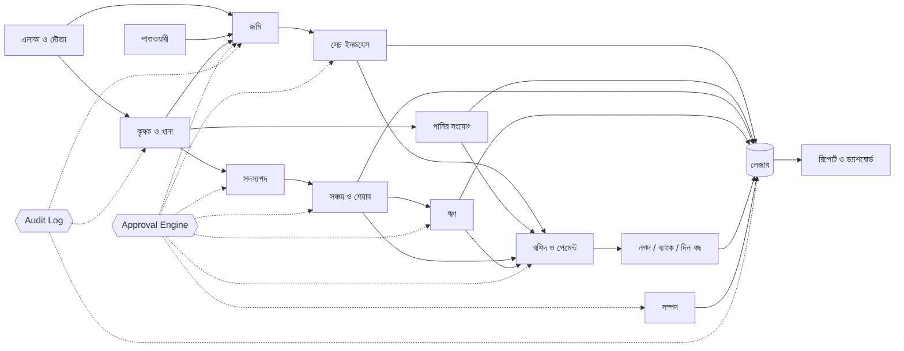

# Plan — পল্লী সমবায় সমিতি + কৃষি সেচ ERP (Polsha)

> এই সফটওয়্যারের পুরো পরিকল্পনা: কোন মডিউল কী কাজ করে, কীভাবে কাজ করে, একটার সাথে আরেকটা কীভাবে যুক্ত, আর কোন নিয়ম সব জায়গায় মানা হয়।
> ডাটাবেজের খুঁটিনাটি [Database.md](Database.md)-এ, স্ক্রিনের নকশা [UI.md](UI.md)-এ, কবে কী তৈরি হয়েছে [development.md](development.md)-এ।

**লাইভ:** https://pmpbssl.com · **লোকাল:** http://localhost/polsha, http://192.168.0.171/polsha, http://160.25.9.132/polsha
**অবস্থা (২৪/১১/২০২৬):** ১২টি ফেজের সফটওয়্যার সম্পন্ন ও লাইভ। বাকি শুধু সমিতির কাজ: UAT, পুরোনো তথ্য Import, Parallel Run, প্রশিক্ষণ।

---

## সূচিপত্র

1. [সফটওয়্যারটি কী](#১-সফটওয়্যারটি-কী)
2. [প্রযুক্তি ও কাঠামো](#২-প্রযুক্তি-ও-কাঠামো)
3. [সব মডিউলে মানা নিয়ম](#৩-সব-মডিউলে-মানা-নিয়ম)
4. [কেন্দ্রীয় ইঞ্জিন](#৪-কেন্দ্রীয়-ইঞ্জিন) — Posting, Approval, Receipt, Sequence, Audit, License
5. [মডিউলগুলো](#৫-মডিউলগুলো) — একটা একটা করে
6. [মডিউলগুলোর পারস্পরিক সম্পর্ক](#৬-মডিউলগুলোর-পারস্পরিক-সম্পর্ক)
7. [Role ও অনুমতি](#৭-role-ও-অনুমতি)
8. [স্বয়ংক্রিয় কাজ (Cron)](#৮-স্বয়ংক্রিয়-কাজ-cron)
9. [ডিপ্লয়মেন্ট ও পরিবেশ](#৯-ডিপ্লয়মেন্ট-ও-পরিবেশ)
10. [বাকি কাজ ও ভবিষ্যৎ](#১০-বাকি-কাজ-ও-ভবিষ্যৎ)

---

## ১. সফটওয়্যারটি কী

একটি পল্লী সমবায় সমিতির সব কাজ এক জায়গায়। সমিতিটি একই সাথে কৃষি সেচ চালায় এবং বাড়ি বাড়ি পানি সরবরাহ করে।

| কাজ | সফটওয়্যারে |
|---|---|
| কৃষক ও সদস্যের খাতা | কৃষক নিবন্ধন, খানা, সদস্যপদ আবেদন → অনুমোদন → সদস্য নম্বর, ভোটার তালিকা |
| জমির খাতা | জমি, মালিকানা (একাধিক মালিক, অংশ %), চাষি (নিজ/বর্গা/লিজ), হস্তান্তর, ইতিহাস |
| সেচ | মৌসুম, রেট, ইনভয়েস (একক/Bulk), আদায়, রশিদ, বকেয়া |
| পানি সরবরাহ | সংযোগ, মাসিক বিল, জরিমানা, আদায়, রশিদ |
| সঞ্চয় ও শেয়ার | জমা, উত্তোলন, শেয়ার ক্রয়/হস্তান্তর, মুনাফা ও লভ্যাংশ বণ্টন |
| ঋণ | প্ল্যান, আবেদন, অনুমোদন, বিতরণ, কিস্তি, জরিমানা, Aging |
| নগদ ও হিসাব | ডাবল-এন্ট্রি লেজার, ক্যাশ বই, ব্যাংক, দিন বন্ধ, হিসাবকাল ও অর্থবছর বন্ধ |
| সম্পদ | রেজিস্টার, স্থাপন, স্থানান্তর, মেরামত, অবচয়, বিক্রয় |
| রিপোর্ট ও নজরদারি | ৫৮+ রিপোর্ট, ড্যাশবোর্ড, Integrity Scan, Audit Log |
| ওয়েবসাইট | সমিতির পাবলিক ওয়েবসাইট (হোম, পরিচিতি, সেবা, নোটিশ, গ্যালারি, FAQ, যোগাযোগ) ও অনলাইন পেমেন্ট `/pay` |

**মূল সম্পর্ক:**

```
                 FARMER (কৃষক)
          ┌────────┴────────┐
       MEMBER          NON-MEMBER
    ┌─────┼─────┐
 Savings Share Loan

FARMER ── LAND ──┬── OWNER (মালিক, অংশ %)
                 └── CULTIVATOR (চাষি) → IRRIGATION INVOICE → PAYMENT → RECEIPT
                                                                │
WATER CONNECTION → MONTHLY BILL → PAYMENT → RECEIPT             │
                                                    ┌───────────┴──────────┐
                                                CASH / BANK      ACCOUNTING → GENERAL LEDGER
```

---

## ২. প্রযুক্তি ও কাঠামো

| স্তর | প্রযুক্তি |
|---|---|
| Frontend | React 19 + Vite 8 + TypeScript 6 + Ant Design 6 + React Router 7 + TanStack Query 5; ফন্ট Hind Siliguri / Inter / Poppins |
| API | REST, JSON, Laravel Sanctum Bearer token; ভাষা `X-Locale` header থেকে |
| Backend | Laravel 12 (PHP 8.2), spatie/laravel-permission |
| ডাটাবেজ | MySQL / MariaDB 10.11 (লাইভ), 10.4 (লোকাল XAMPP) — ১০১টি টেবিল |
| হোস্টিং | Shared cPanel; স্থায়ী queue worker নেই, প্রতি মিনিটের cron `schedule:run` |

**ফোল্ডার:**

```
polsha/
├── backend/                 Laravel API
│   ├── app/Http/Controllers/Api/   ৬৪টি controller (৪৭৮টি route)
│   ├── app/Services/               ৪২টি service — ব্যবসার সব নিয়ম এখানে
│   ├── app/Approvals/              ২২টি handler class (৩২টি অনুমোদন-কাজ)
│   ├── app/Models/                 ৮৬টি Eloquent মডেল
│   ├── app/Support/Runtime/        License (Continuity, TrustAnchor)
│   ├── config/erp.php              মডিউল, Role, অনুমতি, approval handler-এর তালিকা
│   ├── database/migrations/        ৫৬টি migration
│   └── tests/Feature/              ২৭টি ফাইল, ১৮৩টি test
├── frontend/                React SPA
│   ├── src/pages/                  ২৫টি মডিউল-ফোল্ডার, ১৯১টি route
│   ├── src/components/             AppLayout, PageFrame, ReportView, ImportWizard …
│   ├── src/lib/                    api client, i18n, format, মডিউলের helper
│   └── src/locales/en.json         ইংরেজি অনুবাদ
├── deploy/server-deploy.sh  সার্ভারে deploy script
└── docs/                    user-guide.md, go-live-checklist.md
```

**অনুরোধের পথ:** ব্রাউজার → `/api/*` → `.htaccess` → `laravel.php` (public_html-এ, backend থাকে public_html-এর বাইরে, তাই `.env` ওয়েব থেকে দেখা যায় না) → Laravel route → middleware (`auth:sanctum`, `permission:x.y`, প্রথম লগইনে পাসওয়ার্ড বদল, License) → Controller → Service → DB।

---

## ৩. সব মডিউলে মানা নিয়ম

1. **Accounting আগে, টাকার মডিউল পরে।** প্রতিটি আর্থিক লেনদেন সঙ্গে সঙ্গে Posting Engine দিয়ে ডাবল-এন্ট্রি জার্নালে যায়। Operational টেবিল (সেচ/সঞ্চয়/ঋণ/পানি) বিস্তারিত রাখে, Reconciliation দুটো মিলিয়ে দেখে।
2. **একটাই Approval Engine:** Draft → Pending → Approved/Rejected/Returned → Posted। যে পাঠায় সে নিজে অনুমোদন করতে পারে না (Maker ≠ Checker)।
3. **আর্থিক রেকর্ড কখনো ডিলিট হয় না।** বাতিল মানে উল্টো এন্ট্রি (reverse journal) + Audit Log।
4. **Snapshot:** ইনভয়েস ও বিলে মালিক, পিতা, দাগ, খতিয়ান, পরিমাণ তৈরির মুহূর্তে কপি হয়। পরে জমির মালিকানা বদলালেও পুরোনো বিল বদলায় না।
5. **ইতিহাস overwrite হয় না:** মালিকানা, চাষ, পাতওয়ারীর দায়িত্ব, সদস্যপদের অবস্থা — সব শুরু/শেষ তারিখসহ।
6. **কারিগরি মান:** টাকা `DECIMAL(15,2)`; অর্থবছর জুলাই–জুন; সিরিয়াল নম্বর DB lock দিয়ে; Timezone `Asia/Dhaka`; তারিখ `DD/MM/YYYY`; ইনপুটে বাংলা অঙ্ক (০–৯) নিজে থেকে ইংরেজিতে রূপান্তর।
7. **রিপোর্ট:** PDF হয় ব্রাউজারের Print → PDF দিয়ে (বাংলা ফন্ট ঠিক থাকে); Excel/CSV ব্রাউজারেই তৈরি।
8. **অনুমতি দুই জায়গায়:** যার অনুমতি নেই সে বোতামই দেখে না, আর API-তেও একই অনুমতি আবার যাচাই হয়।
9. **Soft Delete:** কোথাও ব্যবহৃত রেকর্ড মোছা যায় না।
10. **দ্বিভাষিক:** সব লেখা বাংলা/English; ডেটা (নাম, গ্রাম) অনুবাদ হয় না।

---

## ৪. কেন্দ্রীয় ইঞ্জিন

এগুলো একটা মডিউল নয় — সব মডিউল এগুলো ব্যবহার করে।

### ৪.১ Posting Engine (`LedgerService`)

প্রতিটি টাকার লেনদেনের ডেবিট/ক্রেডিট নিয়ম এক জায়গায়। জার্নাল `journals` + `journal_lines`-এ; ডেবিট = ক্রেডিট না হলে পোস্ট হয় না; বন্ধ হিসাবকালে (`accounting_periods`) বা বন্ধ দিনে (`day_closes`) নগদ এন্ট্রি আটকায়।

**Chart of Accounts (৪৩টি হিসাব):**

| কোড | হিসাব | কোড | হিসাব |
|---|---|---|---|
| 1111 | সেচের নগদ | 2200 | সদস্যদের সঞ্চয় আমানত |
| 1112 | সমিতির নগদ | 3200 | শেয়ার মূলধন |
| 1113 | বিবিধ নগদ | 3400 | পুঞ্জীভূত উদ্বৃত্ত |
| 1114 | মাঠকর্মীর হাতে নগদ (জমা বাকি) | 3900 | প্রারম্ভিক জের সমন্বয় |
| 1115 | পানির নগদ | 4100 | ভর্তি ফি আয় |
| 1200 | ব্যাংক হিসাব (প্রতি ব্যাংকে উপ-হিসাব) | 4200 | সেচ চার্জ আয় |
| 1320 | সেচ চার্জ পাওনা | 4300 / 4400 | ঋণের সুদ / জরিমানা আয় |
| 1330 | সদস্যদের ঋণ (আসল) | 4600 / 4610 / 4620 | পানির বিল / জরিমানা / সংযোগ ফি আয় |
| 1340 | পানির বিল পাওনা | 5300 | সঞ্চয়ের মুনাফা ব্যয় |
| 1510 / 1590 | স্থায়ী সম্পদ / পুঞ্জীভূত অবচয় | 5400 / 5500 | অবচয় / মেরামত ব্যয় |

**প্রধান Posting নিয়ম:**

| ঘটনা | ডেবিট | ক্রেডিট |
|---|---|---|
| সেচ ইনভয়েস তৈরি | 1320 সেচ চার্জ পাওনা | 4200 সেচ চার্জ আয় |
| সেচ আদায় | 1111 সেচের নগদ / ব্যাংক | 1320 সেচ চার্জ পাওনা |
| পানির মাসিক বিল | 1340 পানির বিল পাওনা | 4600 (সংযোগ ফি হলে 4620) |
| পানির জরিমানা | 1340 | 4610 |
| পানির আদায় | 1115 পানির নগদ / ব্যাংক | 1340 |
| সঞ্চয় জমা | সমিতির নগদ / ব্যাংক | 2200 সঞ্চয় আমানত |
| সঞ্চয় উত্তোলন | 2200 | নগদ / ব্যাংক |
| শেয়ার ক্রয় | নগদ / ব্যাংক | 3200 শেয়ার মূলধন |
| সঞ্চয়ের মুনাফা | 5300 মুনাফা ব্যয় | 2200 |
| লভ্যাংশ | 3300 / 3400 | 2200 |
| ঋণ বিতরণ | 1330 ঋণ (আসল) | নগদ / ব্যাংক |
| ঋণ পরিশোধ | নগদ / ব্যাংক | 4400 জরিমানা → 4300 সুদ → 1330 আসল (এই ক্রমে) |
| ভর্তি ফি | নগদ | 4100 |
| মাসিক অবচয় | 5400 | 1590 |
| মাঠকর্মীর আদায় | 1114 মাঠকর্মীর হাতে নগদ | সংশ্লিষ্ট পাওনা; অফিসে জমা দিলে 1114 → আসল নগদ খাত |
| Import-এর প্রারম্ভিক জের | সংশ্লিষ্ট হিসাব | 3900 প্রারম্ভিক জের সমন্বয় |
| বাতিল (যেকোনো) | মূল ভাউচারের উল্টো ভাউচার, অনুমোদনের পর | |

ভাউচার নম্বর ধরন অনুযায়ী: JV (জার্নাল), RV (জমা), PV (প্রদান), CV (কন্ট্রা), OB (প্রারম্ভিক)।

### ৪.২ Approval Engine (`ApprovalService`)

- নিয়ম (`approval_rules`, ৩২টি): কোন কাজে কয় ধাপ, কোন Role অনুমোদন দেবে, পরিমাণের সীমা। নিয়ম বন্ধ থাকলে বা পরিমাণ সীমার নিচে হলে স্বয়ংক্রিয় অনুমোদন।
- অনুরোধ (`approval_requests`, polymorphic `approvable`) → ধাপ (`approval_steps`) → মন্তব্য (`approval_comments`)।
- প্রত্যাখ্যান বা ফেরত পাঠাতে কারণ বাধ্যতামূলক; ফেরত আসা অনুরোধ সংশোধন করে আবার পাঠানো যায়।
- চূড়ান্ত অনুমোদনে Handler (`app/Approvals/*`) আসল কাজটা করে।

**যে কাজগুলো অনুমোদনের মধ্য দিয়ে যায় (৩২টি কাজ, ২২টি handler class):**

| এলাকা | অনুমোদন-কাজ |
|---|---|
| সদস্যপদ | ভর্তি (Manager → President), নিষ্ক্রিয়, সক্রিয়, বাতিল, পুনর্বহাল |
| কৃষক ও জমি | কৃষক মার্জ, জমি হস্তান্তর (Super Admin-এর ক্ষেত্রে সরাসরি) |
| হিসাব | হাতে দেওয়া জার্নাল, ভাউচার বাতিল (Reversal), দিন আবার খোলা |
| সেচ | নতুন/পরিবর্তিত রেট, রেটের ব্যাচ, ইনভয়েস বাতিল |
| পেমেন্ট | রশিদ বাতিল, একত্রিত পেমেন্ট বাতিল |
| সঞ্চয় ও শেয়ার | প্রারম্ভিক জের, উত্তোলন, সমন্বয়, লেনদেন বাতিল, মুনাফা বণ্টন, শেয়ার হস্তান্তর, লভ্যাংশ, হিসাব বন্ধ |
| ঋণ | আবেদন, পরিশোধ বাতিল |
| অন্যান্য | সম্পদ বিক্রয়/বাতিল, Import Rollback, পানির বিল বাতিল |

### ৪.৩ Receipt Engine (`ReceiptService`)

সব মডিউলের রশিদ একই ব্যবস্থায় (`receipts` + `receipt_items`, `module` = irrigation / water / combined …)। নগদ/ব্যাংক/অন্যান্য; এক রশিদে একাধিক বিল; আংশিক আদায়; প্রিন্টে লোগো, কথায় টাকা, আদায়ের পরের বকেয়া, QR (লগইন ছাড়া `/verify/...` পাতায় যাচাই), ১/২ কপি, A4/A5/থার্মাল। পুনর্মুদ্রণের রেকর্ড `print_logs`-এ। রশিদ বই ও সিরিয়াল বরাদ্দ `receipt_books`-এ (ফাঁক ও ডুপ্লিকেট ধরা হয়)।

### ৪.৪ Sequence (`SequenceService`)

সব নম্বর `sequences` টেবিল থেকে `SELECT … FOR UPDATE` দিয়ে: Farmer `F-000001`, Land `L-000001`, Member (পুরোনো খাতার নম্বর হুবহু, নতুন = সর্বোচ্চ + ১), সঞ্চয় `SAV-`, শেয়ার `SHR-`, পানির সংযোগ `WC-000001`, জমি হস্তান্তর `LT-YYYY-0001`, মার্জ `MR-YYYY-001`, ঋণের প্ল্যান `LP-01` ইত্যাদি। "পরের নম্বর" কমানো যায় না।

### ৪.৫ Audit Log (`Auditable` trait + `AuditLogger`)

প্রতিটি মডেলের create/update/delete/restore নিজে থেকে লগ হয়: কে, কখন, কোন মডিউলে, পুরোনো ও নতুন মান। শুধু পড়া যায়; পাসওয়ার্ড কখনো লগে যায় না।

### ৪.৬ License (`LicenseService`, `Continuity`)

- লাইসেন্স সার্ভার (syncsolutionbd.com) থেকে RSA-2048 স্বাক্ষরিত উত্তর `license_state`-এ রাখা হয়।
- ডোমেইনে বাঁধা (এখন `pmpbssl.com`); ৬ ঘণ্টা পরপর যাচাই; সার্ভার না পেলে ৫ দিন শেষ উত্তরে চলে; মেয়াদের পর ২ দিন grace।
- লাইসেন্স অচল হলে লগইন, প্রোফাইল ও লাইসেন্স পাতা ছাড়া সব signed-in কাজ বন্ধ (`WORKSPACE_LOCKED`)।
- ইচ্ছা করেই বন্ধ করার কোনো সেটিং নেই। লোকাল কপিতে আলাদা ডোমেইনের key লাগবে।

---

## ৫. মডিউলগুলো

প্রতিটি মডিউলের জন্য: **কাজ** · **ধাপ/প্রবাহ** · **মূল নিয়ম** · **টেবিল** · **কোড**।

### ৫.১ প্রশাসন, লগইন ও নিরাপত্তা

- **কাজ:** লগইন, ইউজার, Role, Permission, প্রোফাইল, পাসওয়ার্ড রিসেট, ব্যাকআপ।
- **নিয়ম:**
  - ইউজারনেম বা মোবাইল দিয়ে লগইন; পরপর ৫ বার ভুলে ১৫ মিনিট লক; প্রতিটি চেষ্টা `login_logs`-এ।
  - প্রথম লগইনে পাসওয়ার্ড না বদলানো পর্যন্ত অন্য API চলে না। পাসওয়ার্ড ≥ ৮ অক্ষর, অক্ষর + সংখ্যা; বদলালে অন্য সব ডিভাইস থেকে লগআউট।
  - পাসওয়ার্ড ভুলে গেলে নিবন্ধিত মোবাইলে SMS কোড (`sms_otps`)।
  - নিজেকে নিষ্ক্রিয় করা যায় না; শুধু Super Admin আরেকজনকে Super Admin বানাতে পারেন; System Role ও ইউজার আছে এমন Role মোছা যায় না।
  - নিষ্ক্রিয় থাকলে নিজে থেকে লগআউট (সময় System Preferences-এ)।
  - ব্যাকআপ: প্রতি রাত ২টায় mysqldump + gzip, ৩০ দিন রাখা; ইমেইল দিলে সার্ভারের বাইরেও (ঐচ্ছিক AES-256 জিপ পাসওয়ার্ড)।
- **টেবিল:** users, roles, permissions, model_has_roles, role_has_permissions, personal_access_tokens, login_logs, sms_otps, backups
- **কোড:** AuthController, UserController, RoleController, BackupService

### ৫.২ এলাকা ও মৌজা

- **কাজ:** বিভাগ → জেলা → উপজেলা → ইউনিয়ন → গ্রাম → মৌজা। বাংলাদেশের সব ৮ বিভাগ, ৬৪ জেলা, ৪৯৪ উপজেলা, ৪৫৩৬ ইউনিয়ন আগে থেকে বসানো (`BdLocationImporter`)।
- **নিয়ম:** একই উপজেলায় মৌজার JL নম্বর অনন্য; গ্রাম ও মৌজা many-to-many (`mouza_village`); গ্রাম/মৌজা ফর্ম থেকেই যোগ করা যায়।
- **টেবিল:** divisions, districts, upazilas, unions, villages, mouzas, mouza_village

### ৫.৩ কৃষক ও খানা

- **কাজ:** কৃষকের নিবন্ধন (Farmer ID `F-000001`, অপরিবর্তনীয়), প্রোফাইল, ডকুমেন্ট, পরিবারের সদস্য, খানা, ডুপ্লিকেট ধরা, মার্জ, মুছে ফেলা ও পুনরুদ্ধার।
- **প্রবাহ:** কৃষক যোগ → (ঐচ্ছিক) সদস্যপদের আবেদন খোলা → প্রোফাইলের ১১টি ট্যাব (ওভারভিউ, ব্যক্তিগত তথ্য, সদস্যপদ, জমি ও চাষ, সেচ, সঞ্চয়, ঋণ, শেয়ার, পেমেন্ট, ডকুমেন্ট, ইতিহাস)।
- **নিয়ম:**
  - নাম (বাংলা), পিতার নাম, লিঙ্গ, গ্রাম, মৌজা বাধ্যতামূলক; NID ১০/১৩/১৭ অঙ্ক, অনন্য; মোবাইল `01XXXXXXXXX`; ছবি ≤ ২MB, নিজে compress।
  - **ডুপ্লিকেট:** একই NID → সংরক্ষণ আটকায়। একই মোবাইল, বা একই গ্রামে নাম + পিতার নাম → সতর্কতা ("মোঃ/মোহাম্মদ", "মোছাঃ/মোসাম্মৎ" বানান-পার্থক্য উপেক্ষা)। ইউজার "আলাদা ব্যক্তি" চিহ্ন দিলে `duplicate_dismissals`-এ থাকে।
  - **মার্জ:** প্রতিটি ঘরের চূড়ান্ত মান বাছাই → Manager-এর অনুমোদন (Super Admin হলে সরাসরি) → ডকুমেন্ট, সদস্যপদ, জমি, সেচ, সঞ্চয়, ঋণ, খানা লক্ষ্য কৃষকে যায়। নম্বর `MR-YYYY-001`।
  - **মুছা:** কারণ কোডসহ (ডুপ্লিকেট / ভুল তথ্য / কৃষক নন / অন্যান্য); পুনরুদ্ধার করা যায়; অন্য রেকর্ড যুক্ত থাকলে স্থায়ীভাবে মোছা যায় না।
  - ডকুমেন্ট private storage-এ, শুধু লগইন করা ইউজার দেখতে পারেন।
- **টেবিল:** farmers, farmer_documents, farmer_family_members, households, duplicate_dismissals
- **কোড:** FarmerController, FarmerDuplicateService, FarmerMergeService, DataHealthService

### ৫.৪ সদস্যপদ ও ভোটার

- **কাজ:** সদস্যপদের আবেদন, ভর্তি, সদস্য তালিকা, অবস্থা পরিবর্তন, ভর্তি রেজিস্টার, ভোটার তালিকা, সদস্য কার্ড।
- **প্রবাহ:** আবেদন (৪ ধাপের ফর্ম: কৃষক → সদস্যপদের বিবরণ → নমিনি ও প্রস্তাবক → ডকুমেন্ট ও প্রিভিউ) → খসড়া বা জমা → **Manager → President** → Member Number তৈরি, কৃষকের ধরন "সদস্য", সঞ্চয় ও শেয়ার হিসাব নিজে খোলে, ভর্তি ফি লেজারে।
- **নিয়ম:**
  - যেকোনো সক্রিয় নন-মেম্বার কৃষক আবেদন করতে পারেন; একসাথে একটির বেশি অপেক্ষমাণ আবেদন নয়।
  - নমিনিদের অংশ মিলে ১০০%; প্রস্তাবক/সমর্থক সক্রিয় সদস্য।
  - ভর্তি ফি Settings থেকে; হাতে বদলালে কারণ বাধ্যতামূলক, দুটো মানই Audit-এ।
  - Member Number: পুরোনো খাতার নম্বর হুবহু (শুধু `member.admin`), নতুন = সর্বোচ্চ + ১; বাতিল নম্বর কাউকে দেওয়া হয় না; পুনর্বহালে পুরোনো নম্বর ফেরে।
  - অবস্থা পরিবর্তন (নিষ্ক্রিয় / সক্রিয় / বাতিল / পুনর্বহাল) প্রতিটিতে দুই ধাপের অনুমোদন; সঞ্চয়/শেয়ার/ঋণে টাকা বাকি থাকলে বাতিল করা যায় না।
  - ভোটার তালিকা = কাট-অফ তারিখের সব সক্রিয় সদস্যের Snapshot; Voter Audit দেখায় কে বাদ পড়লেন ও কেন।
- **টেবিল:** membership_applications, membership_nominees, members, membership_status_history, voter_lists, voter_list_items
- **কোড:** MembershipService, VoterListService, MembershipAdmitHandler, MemberStatusHandler

### ৫.৫ পাতওয়ারী

- **কাজ:** পাতওয়ারীর তালিকা, দায়িত্বাধীন মৌজা, দায়িত্বের ইতিহাস; জমি ↔ পাতওয়ারী সংযোগ মৌজার বর্তমান দায়িত্ব থেকে।
- **নিয়ম:** বাদ দেওয়া মৌজার শেষ তারিখ থাকে; যোগদানের তারিখ = প্রথম দায়িত্বের তারিখ; পাতওয়ারী একজন কৃষকের সাথে যুক্ত (ছবি সেখান থেকে)।
- **টেবিল:** patwaris, patwari_mouza_assignments

### ৫.৬ জমি ও বর্গা

- **কাজ:** জমির খাতা (Land ID `L-000001`), মালিকানা, চাষ, বর্গা/লিজ, হস্তান্তর, ইতিহাস, ডকুমেন্ট, নোট, জমির ধরন, রিপোর্ট।
- **নিয়ম:**
  - জমির তথ্য: মৌজা, জরিপ (RS/BS/SA/CS), খতিয়ান, দাগ, পরিমাণ, ধরন, অবস্থা (চাষাধীন/পতিত/বিরোধপূর্ণ/নিষ্ক্রিয়), সেচকৃত অংশ, GPS (অক্ষাংশ/দ্রাঘিমাংশ)।
  - পরিমাণ সবসময় শতকে সংরক্ষিত; ইনপুটে শতক/একর/বিঘা/কাঠা/হেক্টর; ১ বিঘা = কত শতক Settings-এ (ডিফল্ট ৩৩)।
  - একই মৌজা/জরিপ/খতিয়ান/দাগ থাকলে সতর্কতা ("আলাদা অংশ" নিশ্চিত করে সংরক্ষণ)।
  - **মালিকানা:** একাধিক মালিক, অংশ মিলে ১০০%; শুরু/শেষ তারিখসহ, কিছু মুছে যায় না।
  - **চাষ:** নিজ চাষ / বর্গা / লিজ; নিজ চাষে চাষি অবশ্যই মালিক; বর্গায় মালিক চাষি হতে পারেন না; বর্গার অংশ % ও চুক্তি শেষের তারিখ।
  - **হস্তান্তর:** ধাপে ধাপে ফর্ম (জমি → বর্তমান মালিক → নতুন মালিক → পূর্ণ/আংশিক % → কারণ, তারিখ, টাকা, দলিল) → খসড়া → Manager-এর অনুমোদন → মালিকানা বদলায়। আগের মালিকের "নিজ চাষ" নিজে থেকে শেষ হয়; বর্গাচাষি মালিক হলে বর্গা শেষ হয়ে "নিজ চাষ" শুরু হয়।
  - Data Health: ১৩টি যাচাই (মালিকহীন/চাষিবিহীন/ডুপ্লিকেট জমি, অংশ ১০০% নয়, ভুল মৌজা ইত্যাদি)।
- **টেবিল:** lands, land_types, land_owners, land_cultivations, land_transfers, land_documents, land_notes
- **কোড:** LandService, LandTransferService, LandController, LandRegisterController

### ৫.৭ সেচ

- **কাজ:** মৌসুম, সেচের ধরন (ক্যাটাগরি), লিফট, রেট, ইনভয়েস, আদায়, পুরোনো রশিদ, বকেয়া, যাচাই।
- **প্রবাহ:** মৌসুম তৈরি (ফসল, শুরু, শেষ, পরিশোধের শেষ তারিখ) → রেট (প্রতি শতক; সেচের ধরন × লিফট × ঐচ্ছিক জমির ধরন × মৌসুম; আগের মৌসুমের রেট কপি করা যায়) → Manager-এর অনুমোদন → ইনভয়েস (একক বা Bulk — মৌসুম/মৌজা/উৎস/বাছাই করা জমি ধরে, Billing Split Preview) → আদায় (যেকোনো কৃষকের বকেয়া ইনভয়েস বাছাই, প্রতি কৃষকে এক রশিদ) → রশিদ → লেজার।
- **নিয়ম:**
  - একই মৌসুমে একই জমিতে দ্বিতীয় ইনভয়েস আটকায়।
  - নিজের জমি → মালিকের নামে; বর্গা/লিজ → চাষির নামে; মালিক/পিতা/মৌজা/দাগ/খতিয়ান/পরিমাণ Snapshot।
  - ইনভয়েসে অতিরিক্ত চার্জ ও ছাড় যোগ করা যায়।
  - অপরিশোধিত ইনভয়েস বাতিল অনুমোদনসহ উল্টো ভাউচারে; রশিদ বাতিলে ইনভয়েসের বকেয়া ফিরে আসে, রশিদে "বাতিলকৃত" ছাপ।
  - Due Mismatch (ইনভয়েস ↔ রশিদ ↔ লেজার) ও Rate Audit (রেট ছাড়া জমি, লিফট বসানো নেই এমন জমি, রেটের সাথে না মেলা ইনভয়েস)।
- **লিফট অনুযায়ী রেট (২৪/১১/২০২৬):** পানি কয় ধাপে তুলে জমিতে আসে — ১ম, ২য়, ৩য় লিফট — সেই অনুযায়ী রেট।
  - লিফটের তালিকা (`irrigation_lifts`; শুরুতে L1/L2/L3, Settings-অনুমতিতে আরও যোগ করা যায়; ব্যবহৃত লিফট মোছা যায় না, নিষ্ক্রিয় হয়)।
  - লিফট জমির স্থায়ী তথ্য (`lands.lift_id`) — জমির ফর্মে, জমির তালিকা থেকে একসাথে অনেক জমিতে, বা জমির Import-এ "লিফট" কলামে বসে; বদল জমির ইতিহাসে থাকে।
  - রেটের পাতায় "লিফট অনুযায়ী রেট" ছক: সারি = সেচের উৎস, কলাম = লিফট; ঘরে রেট লিখে একসাথে অনুমোদনের জন্য পাঠানো।
  - রেট বাছাই: কোনো মৌসুমে কোনো উৎসের অন্তত একটি লিফট-রেট চালু হলে সেই উৎসে **শুধু জমির লিফটের রেট** গণ্য হয় (লিফটের মধ্যে জমির ধরনের রেট থাকলে সেটি আগে); লিফট বসানো নেই এমন জমির বিল হয় না (`no_lift`, তালিকা ও "লিফট বসান" বোতামসহ)। লিফট-রেট না থাকলে আগের মতো সাধারণ রেট।
  - ইনভয়েস লিফট মনে রাখে (`invoices.lift_id` + snapshot); পরে জমির লিফট বদলালেও পুরোনো বিল বদলায় না। ইনভয়েস ও রশিদে লিফট ছাপা হয়।
  - Bulk-এ লিফট ফিল্টার (বা "লিফট বসানো নেই") ও লিফটভিত্তিক সারাংশ (জমি × রেট = টাকা); রিপোর্ট কেন্দ্রে "লিফটভিত্তিক সেচ সারসংক্ষেপ", ইনভয়েস ও বকেয়া রিপোর্টে লিফট ফিল্টার।
- **টেবিল:** seasons, irrigation_types, irrigation_lifts, irrigation_rates, invoice_batches, invoices, receipts, receipt_items
- **কোড:** IrrigationService, ReceiptService, IrrigationCashStatementService

### ৫.৮ পানি সরবরাহ

- **কাজ:** বাড়ি বাড়ি পানির সংযোগ, মাসিক নির্দিষ্ট বিল, জরিমানা, আদায়, রশিদ, বকেয়া।
- **প্রবাহ:** সংযোগের ধরন ও মাসিক ফি (আবাসিক / বাণিজ্যিক / প্রাতিষ্ঠানিক) → সংযোগ ও গ্রাহক (`WC-000001`, ঐচ্ছিকভাবে নিবন্ধিত কৃষকের সাথে যুক্ত) → মাস বাছাই করে মাসিক বিল (প্রিভিউ, ফি ঠিক না থাকা সংযোগ আলাদা সতর্কতায়) → আদায় (বকেয়া বিল টিক দিয়ে, আংশিকও, মেয়াদোত্তীর্ণ হলে জরিমানা) → রশিদ।
- **নিয়ম:**
  - সংযোগ ফি দিলে আলাদা বিল (4620 সংযোগ ফি আয়)।
  - বিচ্ছিন্ন / পুনঃসংযোগ / বন্ধ — কারণ ও তারিখসহ; বিচ্ছিন্ন থাকলে মাসিক বিল হয় না।
  - রশিদ বাতিল ও বিল বাতিল ম্যানেজারের অনুমোদনে; অপরিশোধিত জরিমানা কারণসহ মওকুফ।
  - পানি সব জায়গায় আছে: একত্রিত পেমেন্ট, মাঠে আদায়, অনলাইন `/pay` (WC- নম্বর দিয়ে), ড্যাশবোর্ড, রিপোর্ট, SMS, Import, Ledger Integrity (বকেয়া ↔ 1340)।
  - **সমিতির কাজ বাকি:** ধরনগুলোর ফি এখন ০ — ফি না বসালে বিল হয় না।
- **টেবিল:** water_connection_types, water_connections, water_connection_documents, water_bills, water_bill_penalties
- **কোড:** WaterService, WaterController

### ৫.৯ সঞ্চয় ও শেয়ার

- **কাজ:** প্রতি সদস্যে একটি সাধারণ সঞ্চয় হিসাব (`SAV-`) ও একটি শেয়ার হিসাব (`SHR-`), দুটো কখনো এক নয়।
- **প্রবাহ ও নিয়ম:**
  - হিসাব সদস্যপদের সাথে নিজে খোলে; শুধু সক্রিয় সদস্য।
  - জমা সাথে সাথে পোস্ট; উত্তোলন সবসময় অনুমোদনের পর (অপেক্ষার সময় টাকা আটকে থাকে); সমন্বয় কারণ ও বিপরীত হিসাবসহ, অনুমোদনের পর।
  - শেয়ার: ক্রয়, প্রারম্ভিক শেয়ার, হস্তান্তর (প্রাপকের হিসাব না থাকলে নিজে খোলে), সমন্বয় — টাকার অঙ্কে; প্রতি শেয়ারের মূল্য Settings-এ।
  - **মুনাফা বণ্টন:** প্রতি সদস্যের মুনাফা হাতে বা % দিয়ে → অনুমোদন → সঞ্চয়ে জমা ও লেজারে (`distribution_runs` / `distribution_items`)।
  - **লভ্যাংশ:** ভিত্তি তারিখের শেয়ার জের অনুযায়ী আনুপাতিক → অনুমোদন → সঞ্চয়ে জমা।
  - Member Statement (দৈনিক/মাসিক/বার্ষিক), Savings Audit (মোট জের ↔ 2200), Share Capital Reconciliation (↔ 3200)।
  - হিসাব বন্ধ অনুমোদনসহ।
- **টেবিল:** member_accounts, member_transactions, distribution_runs, distribution_items
- **কোড:** MemberFundService, FundHistoryService

### ৫.১০ ঋণ

- **কাজ:** ঋণের প্ল্যান, আবেদন, অনুমোদন, বিতরণ, কিস্তিসূচি, জরিমানা, আদায়, বকেয়া ও Aging।
- **প্রবাহ:** প্ল্যান (নাম, সর্বোচ্চ ঋণ, ফ্ল্যাট সুদ, কিস্তির ধরন — মাসিক/সাপ্তাহিক/ত্রৈমাসিক/এককালীন — ও সংখ্যা, জরিমানা; কোড `LP-01`) → আবেদন (ফর্মেই প্রতি কিস্তি, মোট সুদ ও মোট ফেরত) → অনুমোদন → বিতরণ (নগদ/ব্যাংক, তহবিলে টাকা যাচাই) → কিস্তিসূচি নিজে তৈরি (আসল ও সুদ আলাদা) → "কিস্তি আদায়" স্ক্রিন → সমাপ্ত।
- **নিয়ম:**
  - ঋণসীমা = সর্বোচ্চ সীমা ও (গুণিতক × সঞ্চয় + শেয়ার) — যেটি কম; প্রতি সদস্যে একটিই চলমান/অপেক্ষমাণ ঋণ।
  - জামিনদার সক্রিয় সদস্য, ঋণগ্রহীতা নিজে নন; একজন কয়টি চলমান ঋণের জামিনদার হতে পারবেন তা Settings-এ।
  - জরিমানা: প্রতিটি দেরি কিস্তিতে একবার — নির্দিষ্ট টাকা বা কিস্তির % (পুরোনো ঋণ আগের দিন-হিসাবের নিয়মে)।
  - পরিশোধ ভাগের ক্রম: জরিমানা → সুদ → আসল; সর্বশেষ জমা বাতিল অনুমোদনসহ।
  - Overdue Aging: ১–৩০ / ৩১–৯০ / ৯০+ দিন; ঋণ অডিট (আসল বাকি ↔ 1330)।
- **টেবিল:** loan_products, loans, loan_guarantors, loan_installments, loan_payments
- **কোড:** LoanService, LoanApplicationHandler

### ৫.১১ নগদ ও পেমেন্ট

- **কাজ:** টাকা আদায়ের এক স্ক্রিন, রশিদ, একত্রিত পেমেন্ট, মাঠে আদায়, অনলাইন পেমেন্ট, দিন বন্ধ, হাতে নগদ।
- **একত্রিত পেমেন্ট:** এক রশিদে ঋণ → সেচ → পানি → শেয়ার (ক্রম Settings-এ), বাকি টাকা সঞ্চয়ে; আদায়ের সময় হাতে ভাগ বদলানো যায়; বাতিল = অনুমোদন + সব খাত একসাথে রিভার্স।
- **মাঠে আদায় (মোবাইল):** মাঠকর্মী মোবাইলে কৃষকের বকেয়া দেখে আদায় করেন → টাকা 1114 "মাঠকর্মীর হাতে নগদ"-এ → অফিসে জমা দিলে আসল নগদ খাতে (`field_deposits`)। জমা না দেওয়া টাকার জন্য Bell সতর্কতা।
- **অনলাইন পেমেন্ট `/pay`:** লগইন ছাড়া বিকাশ/নগদে পাঠিয়ে তথ্য জমা (Farmer ID বা WC- নম্বর) → ক্যাশিয়ার যাচাই → রশিদ ও SMS। অবস্থা দেখতে পুরো মোবাইল নম্বর মিলতে হয়।
- **দিন বন্ধ:** খাতভিত্তিক প্রারম্ভিক + আদায় − প্রদান = প্রত্যাশিত; নোট গণনা; গরমিলে কারণ বাধ্যতামূলক; বন্ধ দিনে নগদ লেনদেন নিষিদ্ধ; আবার খুলতে অনুমোদন।
- **টেবিল:** receipts, receipt_items, combined_payments, combined_payment_parts, field_deposits, public_payment_requests, day_closes, receipt_books, print_logs
- **কোড:** CombinedPaymentService, FieldCollectionService, PublicPaymentService, DayCloseService

### ৫.১২ ক্যাশ বই ও খতিয়ান

- সেচ নগদ বিবরণী ও সমিতির নগদ বিবরণী (অডিট শিটের ধাঁচে, ব্যাংক হিসাবসহ), আয়-ব্যয় নগদ বই (কাগজের খাতার ধাঁচে), Cash Book (Ledger), Export Audit (`export_logs`)।
- **কোড:** IrrigationCashStatementService, IncomeExpenseCashBookService

### ৫.১৩ হিসাব (Accounting) ও ব্যাংক

- **কাজ:** Chart of Accounts (গাছের মতো, গ্রুপে উপ-হিসাবের জের যোগ হয়), জার্নাল ও ভাউচার, General Ledger, Trial Balance, আয়-ব্যয়, Balance Sheet, Cash Flow, Financial Summary, Source vs Ledger, Opening Balance।
- **নিয়ম:**
  - সিস্টেম হিসাবের কোড/ধরন বদলানো যায় না, লেনদেন থাকলে মোছা যায় না।
  - হাতে দেওয়া জার্নাল Manager অনুমোদনের পর পোস্ট; পোস্ট হওয়া ভাউচার বদলানো যায় না, শুধু Reversal।
  - Cash Stream আলাদা: সেচের, সমিতির, বিবিধ, পানির, মাঠকর্মীর নগদ — এক খাতের টাকা অন্য খাতে শুধু স্থানান্তর দিয়ে; জের ছাড়িয়ে খরচ আটকায়।
  - **হিসাবকাল:** প্রথম লেনদেনে মাস নিজে খোলে; বন্ধ মাসে এন্ট্রি নিষিদ্ধ; কারণসহ আবার খোলা।
  - **অর্থবছর বন্ধ:** আয়-ব্যয় শূন্য করে 3400 পুঞ্জীভূত উদ্বৃত্তে।
  - **ব্যাংক:** চলতি/সঞ্চয়ী/FDR (মেয়াদপূর্তি, সুদের হার); জমা, উত্তোলন, স্থানান্তর; মাসিক Reconciliation (স্টেটমেন্ট লাইন পেস্ট, স্বয়ংক্রিয়/হাতে মিল, চূড়ান্ত করলে লক)।
- **টেবিল:** chart_of_accounts, journals, journal_lines, accounting_periods, fiscal_year_closes, bank_accounts, bank_reconciliations, bank_statement_lines
- **কোড:** LedgerService, AccountingReportService, BankReconciliationService, FinancialYearService

### ৫.১৪ সম্পদ (Assets)

- **কাজ:** রেজিস্টার (কোড, শ্রেণি — আয়ুষ্কাল ও অবশিষ্ট মূল্যের ডিফল্টসহ, ক্রয়মূল্য, অবস্থান, দায়িত্বপ্রাপ্ত, বর্তমান মূল্য), ক্রয় (নগদ/ব্যাংক/বাকি), Stock, স্থাপন, স্থানান্তর, রক্ষণাবেক্ষণের সময়সূচি, মেরামত, অবচয়, বিক্রয়/বাতিল, ড্যাশবোর্ড।
- **নিয়ম:** অবচয় সরল রেখা পদ্ধতিতে প্রতি মাসের ১ তারিখ রাত ৩টায় নিজে পোস্ট হয় (বাদ পড়া মাস ক্রমানুসারে; বন্ধ হিসাবকালে বাদ); বিক্রয়/বাতিল অনুমোদনের পর লাভ/ক্ষতির ভাউচার; প্রতিটি চলাচল `asset_movements`-এ।
- **টেবিল:** asset_categories, assets, asset_movements, asset_maintenances, asset_depreciations
- **কোড:** AssetService

### ৫.১৫ রিপোর্ট, ড্যাশবোর্ড ও নজরদারি

- **রিপোর্ট কেন্দ্র (৫৮+):** কৃষক/সদস্য, জমি, সেচ, পানি, সঞ্চয়, ঋণ, হিসাব; প্রতিটিতে Filter, Print → PDF, Excel। Collection / Due / Audit রিপোর্ট আলাদা মেন্যুতে।
- **ড্যাশবোর্ড:** ১৩টি KPI (গত মাস/মৌসুমের তুলনায় %), ৪০ দিনের দৈনিক আদায় চার্ট, এই মৌসুমের আদায় বনাম বকেয়া, সাম্প্রতিক লেনদেন, অপেক্ষমাণ অনুমোদন, সতর্কতা। Cache করা, যাতে shared hosting-এও দ্রুত (`DashboardService`)।
- **Integrity Scan:** প্রতি রাত ১:৩০-এ — জমি/কৃষকের তথ্য, ভাউচারহীন রশিদ/ইনভয়েস/ঋণ/সঞ্চয়, না মেলা ভাউচার, রেওয়ামিল, মডিউল বনাম খতিয়ান (`integrity_scans`)।
- **Ledger Integrity:** প্রতিটি মডিউলের মোট ↔ লেজারের হিসাব (সেচ 1320, ঋণ 1330, পানি 1340, সঞ্চয় 2200, শেয়ার 3200)।
- **Bell সতর্কতা (`AlertService`):** ৩০ দিনের বেশি সেচ বকেয়া, ঋণ কিস্তি, সদস্য আবেদন, সঞ্চয় উত্তোলন, ব্যাংক মিলকরণ, সম্পদ রক্ষণাবেক্ষণ, মাঠকর্মীর জমা না দেওয়া টাকা।

### ৫.১৬ SMS

- যেকোনো HTTP গেটওয়ে (URL/key/sender Settings-এ; গোপন key ব্রাউজারে যায় না)।
- Template (৯টি), Log, OTP, পেমেন্ট নিশ্চিতকরণ, সঞ্চয় নিশ্চিতকরণ, পানির বিল, বকেয়া/ঋণ/সেচের রিমাইন্ডার (প্রতিদিন সকাল ৯টায়)।
- Queue প্রতি মিনিটের cron-এ (`sms:process`)। গেটওয়ে না দিলে SMS শুধু লগ হয়।
- **টেবিল:** sms_templates, sms_logs, sms_otps · **কোড:** SmsService

### ৫.১৭ Import / Migration

- **Import Wizard:** Excel (.xlsx) / CSV আপলোড → কলাম মেলানো (নিজে অনুমান) → যাচাই → ভুলের রিপোর্ট (ডাউনলোড) → Preview → নিশ্চিত → Import → Audit।
- কৃষক, জমি, সঞ্চয়/শেয়ারের প্রারম্ভিক জের, চলমান ঋণ (কিস্তিসূচিসহ), পুরোনো সেচ বকেয়া, পুরোনো রশিদ, পানির সংযোগ ও বকেয়া — প্রতিটির Template; বাংলা অঙ্ক, "১২,৫০০", "১.৫ একর" বোঝে।
- টাকার Import চালুর তারিখে 3900-এর বিপরীতে লেজারে।
- প্রতিটি Import-এর Batch ID; Rollback = এক অ্যাডমিনের আবেদন → অন্য অ্যাডমিনের অনুমোদন; Import-এর পরে লেনদেন হয়ে থাকলে আটকায়।
- **টেবিল:** import_batches · **কোড:** ImportService, ImportRollbackService, `app/Services/Imports/*`

### ৫.১৮ Settings

- সাধারণ (সমিতির নাম/ধরন/যোগাযোগ, ডিফল্ট এলাকা ও মৌজা, তারিখ ফরম্যাট, ভাষা, মুদ্রা), Branding & Logo (লোগো, স্বাক্ষর, সিল, ব্র্যান্ড রং, লেটারহেড, ফুটার), রশিদ (কাগজের মাপ, কপি, QR, বকেয়া দেখানো), অর্থবছর, SMS, System Preferences (সদস্যপদ/জমি/ঋণ/পেমেন্টের নিয়ম, পাতার সারি, নিষ্ক্রিয় লগআউট, চালুর তারিখ), লাইসেন্স, সিস্টেম ও ইনস্টলেশন (ভার্সন, ডিস্ক, শেষ ব্যাকআপ, cron heartbeat), ওয়েবসাইট, ওয়েবসাইটের বার্তা।
- **টেবিল:** settings (key-value, ৪৬টি), sequences, license_state

### ৫.১৯ সমিতির ওয়েবসাইট

- লগইন ছাড়া মূল ঠিকানা (`/`) খুললে সমিতির ওয়েবসাইট; লগইন করা ইউজার ড্যাশবোর্ডে যান।
- পাতা: হোম, পরিচিতি (`/about`), সেবা (`/services`, `/services/:key`), নোটিশ (`/notices`, `/notices/:id`), গ্যালারি, FAQ, যোগাযোগ।
- সব লেখা ও ছবি Settings → ওয়েবসাইট থেকে: শিরোনাম, পরিচিতি, প্রতিষ্ঠার সাল, কর্ম এলাকা, সভাপতির বাণী, কমিটি, নোটিশ (PDF সংযুক্তিসহ), গ্যালারি, সোশ্যাল লিংক, গুগল ম্যাপ।
- সংখ্যার সারি আসল হিসাব থেকে (সক্রিয় সদস্য, কৃষক, সেচকৃত জমি, পানির সংযোগ)। খালি অংশ নিজে লুকায়।
- যোগাযোগের ফর্মের বার্তা যায় Settings → ওয়েবসাইটের বার্তা-য় (`website_messages`)।
- ছবি আপলোডে নিজে ছোট হয় (১৬০০px, JPEG); পাতা থেকে সরালে সার্ভার থেকেও মোছে।

### ৫.২০ QR

- কৃষক, সদস্য, জমি, রশিদ, একত্রিত রশিদ, সম্পদ — সবকিছুর QR।
- রশিদের QR লগইন ছাড়া যাচাই হয় (`/verify/:kind/:token`); বাকিগুলো লগইনসহ।
- ক্যামেরা স্ক্যানার (jsQR) ও কোড লিখে খোঁজা; প্রতিটি স্ক্যানের ইতিহাস (`qr_scans`)।

---

## ৬. মডিউলগুলোর পারস্পরিক সম্পর্ক



**ফেজ-নির্ভরতা (যে ক্রমে তৈরি হয়েছে):**

| ফেজ | বিষয় | যার উপর নির্ভরশীল |
|---|---|---|
| ১ | ভিত্তি, প্রশাসন ও অনুমোদন | — |
| ২ | কৃষক, সদস্য ও পাতওয়ারী | ১ |
| ৩ / ৩ক | জমি, বর্গা, Data Health / দ্বিভাষিক | ২ / ৩ |
| ৪ | Accounting, ক্যাশ ও ব্যাংক | ১ |
| ৫ | সেচ ও রশিদ | ৩, ৪ |
| ৬ | সঞ্চয় ও শেয়ার | ২, ৫ |
| ৭ | ঋণ | ৬ |
| ৮ | Combined Payment, Day Close, QR, সম্পদ, ১৫-গ্রুপ মেন্যু | ৫, ৬, ৭ |
| ৯ | রিপোর্ট, ড্যাশবোর্ড, Integrity, SMS | ৮ |
| ১০ | Import, License, Go-Live | সব |
| ১১ | ওয়েবসাইট | ১ |
| ১২ / ১২ক | পানি সরবরাহ / পানি সব জায়গায় | ৪, ৫ |

---

## ৭. Role ও অনুমতি

**অনুমতির ফরম্যাট:** `module.action` — action: `view`, `create`, `edit`, `delete`, `approve`, `export`, `admin`। ২৭টি মডিউল (user, role, audit, approval, location, mouza, settings, backup, farmer, membership, member, patwari, land, irrigation, savings, share, loan, payment, cash, bank, accounting, asset, report, sms, import, field, water) → ১৮৯টি অনুমতি।

| Role | নাম | মূল দায়িত্ব |
|---|---|---|
| Super Admin | সুপার অ্যাডমিন | সব অনুমতি (পরিবর্তনযোগ্য নয়) |
| Admin | অ্যাডমিন | সিস্টেম ও ইউজার ব্যবস্থাপনা |
| President | সভাপতি/বোর্ড | চূড়ান্ত অনুমোদন |
| Manager | ম্যানেজার | দৈনন্দিন কাজ, প্রথম ধাপের অনুমোদন |
| Accountant | হিসাবরক্ষক | হিসাব, লেজার |
| Cashier | ক্যাশিয়ার | টাকা গ্রহণ ও প্রদান (শুধু নগদ) |
| Irrigation Officer | সেচ কর্মকর্তা | সেচ ইনভয়েস ও আদায় |
| Member Officer | সদস্য কর্মকর্তা | কৃষক ও সদস্য |
| Loan Officer | ঋণ কর্মকর্তা | ঋণ |
| Asset Officer | সম্পদ কর্মকর্তা | সম্পদ |
| Auditor | অডিটর | শুধু দেখা ও Export |
| Data Entry | ডাটা এন্ট্রি | তথ্য এন্ট্রি |
| Field Collector | মাঠকর্মী | মাঠে মোবাইলে আদায় (শুধু সেই পাতা) |
| Water Officer | পানি কর্মকর্তা | পানির সংযোগ, মাসিক বিল ও আদায় |

- কাজের এলাকা শুধু Role ও অনুমতিভিত্তিক; মৌজাভিত্তিক সীমা নেই।
- লগইনের পর Role অনুযায়ী প্রথম পাতা (যেমন পানি কর্মকর্তা → সংযোগের তালিকা, মাঠকর্মী → মাঠে আদায়)।

---

## ৮. স্বয়ংক্রিয় কাজ (Cron)

সার্ভারে একটাই cron: `* * * * * cd ~/polsha/backend && php artisan schedule:run`

| সময় | কাজ |
|---|---|
| প্রতি মিনিট | `queue:work --stop-when-empty` (স্থায়ী worker ছাড়া queue), `sms:process`, scheduler heartbeat |
| প্রতি ৬ ঘণ্টা | `license:verify` |
| প্রতিদিন ০১:৩০ | `integrity:scan` |
| প্রতিদিন ০২:০০ | `backup:run` (৩০ দিন রাখা, ঐচ্ছিক ইমেইলে) |
| প্রতিদিন ০৯:০০ | `sms:reminders` |
| প্রতিদিন | `sanctum:prune-expired` |
| প্রতি মাসের ১ তারিখ ০৩:০০ | `assets:depreciate` |

---

## ৯. ডিপ্লয়মেন্ট ও পরিবেশ

| পরিবেশ | ঠিকানা | কোথায় |
|---|---|---|
| লাইভ | https://pmpbssl.com | cPanel `pmwmcs@169.40.116.146` (srv3.syncsolutionbd.com; আগে 163.227.239.146) — `~/public_html` (frontend), `~/polsha/backend` (Laravel), DB `pmwmcs_polsha`; PHP 8.2, MariaDB 10.11 |
| লোকাল | http://localhost/polsha · http://192.168.0.171/polsha · http://160.25.9.132/polsha | XAMPP `F:\Lovable\xampp` (Apache + MariaDB 10.4, Windows service), frontend build `F:\Lovable\polsha-web`, backend `F:\Lovable\polsha\backend`, DB `polsha` |
| ডেভেলপমেন্ট | http://localhost:5173 (Vite) + http://127.0.0.1:8000 (`php artisan serve`) | |

**নতুন ভার্সন deploy:** `frontend.tgz` (build) ও `backend.tgz` (`git archive HEAD backend`) → সার্ভারের `~/polsha/releases/` → `bash ~/polsha/server-deploy.sh`। Script আগে দুই প্যাকেজ যাচাই করে, ডাটাবেজ ব্যাকআপ নেয়, `.env` ও `storage/` রেখে দেয়, `composer install`, `migrate`, release বদলায় (আগেরটা `backend.old`), cache করে, frontend বদলায়, cron নিশ্চিত করে।

**লোকাল সাব-পাথ build:** `VITE_API_URL=/polsha/api`, `vite build --base /polsha/`; build ফোল্ডারে `.htaccess` (`RewriteBase /polsha/`) ও `laravel.php`; Apache-এ `Alias /polsha` (`conf/extra/httpd-polsha.conf`)।

---

## ১০. বাকি কাজ ও ভবিষ্যৎ

**সমিতির কাজ (Go-Live-এর আগে):**
- [ ] আরও ব্যবহারকারী (অন্তত একজন Manager ও President) — নিজের অনুরোধ নিজে অনুমোদন করা যায় না
- [ ] SMS Gateway-এর তথ্য
- [ ] পানির সংযোগের ধরনগুলোর মাসিক ফি ও সংযোগ ফি (এখন ০)
- [ ] ওয়েবসাইটের কমিটি, নোটিশ, গ্যালারি, সোশ্যাল লিংক, ছবি
- [ ] UAT প্রতিটি Role দিয়ে — [docs/go-live-checklist.md](docs/go-live-checklist.md)
- [ ] পুরোনো তথ্য Import (কৃষক, জমি, সঞ্চয়, শেয়ার, ঋণের প্রারম্ভিক জের)
- [ ] Parallel Run (২–৪ সপ্তাহ), প্রশিক্ষণ ([docs/user-guide.md](docs/user-guide.md)) ও Go-Live
- [ ] cPanel/SSH পাসওয়ার্ড বদলানো
- [ ] সুপার অ্যাডমিনের জমি হস্তান্তর সরাসরি কার্যকর হবে কি না নিশ্চিত করা

**লোকাল কপির জন্য:**
- [ ] লোকাল ঠিকানার জন্য লাইসেন্স key (এখন লাইসেন্স `pmpbssl.com`-এ বাঁধা, তাই লোকালে signed-in কাজ বন্ধ)
- [x] Windows Firewall-এ পোর্ট 80 খোলা (২৪/১১/২০২৬, rule "Polsha - Apache HTTP (TCP 80)")

**ভবিষ্যতের উন্নতি (পরামর্শ):**
- [ ] ব্যাকআপ/ডেটা সঠিকতা/SMS/লাইসেন্সের সতর্কবার্তা ইমেইল/SMS-এ পাঠানো
- [ ] প্রতিটি পরিবর্তনের পর মূল পাতাগুলো নিজে খুলে দেখার স্বয়ংক্রিয় পরীক্ষা
- [ ] মাস শেষে সদস্যকে সারাংশ SMS/বিবরণী
- [ ] জমির GPS সীমানা (এখন শুধু একটি বিন্দু ও প্রতীকী নকশা)
